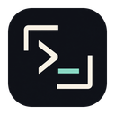
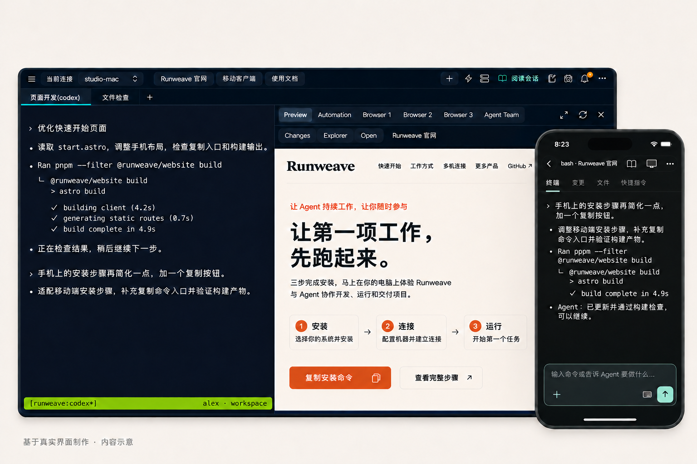
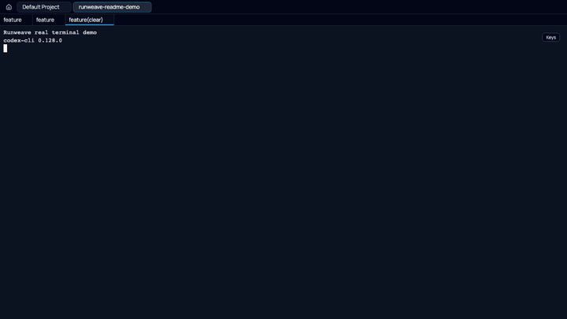

<p align="center">
  
</p>

<h1 align="center">Runweave</h1>

<p align="center"><strong>Your projects, terminals, and AI agents. One workspace.</strong></p>

<p align="center">Start on your computer. Check in from your phone. Keep working in the same terminal.</p>

<p align="center">
  <a href="https://runweave.jackshen310.cn/">Website</a> ·
  <a href="https://runweave.jackshen310.cn/start/">Quick start</a> ·
  <a href="https://runweave.jackshen310.cn/agent-guide.txt">AI guide</a> ·
  <a href="docs/README.md">Docs</a> ·
  <a href="README.zh-CN.md">简体中文</a>
</p>

<p align="center">
  <a href="LICENSE.md"></a>
  <a href="https://www.npmjs.com/package/@runweave/cli"></a>
  <a href="https://nodejs.org/en/download"></a>
</p>



<p align="center"><sub>Website illustration based on real product interfaces; task content is illustrative.</sub></p>

Runweave is a **local-first workspace for AI CLI workflows**. Organize projects,
run Codex, Claude Code, OpenCode, or shell commands, and inspect results with a
browser alongside your terminal. Connect to Mac, Windows, and Linux backends,
each using its own tools and data. With the iOS app, follow progress and send
instructions to the same terminal from your phone.

## ✨ Why Runweave?

Your agent is editing code, a dev server is running, and another terminal needs
your input. Runweave brings that work into one place—and gives you a way to stay
involved when you leave your desk.

|                                    | What you get                                                                                      |
| ---------------------------------- | ------------------------------------------------------------------------------------------------- |
| **⌘ Your tools, your machine**     | Run the CLIs and project scripts you already use, in your actual project directory.               |
| **▦ Projects + terminals**         | Group sessions by project, follow live output, and send input to an existing terminal.            |
| **◉ Browser alongside the work**   | Use the desktop's built-in Browser to inspect pages and results while the terminal stays in view. |
| **↗ Continue from your phone**     | Open a project in the native iOS app, read terminal output, and add follow-up instructions.       |
| **⇄ Multiple backends**            | Switch between connections to your computers and servers, each with its own environment.          |
| **⚡ A CLI for humans and agents** | Use `rw` to create terminals, send commands, read snapshots, and build handoff context.           |

Terminal continuity depends on the host and runtime configuration. Reconnect to
work that is still running; see [terminal recovery](docs/architecture/terminal-tmux-recovery.md)
and [Windows PTY Host](docs/architecture/windows-pty-host.md) for platform behavior.

<details>
<summary><strong>Watch the terminal management demo</strong></summary>



</details>

## 🚀 Quick start

Install on the computer or server where you want your agents to run. **No source
checkout required.**

Requires **[Node.js 22.x](https://nodejs.org/en/download)**. Server targets:
Apple Silicon Mac, Linux glibc x64/arm64, and Windows x64. Desktop preview
availability and platform limits are documented separately below.

### 1. Install

```bash
npm install -g @runweave/cli@latest @runweave/server@latest
```

### 2. Initialize and start

```bash
rw server init &&
rw server doctor --json &&
rw server start
```

Set up your account during initialization and save the generated password shown
in the terminal. Resolve any diagnostics before starting. Keep the startup
terminal open; `server start` runs in the foreground. If you already have a
running instance, use it directly.

<details>
<summary><strong>Windows PowerShell commands</strong></summary>

Use the `.cmd` entry points:

```powershell
npm.cmd install -g @runweave/cli@latest @runweave/server@latest
rw.cmd server init
if ($LASTEXITCODE -eq 0) {
  rw.cmd server doctor --json
  if ($LASTEXITCODE -eq 0) { rw.cmd server start }
}
```

See [Windows setup and limits](docs/cli/server-cli.md#windows-轻量模式).

</details>

### 3. Run your first task

Open **<http://127.0.0.1:5001/>**, sign in, select your project directory, and
create a terminal. Start an agent you have already installed and authenticated:

```bash
codex
# or: claude, opencode, or your project command
```

Runweave uses your existing Agent CLIs; install and sign in to those separately.
In another terminal, use `rw server status --json` to check the service
(`rw.cmd` on Windows).

**Next:** [Connect your iPhone](packages/app-ios/README.md) ·
[Configure remote access](docs/architecture/network-topology.md) ·
[Server operations and troubleshooting](docs/cli/server-cli.md)

Phone access requires the iOS app and a protected, reachable backend address.
`127.0.0.1` refers to the computer itself; it is not its address from your phone.

## 🤖 Let your AI agent get started

Give this prompt to an agent that can run commands on your target machine:

```text
Help me install and start using Runweave on this machine.
Read https://runweave.jackshen310.cn/agent-guide.txt first.
Check existing installations and services; reuse my configuration and data.
Install missing components, check diagnostics, and help me start the local Web
workspace and create my first project and terminal. I will enter credentials
locally; do not put passwords in chat or scripts. Verify Agent CLI login and
phone connectivity separately.
```

For agents reading this repository:

- **Install and first use:** [Plain-text Agent guide](https://runweave.jackshen310.cn/agent-guide.txt) · [llms.txt](https://runweave.jackshen310.cn/llms.txt).
- **Control a workspace:** [Terminal CLI](docs/cli/terminal-cli.md) · [Task delegation and verification](docs/cli/terminal-task-control.md).
- **Change the code:** Read [AGENTS.md](AGENTS.md), then the nearest package instructions. Use the [architecture map](docs/architecture/README.md) to find the relevant runtime.

### Drive a terminal with `rw`

After the service is running, log in with the account you initialized:

```bash
rw auth login --base-url http://127.0.0.1:5001 --username YOUR_USERNAME
rw project ensure --name my-project --path "$PWD" --json
```

Use the returned `projectId` as `PROJECT_ID`, then use the next command's
`terminalSessionId` as `TERMINAL_ID`:

```bash
rw terminal create --project-id "$PROJECT_ID" --cwd "$PWD" --json
rw terminal send "$TERMINAL_ID" --text "codex" --mode line --json
rw terminal snapshot "$TERMINAL_ID" --tail 120 --plain
rw terminal handoff "$TERMINAL_ID" --tail 120 --json
```

A successful `send` means input was accepted. Read the output and verify the
result to determine whether the task succeeded.

## 🖥️ Choose your setup

| Setup                     | Start here                                                                                                                                                                                                                            |
| ------------------------- | ------------------------------------------------------------------------------------------------------------------------------------------------------------------------------------------------------------------------------------- |
| **CLI + Web**             | Use the quick start above on your computer or server.                                                                                                                                                                                 |
| **macOS desktop**         | [Desktop setup and packaging](docs/deployment/overview.md#electron-桌面客户端).                                                                                                                                                       |
| **Linux desktop preview** | [Download and platform guide](docs/deployment/electron-linux.md). Successful `main` runs in [Linux desktop Actions](https://github.com/jackshen3102/run-weave/actions/workflows/linux-desktop.yml) provide x64 artifacts for 14 days. |
| **Native iOS app**        | [Build, install, and connect](packages/app-ios/README.md) with Xcode; no Web build required.                                                                                                                                          |

Version-tagged Linux tarballs and checksums are attached alongside the macOS
installer to a draft [GitHub Release](https://github.com/jackshen3102/run-weave/releases)
for maintainer review before publication.

## 🛠️ Develop from source

With Node.js 22.x and the repository's pinned **pnpm 10.6.2**:

```bash
git clone https://github.com/jackshen3102/run-weave.git
cd run-weave
pnpm install
cp backend/.env.example backend/.env
pnpm dev
```

Use `pnpm dev:electron` for the desktop client. For a production-style source
deployment, see the [deployment guide](docs/deployment/overview.md); for a server
installation, prefer the npm quick start above.

See [contributor instructions](AGENTS.md) and [verification layers](docs/testing/layers.md)
before making changes. Common checks:

```bash
pnpm typecheck
pnpm lint
pnpm docs:check
```

## 📚 Go deeper

| Topic                             | Guide                                                             |
| --------------------------------- | ----------------------------------------------------------------- |
| All documentation                 | [Documentation index](docs/README.md)                             |
| Install and manage a server       | [Server CLI](docs/cli/server-cli.md)                              |
| Automate terminal workflows       | [Terminal CLI](docs/cli/terminal-cli.md)                          |
| Connect machines and clients      | [Network topology](docs/architecture/network-topology.md)         |
| Configure an instance             | [Configuration](docs/cli/configuration.md)                        |
| Understand the codebase           | [Architecture](docs/architecture/README.md)                       |
| Report a bug or request a feature | [GitHub Issues](https://github.com/jackshen3102/run-weave/issues) |

### Companion tools

- **[Suiji / 随记](packages/suiji-ios/README.md)** — Capture ideas and organize notes, todos, browsing, and work.
- **[Screen Journal / 屏幕日记](packages/screen-recording-macos/README.md)** — Record screen activity and revisit the context.
- **[Remote Desktop / 远程桌面](packages/remote-desktop-host/README.md)** — Connect to and control your Mac from your phone.

## License

[MIT](LICENSE.md)
