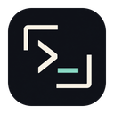
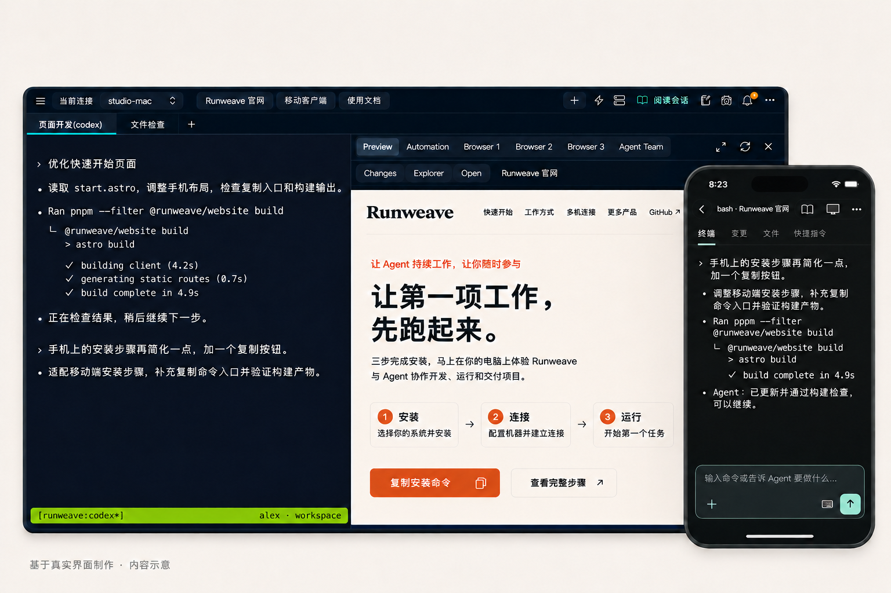
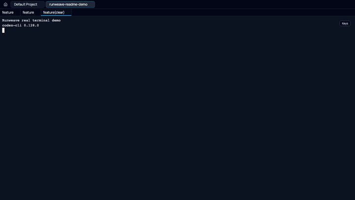

<p align="center">
  
</p>

<h1 align="center">Runweave</h1>

<p align="center"><strong>项目、终端与 Agent，一个工作台。</strong></p>

<p align="center">在电脑上开始，从手机接着参与，沿用同一个终端。</p>

<p align="center">
  <a href="https://runweave.jackshen310.cn/">官网</a> ·
  <a href="https://runweave.jackshen310.cn/start/">快速开始</a> ·
  <a href="https://runweave.jackshen310.cn/agent-guide.txt">AI 使用指南</a> ·
  <a href="docs/README.md">文档</a> ·
  <a href="README.md">English</a>
</p>

<p align="center">
  <a href="LICENSE.md"></a>
  <a href="https://www.npmjs.com/package/@runweave/cli"></a>
  <a href="https://nodejs.org/en/download"></a>
</p>



<p align="center"><sub>官网配图，基于真实产品界面制作；任务内容为示意。</sub></p>

Runweave 是一个**本地优先的 AI CLI 工作台**。在电脑上组织项目与终端，运行
Codex、Claude Code、OpenCode 或项目脚本，在旁边的浏览器里查看结果。连接 Mac、Windows
和 Linux 后端，沿用各自的工具与数据；需要时，打开 iOS App，从手机查看进展、向同一个
终端补充要求。

## ✨ 为什么用 Runweave？

一个 Agent 在改代码，一个开发服务在运行，还有一个终端正等你输入。Runweave 把这些工作
放在同一个工作台，让你离开电脑后也能继续参与。

|                          | 你能得到什么                                                   |
| ------------------------ | -------------------------------------------------------------- |
| **⌘ 用自己的工具和电脑** | 在真实项目目录里，运行已有的 Agent CLI、Shell 命令和项目脚本。 |
| **▦ 项目与终端集中管理** | 按项目组织会话，查看实时输出，向已有终端继续发送输入。         |
| **◉ 边执行，边看结果**   | 桌面内置 Browser，终端执行任务时，在旁边检查页面和结果。       |
| **↗ 手机接着参与**       | 原生 iOS App 打开对应项目，阅读终端输出，补充下一步要求。      |
| **⇄ 连接多台机器**       | 在电脑和服务器的后端连接之间切换，每台机器沿用自己的环境。     |
| **⚡ 人和 AI 都能操作**  | 用 `rw` 创建终端、发送命令、读取快照、生成接力上下文。         |

终端能否持续运行和恢复，取决于所在机器与运行时配置。重新连接仍在运行的任务，具体平台
行为见 [终端恢复](docs/architecture/terminal-tmux-recovery.md) 与
[Windows PTY Host](docs/architecture/windows-pty-host.md)。

<details>
<summary><strong>查看终端管理动态演示</strong></summary>



</details>

## 🚀 快速开始

在准备运行 Agent 的电脑或服务器上安装，**无需克隆源码**。

先准备 **[Node.js 22.x](https://nodejs.org/en/download)**。Server 支持 Apple Silicon Mac、
Linux glibc x64/arm64、Windows x64；桌面预览版的获取方式和平台限制见下文。

### 1. 安装组件

```bash
npm install -g @runweave/cli@latest @runweave/server@latest
```

### 2. 设置账号，启动工作区

```bash
rw server init &&
rw server doctor --json &&
rw server start
```

初始化时设置账号，保存终端展示的生成密码；诊断检查通过后再启动。保持启动窗口打开，
`server start` 在前台运行。已有实例正在运行时，直接使用它。

<details>
<summary><strong>Windows PowerShell 命令</strong></summary>

使用 `.cmd` 入口：

```powershell
npm.cmd install -g @runweave/cli@latest @runweave/server@latest
rw.cmd server init
if ($LASTEXITCODE -eq 0) {
  rw.cmd server doctor --json
  if ($LASTEXITCODE -eq 0) { rw.cmd server start }
}
```

详见 [Windows 安装与能力边界](docs/cli/server-cli.md#windows-轻量模式)。

</details>

### 3. 开始第一个任务

在这台电脑上打开 **<http://127.0.0.1:5001/>**，登录后选择项目目录、创建终端。
启动你已经安装并登录的 Agent：

```bash
codex
# 也可以运行 claude、opencode 或项目命令
```

Agent CLI 需要单独安装和登录。在另一个终端执行 `rw server status --json` 查看服务状态
（Windows 使用 `rw.cmd`）。

**接下来：**[连接 iPhone](packages/app-ios/README.md) ·
[配置远程访问](docs/architecture/network-topology.md) ·
[服务管理与排障](docs/cli/server-cli.md)

手机访问需要 iOS App，以及受保护、手机可达的后端地址。`127.0.0.1` 只代表电脑本机，
不能作为手机连接电脑的地址。

## 🤖 让 AI 帮你开始

把这段话交给能在目标电脑上执行命令的 AI Agent：

```text
请帮我在这台机器上安装并开始使用 Runweave。
先阅读 https://runweave.jackshen310.cn/agent-guide.txt 。
检查已有安装和运行状态，复用现有配置与数据。
按需安装缺失组件、检查诊断，协助我启动本机 Web 工作区并创建第一个项目与终端。
账号密码由我在本机输入，不写入聊天或脚本。
Agent CLI 登录和手机连接分别核对。
```

如果你是正在阅读这个仓库的 Agent：

- **安装与首次使用：**[纯文本 Agent 指南](https://runweave.jackshen310.cn/agent-guide.txt) · [llms.txt](https://runweave.jackshen310.cn/llms.txt)。
- **操作工作区：**[终端 CLI](docs/cli/terminal-cli.md) · [任务交办与验收](docs/cli/terminal-task-control.md)。
- **修改代码：**先读 [AGENTS.md](AGENTS.md) 与目标目录的就近规则，再从 [架构地图](docs/architecture/README.md) 定位运行时。

### 用 `rw` 操作终端

服务启动后，使用初始化时设置的账号登录：

```bash
rw auth login --base-url http://127.0.0.1:5001 --username YOUR_USERNAME
rw project ensure --name my-project --path "$PWD" --json
```

将返回的 `projectId` 设为 `PROJECT_ID`，再将下一条命令返回的 `terminalSessionId`
设为 `TERMINAL_ID`：

```bash
rw terminal create --project-id "$PROJECT_ID" --cwd "$PWD" --json
rw terminal send "$TERMINAL_ID" --text "codex" --mode line --json
rw terminal snapshot "$TERMINAL_ID" --tail 120 --plain
rw terminal handoff "$TERMINAL_ID" --tail 120 --json
```

`send` 成功表示输入已被接受。任务是否完成、结果是否正确，需要继续读取输出并验证。

## 🖥️ 选择你的使用方式

| 使用方式             | 从这里开始                                                                                                                                                                                                    |
| -------------------- | ------------------------------------------------------------------------------------------------------------------------------------------------------------------------------------------------------------- |
| **CLI + Web**        | 按上面的快速开始，在电脑或服务器上安装。                                                                                                                                                                      |
| **macOS 桌面端**     | [桌面运行与打包说明](docs/deployment/overview.md#electron-桌面客户端)。                                                                                                                                       |
| **Linux 桌面预览版** | [下载与平台说明](docs/deployment/electron-linux.md)；[Linux desktop Actions](https://github.com/jackshen3102/run-weave/actions/workflows/linux-desktop.yml) 成功的 `main` 构建提供 x64 Artifact，保留 14 天。 |
| **原生 iOS App**     | 用 Xcode [构建、安装并连接](packages/app-ios/README.md)，无需 Web 构建。                                                                                                                                      |

版本标签构建会将 Linux tarball、校验和与 macOS 安装包附到
[GitHub Release](https://github.com/jackshen3102/run-weave/releases) 草稿，由维护者审核后发布。

## 🛠️ 从源码开发

准备 Node.js 22.x 和仓库锁定的 **pnpm 10.6.2**：

```bash
git clone https://github.com/jackshen3102/run-weave.git
cd run-weave
pnpm install
cp backend/.env.example backend/.env
pnpm dev
```

桌面开发使用 `pnpm dev:electron`。生产风格的源码部署见 [部署说明](docs/deployment/overview.md)；
安装服务端优先使用上面的 npm 快速开始。

修改前阅读 [贡献与编码规则](AGENTS.md) 和 [验证分层](docs/testing/layers.md)。常用检查：

```bash
pnpm typecheck
pnpm lint
pnpm docs:check
```

## 📚 深入了解

| 想做什么           | 文档入口                                                          |
| ------------------ | ----------------------------------------------------------------- |
| 查看全部文档       | [文档索引](docs/README.md)                                        |
| 安装和管理服务端   | [Server CLI](docs/cli/server-cli.md)                              |
| 自动操作终端       | [终端 CLI](docs/cli/terminal-cli.md)                              |
| 连接电脑与客户端   | [网络拓扑](docs/architecture/network-topology.md)                 |
| 配置实例           | [配置说明](docs/cli/configuration.md)                             |
| 了解代码结构       | [架构地图](docs/architecture/README.md)                           |
| 报告问题或提出需求 | [GitHub Issues](https://github.com/jackshen3102/run-weave/issues) |

### 配套工具

- **[随记](packages/suiji-ios/README.md)** — 记下想法，整理待办、浏览与工作。
- **[屏幕日记](packages/screen-recording-macos/README.md)** — 记录屏幕活动，回看当时的现场。
- **[远程桌面](packages/remote-desktop-host/README.md)** — 从手机连接 Mac，直接操作桌面。

## 许可证

[MIT](LICENSE.md)
