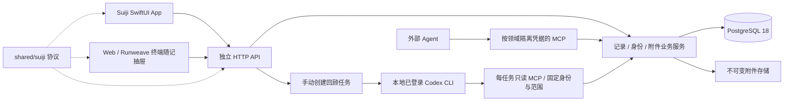

# 随记架构与交付状态

随记采用独立单人服务，Swift App 与 Web/Runweave 桌面直接访问相同 HTTP API。
随记账号与 Runweave 节点身份分离，记录保存不依赖 Terminal、Backend、App Server 或模型。
AI 回顾使用已登录 Codex CLI；正式服务可配置独立的持久登录目录，运行与登录见部署入口。
云端回顾的实际部署与手机验收仍需单独取证。

| 归属                   | 入口与约束                                                                                                                                           |
| ---------------------- | ---------------------------------------------------------------------------------------------------------------------------------------------------- |
| HTTP / 数据 / AI / MCP | [suiji-server](../../packages/suiji-server/README.md)，事务、版本、独立认证、模型进程生命周期                                                        |
| 原生 UI / 草稿         | [suiji-ios](../../packages/suiji-ios/README.md)，Swift Package + 薄宿主，Keychain 与原子草稿                                                         |
| Web UI / 草稿          | [页面](../../frontend/src/features/suiji/connection.tsx)、[客户端](../../frontend/src/services/suiji.ts)，终端抽屉、环境隔离、IndexedDB 与 Web Locks |
| 共享协议               | [shared/suiji](../../packages/shared/src/suiji/index.ts)，纯 TS 合同与限额，无运行时驱动                                                             |
| 部署与恢复             | [deploy/suiji](../../deploy/suiji/README.md)，独立产物、追加迁移、停写备份、空目标恢复                                                               |

## 桌面交互与账户

桌面只从终端右上角打开[随记抽屉](../../frontend/src/features/suiji/drawer.tsx)，不创建独立窗口。
桌面沿用记录、待办、工作及次级回收站/AI 入口；支持工作能力的原生主导航为记录、待办、浏览、工作，
回收站位于更多菜单。独立浏览不作为桌面记录中的素材分类；详情、编辑和附件在抽屉内导航。
关闭抽屉保留当前页面和草稿，终端切换不重建随记会话。原生内嵌浏览器在抽屉打开时隐藏，关闭后恢复。

列表与详情正文的普通链接点击通过[浏览器装配层](../../frontend/src/features/suiji/browser-navigation.ts)
收起抽屉，在当前 Browser Profile 新建分组标签并激活面板；重新打开随记仍保留原页面。
页面不注入随记凭据，网站身份沿用所选 Browser Profile。失败显示主动重试/外部打开入口，
迟到结果不抢占已切换的账户或界面。纯 Web 保留原生新标签行为；缺少创建标签能力的旧桌面壳走外部打开。

Web/桌面编辑正文时可从剪贴板粘贴图片，复用现有附件上传与草稿状态；忙碌或草稿冻结时不添加。
文字粘贴保留原行为，图片添加不自动保存记录。入口为 [编辑器](../../frontend/src/features/suiji/editor.tsx)
与 [共享正文面板](../../frontend/src/features/suiji/panel.tsx)。

账户固定为正式和开发两套，切换不注销另一环境。桌面通过窄 IPC 访问
[主进程安全存储](../../electron/src/desktop/suiji-storage.ts)：账号、密码和会话一起由 Electron
异步 safeStorage 加密，密文以原子替换方式写入稳定 userData 目录，不依赖 renderer origin 或构建目录。
桌面更新须保持应用身份、签名和 userData 稳定。Web 只保存非敏感账户配置，令牌仍限当前标签页，不持久保存密码。

打开时恢复会话，访问令牌过期后续期；刷新令牌失效时以保存的密码重新认证，并核验原 server/owner 身份。
网络故障保留凭据；主动退出先取消旧请求，再清除当前环境密码和会话，草稿保留。
开发草稿额外按环境隔离；正式草稿沿用旧的 endpoint/serverId/ownerId 键。
认证恢复不自动重发业务写操作，保存结果未知时仍由用户手动确认。

## 一致性边界

- 正文与当前附件通过一个 PATCH 提交。记录、关系、完整修订及幂等结果共用同一 pg client 事务。
- 幂等键按 owner 唯一，摘要包含操作、目标和完整输入。成功重放返回原结果；失败事务整体回滚。
- 待办支持 open → done 或 archived，以及 done → open 撤销完成；状态变化保留记录身份、正文和附件。archived 不可恢复，再次想做新建独立记录。
- 文件先落盘同步与原子改名，再登记元数据。首次绑定后不能被其他记录复用；历史引用保留。
- 草稿按端点及 server/owner 身份隔离。本机落盘与远端保存分别反馈；未知结果冻结并手动重试。
- 业务写操作没有联网、前台或登录自动重发；只读请求最多一次认证恢复重试。
- 回顾没有写工具，引用必须匹配本次读取版本和逐字原文。用户手动保存回答才创建新记录，已有草稿不被预填覆盖。
- 当前 AI 以模型扩展关键词检索，不含 embedding/pgvector、附件全文索引、外链采集或跨会话聊天存储。

## 原生使用分析

随记 iOS 的 Clarity 采集独立于业务 API、草稿和数据库，不复用 Runweave 的项目或身份。
SDK 只补充固定页面分类与已安装包的五个构建标签，不上传业务 ID、自定义用户身份或正文，
不以交互回放证明保存或完成待办成功。配置、项目与遮盖以
[原生使用分析](../../packages/suiji-ios/README.md#原生使用分析)为准；共享浏览器包不依赖采集 SDK。
独立随记 Web 接入、按正式/开发连接排除采集不在当前范围。

## 验证与交付边界

记录、MCP、AI、原生及部署验收从[随记测试入口](../testing/README.md)选择对应 YAML，
运行与恢复遵循[部署合同](../../deploy/suiji/README.md)。证据存放在根 `.runweave/suiji/`；
不提交凭据、数据库、私人正文、附件或一次性截图。旧本地或生产验证只覆盖当时版本，
本轮文档整理没有重跑行为验收，不将历史计划中的状态当作当前通过证明。

原生、Web、正式部署、异机备份恢复与自然调度分别取证；模拟器和构建不能替代真机系统分享，
手动采集不能替代到点执行。首次部署或变更备份目标仍需明确主机、域名/TLS、RPO/RTO 与停写窗口。
embedding/pgvector、中文召回评测、聊天持久化与私有文档连接器尚未交付，当前关键词回顾不代表这些能力。

## 回收站

记录通过 `deleted_at` 保留删除标记，删除和恢复使用既有版本与幂等事务，不改变待办状态。
Web 与原生 iOS 提供回收站列表、删除确认和恢复入口；普通列表与 Agent/AI 检索排除回收站。
正文、附件和历史修订保留，不提供永久清空或定时清理。回收站最初引入于 schema 3；当前服务要求 schema 16，见[服务入口](../../packages/suiji-server/README.md#独立浏览与迁移schema-16)。

## 跟进与外部 Agent 成果

记录保留原始正文，跟进独立追加到 record_followups；父记录版本和完成状态不随追加改变。原文与跟进附件分别关联同一个父记录的不可变对象。HTTP 和 MCP 复用 FollowupService 与既有幂等事务；多 Agent 追加保留各自成果，不引入调度、审批或执行状态。

Web/桌面与 iOS 提供跟进、成果阅读、复制交接；[随记 Skill](../../plugins/toolkit/skills/suiji/SKILL.md) 可在其他电脑读写同一服务，只有最终成功成果回写，用户确认后才由 Agent 完成待办。跟进里的用户补充不会触发 Agent。

服务接口与版本合同以 [服务 README](../../packages/suiji-server/README.md#跟进与最终成果) 为准；当前服务要求 schema 16；线上启用情况及行为通过范围需要独立验证。

### 验收入口与保留缺口

跟进按 [服务](../testing/suiji/followups-service.testplan.yaml)、[客户端](../testing/suiji/followups-clients.testplan.yaml)
和 [Agent](../testing/suiji/followups-agent.testplan.yaml) 分层取证。迁移的 2026-09-22 历史记录仍有两项
环境阻塞：SUIJIFUA-011 需要第二台实际电脑与 HTTPS 配置；SUIJIFUS-020 需要完整异机部署恢复。
本机数据库恢复、模拟器或真实 Agent 的本机执行不能替代它们，也不能据此宣称正式服务已发布。

浏览器复用分别按 [桌面](../testing/suiji/desktop-browser-reuse.testplan.yaml) 与
[iOS](../testing/suiji/ios-browser-reuse.testplan.yaml) 验收。2026-09-17 记录中的桌面故障/延迟、旧壳、
双 Profile 与纯 Web 操作，以及原生业务草稿、来源失效、双 App 身份、选区/大字号、真实 SSO
和飞书客户端交接尚无完整矩阵通过结论。共享实现以
[Swift 浏览器包](../../packages/browser-ios/README.md) 为准，两个宿主仍需分别取证。
上述为删除过程材料时保留的证据边界，本轮未重跑这些用例。

MCP 设备凭据存储于 schema 6 的独立凭据表，各设备可单独撤销。注册和撤销无需重启；
旧 token 通过摘要与原期限导入保留，服务启动不自动恢复旧配置。管理和迁移见[服务入口](../../packages/suiji-server/README.md#外部-agent-mcp)。

增量发现使用 schema 9 的只读 `list_changes`，覆盖记录变化、跟进和回收站可见性；
游标与 Lumi 消费边界见[服务合同](../../packages/suiji-server/README.md#增量变化读取与-lumi)。

## 独立工作事实

schema10增加work_facts、work_fact_revisions、work_import_runs、work_day_coverage和work_feed_heads；普通records/跟进/任务完成状态不变。共享合同在 `packages/shared/src/suiji/work-records.ts`，HTTP与设备MCP共用 `packages/suiji-server/src/work-records` 服务和校验，写入仍进入原mutate的同一PG client事务。导入没有App密码HTTP入口。

事实按Asia/Shanghai业务日期排序，来源稳定身份与业务幂等各自负责去重。版本检查、人工字段保护、源时间单调和feedRevision分页防止跨客户端覆盖与静默漏读。覆盖回执仅说明实际请求范围，partial/unavailable/缺失不能变成没有工作。内部原生引用不包含原始聊天或本机路径，界面只呈现事实。

Web使用已有480px抽屉、presence和连接身份隔离的IndexedDB；原生使用SwiftUI与独立work草稿文件。工作替换第四个AI主入口，旧AI保留次级入口与普通记录范围，暂不读取新工作领域。每日事实的采集与定时上报由下述 Daily Record 承担；随记工作界面不负责采集和调度，大屏分类未接入。工作周报使用独立 schema12 存储，按结束日期与事实统一分页、混排，不计入事实条数；客户端以可选 `features.workReports` 兼容旧服务。

合同和导入操作见[随记工作事实](../../plugins/toolkit/skills/suiji/references/work-records.md)；行为验收分别见[服务](../testing/suiji/work-records-service.testplan.yaml)与[客户端](../testing/suiji/work-records-clients.testplan.yaml)。源码、隔离服务、Electron、Simulator和生产部署证据分开报告。

## Daily Record 定时上报

Daily Record 在各 Backend 本机采集 Agent 执行依据及明确授权的本人飞书事项，
不将浏览、素材、App 使用记录或其摘要装配进工作输入。工作导入与周报来源同样拒绝
`browser-visit`、`suiji-material` 及对应 scope；项目为空也不能绕过领域隔离。

既有调度只负责唤醒，逐日补报、固定机器身份、事项映射、冻结导入及未知结果恢复由
Daily Record 本地状态管理。缺报来源使日期为 partial，无登记旧日期为 unknown；
导入保护人工字段，不修改普通笔记或待办。已有任务复用本机配置与固定 runtime，
不依赖临时 worktree。旧浏览来源关闭有效区间，保留历史回执，不重放旧浏览工作请求。
配置与迁移见[定时上报](../../plugins/toolkit/skills/daily-record/references/scheduled-reporting.md)。

验收入口为[多机器定时上报](../testing/skills/daily-record-reporting.testplan.yaml)、
[本机采集](../testing/skills/daily-record-local.testplan.yaml)和
[项目归属](../testing/skills/daily-record-projects.testplan.yaml)。
本机集成验证不替代真实 Mac/飞书、真实 devbox、服务独立回读或到点调度；手动触发成功
也不证明自然运行。浏览资料由下述独立领域处理，不恢复旧工作浏览概览合同。

工作周报固定覆盖七个自然日，默认每周五 04:00（Asia/Shanghai）生成上周五至本周四的结果。
生成只消费随记已上报工作事实；`report-prepare` 按实际来源覆盖有界等待日报，缺报日期在报告详情保留。
来源必须包含周期内全部事实 ID/版本，并核对 feedRevision；同周期唯一，业务幂等与修订保护重复提交和并发修改。
人工修改后的报告禁止自动覆盖。工作页提供全部/日志/总结、报告阅读与编辑、原始日志日期范围入口；
未知编辑请求沿用隔离草稿冻结，不在启动或联网时重发。生成调度复用 Runweave Backend，不在随记服务内另建采集器或时钟。

## 独立浏览

schema 16 将旧素材迁入独立浏览领域，记录的全部、普通 AI 回顾、工作事实及周报均排除浏览。
原生浏览入口支持来源、日期、类型与已保存文字检索；浏览、普通记录和分享队列分别保存草稿。
分享及手动保存进入浏览，冻结未知请求不在联网、启动或前台恢复时自动重发。
旧 material 请求只保留分享和冻结请求的有界兼容，不能把迁出对象转回普通记录。

浏览原始条目、观察证据、来源连接、批次回执与派生摘要独立保存；事件时间、采集时间和归属日期
分别表达，缺失事件时间不补造。摘要引用输入条目版本及 hash，原文变化或删除后标记待更新。
同日知乎计数按不同内容身份去重，不推断访问次数、读完、停留时长或工作成果。失败、缺正文
与未登录保留明确覆盖和错误，不能写成零活动。

`/mcp/browse` 与 `/mcp/work` 使用独立领域凭据和工具，浏览 revision 不推进工作 revision。
迁移保留旧修订、跟进及附件归档；历史纯浏览工作事实隔离为 excluded，混合事实为 needs-review，
不删除原文和人工字段，不进入新的工作输入。账号切换、附件权限和回滚边界以
[服务合同](../../packages/suiji-server/README.md#独立浏览与迁移schema-16)为准。

采集与阅读回顾使用 [browse-record](../../plugins/toolkit/skills/browse-record/SKILL.md)，
每日同步与延迟 App 使用窗口见[来源同步合同](../../plugins/toolkit/skills/browse-record/references/daily-reporting.md)。
该流程不创建调度；任务启用须独立确认完整配置，手动导入不代表自然采集已启用。
验证入口为[浏览领域与工作隔离](../testing/suiji/browse-domain.testplan.yaml)及
[知乎采集](../testing/suiji/browse-zhihu.testplan.yaml)。隔离服务、模拟器、正式部署、真实手机和自然调度
分别取证；本轮文档维护不重新认证旧验收结果。
