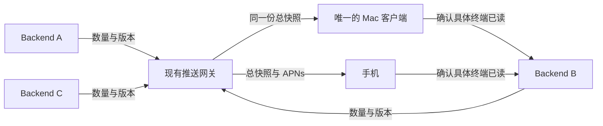

# 统一未读总数：复用推送网关实施计划

日期：2026-10-11。状态：源码与隔离集成验证已完成；公网网关、Mac Stable 0.264.0 与本机 Backend 已部署，已验证正式桌面 Dock 与真实 iPhone 的未读累加、双向已读扣减及手机前后台归零；三个实际 Backend 同时参与的整套 UI 用例未整体执行。粒度：L3（跨运行时、鉴权与恢复）。

## 1. 目标与范围

始终只有一个 Mac 桌面客户端，它连接分布在不同设备上的多个 Backend。手机订阅同一组 Backend，订阅完整性由用户保证。

Mac Dock 与手机 App 图标显示同一份全局未读终端总数。任意端读过终端后，更新该终端所属 Backend 的已读状态，网关重新汇总，两端同步扣减；全部读完后归零。一个终端即使产生多次完成，也至多计 1；同一 Backend 的不同连接地址不能重复计数。

本计划采用：**Backend 保持已读状态权威，现有推送网关负责唯一的总数汇总，Mac 接入同一份网关快照。**

范围约束：

- 不新增服务、账号体系或第二套终端已读存储，不将正文或终端列表上传网关。
- 不改写现有“打开终端确认当时版本”的语义；打开首页不批量清零。
- 不增加手机订阅完整性检查，不要求各 Backend 使用同一个用户名或会话 ID。
- 本期 Mac 使用单一网关 HTTP 查询，不引入 SSE/WebSocket；原有终端业务连接继续存在。
- 现有项目、终端列表的局部计数保留局部范围，不能把全局总数填进单个项目的计数位置。
- 不自动升级 Stable、部署线上网关、安装手机、提交或合并代码。这些是实施后独立交付操作。

## 2. 计划制定时核对的代码事实

| 能力             | 当前入口与事实                                                                                                                                                                      |
| ---------------- | ----------------------------------------------------------------------------------------------------------------------------------------------------------------------------------- |
| 已读权威         | `backend/src/terminal/manager/session-runtime.ts`：保存完成版本与已读版本；确认只能向前推进，并发新完成不会被旧确认覆盖                                                             |
| Backend 未读上报 | `backend/src/device-monitor/terminal-badges.ts`：统计未读终端，持久化数量版本；按有效手机订阅上报绝对快照                                                                           |
| 网关总数         | `packages/push-gateway/src/badges.ts`：按 installationId/environment 汇总，按 hostId 去重；已有总数查询、持久化、APNs 投递；当前缺失的 host 贡献按 0 处理，需要补齐首次快照就绪判断 |
| 当前鉴权         | `GET /v1/badges/:subscriptionId` 接受所属 host 的发送凭据或手机 revokeToken；后者也可以撤销订阅，不宜直接下发 Mac 作为只读凭据                                                      |
| 桌面身份         | `backend/src/auth/service.ts` 已有 `getActiveDesktopSession`；无需让 Mac 伪装手机登录                                                                                               |
| Mac 总数         | `electron/src/monitoring/terminal-badge.ts` 当前每 2 秒分别请求各 Backend，主进程汇总并设置 Dock                                                                                    |
| Mac 连接来源     | `frontend/src/features/attention/use-desktop-badge.ts` 通过现有 bridge 向主进程提供连接与访问令牌                                                                                   |
| 手机总数         | `packages/app-ios/Sources/RunweaveIOS/Services/NotificationCoordinator.swift` 从网关校准，前台每 3 秒查询；后台通过 APNs 更新角标                                                   |

以上是源码事实，不代表安装态或真机已经通过本方案验收。

## 3. 数据流与请求量



1. 首次启动、登录连接增删或凭据失效时，Mac 向已登录 Backend 发现可访问的手机汇总目标。N 个连接最多各查询一次；按网关 origin 与 targetId 去重。
2. 本次前提下应得到唯一目标，自动绑定，无扫码或手动复制密钥。初始化发现完成前不能将部分候选当成最终选择；请求超时后允许从已成功返回的唯一候选开始，恢复的连接只能验证当前目标，不能静默切换。
3. Mac 通过其中一个有有效桌面登录、拥有该手机订阅的 Backend 换取短期只读授权。
4. 稳定运行时 Mac 每 2 秒只向同一个网关读取一次快照，即每秒约 0.5 次计数请求，数量不随 Backend 个数增加。5 分钟读授权在到期前 1 分钟通过一个 Backend 续期；这不是对多个 Backend 轮询计数。
5. 任意端确认已读后，所属 Backend 保存状态并上报新的绝对数量；网关汇总后，Mac 查询与手机前台查询/APNs 消费同一总数。

总数示例：A=2、B=3、C=1，Mac 与手机均为 6；手机读掉 B 的一个未读，B 上报 2，统一总数为 5。禁止客户端直接对总数做永久性的加减操作。

## 4. 身份与只读授权设计

### 4.1 复用已有汇总范围

本期沿用现有手机 installationId/environment 对应的汇总，不另建汇总组或账户。新增稳定、不含凭据的 `targetId`，Backend 与网关按同一合同计算：对 JSON 编码的 `["badge-target-v1", environment, installationId]` 求 SHA-256 十六进制摘要。共享包只定义编码与 DTO 合同，Node 运行时使用自身 crypto 实现。相同安装和环境在不同 Backend 返回相同 targetId；sandbox 与 production 必须不同。

候选目标必须来自当前桌面登录用户在该 Backend 已有的有效手机订阅，同时满足 `terminal-unread`、enabled、confirmed、synced、当前 gatewayURL，且订阅对应手机会话仍有效。Backend 内按 username 校验所有权，不将不同 Backend 的 username 当作全局身份。

发现 0 个目标：展示“未读同步未就绪”，没有真实快照时不伪造 0。发现多个不同目标：显示“存在多个未读汇总来源”，暂停首次自动绑定；不猜选手机、不相加不同安装的总数。本期不扩展多手机选择产品流程。已绑定后发现冲突，保留最后成功值并提示来源冲突，不切换目标。

### 4.2 已实现合同

以下接口已实现于当前工作区；线上可用性取决于对应版本部署。

| 所属运行时、接口                                   | 输入与鉴权                                                   | 输出与语义                                                                                                                     |
| -------------------------------------------------- | ------------------------------------------------------------ | ------------------------------------------------------------------------------------------------------------------------------ |
| Backend `GET /api/terminal/unread/gateway-targets` | 现有 accessToken，且 `getActiveDesktopSession` 有效          | `{ targets: [{ gatewayURL, targetId, subscriptionId, environment }] }`；无手机密钥，无发送凭据                                 |
| Backend `POST /api/terminal/unread/gateway-access` | 同上；严格 body `{ subscriptionId }`，只能选发现范围中的订阅 | `{ gatewayURL, targetId, readerId, readToken, expiresAt }`；发请求前及返回前重新验证桌面会话和订阅资格                         |
| 网关 `PUT /v1/badge-readers/:readerId`             | 所属 host 的 sender 凭据；严格 body `{ subscriptionId }`     | 核对活跃未读订阅属于该 sender；签发绑定 targetId 的只读 token，5 分钟到期，返回 `{ targetId, readerId, readToken, expiresAt }` |
| 网关 `GET /v1/badge-readers/:readerId`             | 独立 readToken                                               | `{ targetId, revision, count }`，读取已有汇总；不新算另一套总数                                                                |

`readerId` 由 Backend 使用固定命名空间、hostId、桌面 sessionId 与 subscriptionId 生成摘要，不接受客户端任意指定。网关记录 issuerHostId、sourceSubscriptionId、targetId、tokenHash、expiresAt；不保存或输出到日志中的明文 token。

已存在 readerId 的 issuerHostId、sourceSubscriptionId 与 targetId 不可变；其他 sender 即使知道该 ID，也不能通过 PUT 抢占、轮换或改变其目标。字段严格校验，ID 沿用现有 8–128 位字母数字/下划线/连字符限制；时间为服务端生成的 ISO 字符串，数量与版本使用安全整数。

续期采用同 readerId 轮换读 token，旧 token 立即失效；客户端只允许一轮签发/续期在途。签发响应丢失后可重新签发，旧读授权被覆盖，不涉及业务计数或订阅变更；禁止重试形成无限新增授权记录。网关清理过期读授权，限制每 host 的活跃读授权数量（100）。

读取时再次核对签发 host 未撤销、sourceSubscriptionId 仍有效、目标未改变。读 token 不能更新 badge、注册/撤销订阅、发送通知、签发其他读授权或读取其他 readerId。现有手机接口保持兼容。

### 4.3 密钥与注销边界

- senderToken 与 revokeToken 不进入 Electron renderer、IPC 返回值、日志、URL 或诊断证据。
- Electron 主进程直接调用 Backend 换授权，readToken 仅保存在主进程内存。继续复用现有 renderer → main 的 Backend accessToken 通道，不新增凭据持久化。
- 全部桌面连接注销或删除后立即取消请求、丢弃读 token 与缓存，并清除当前登录范围的 Dock 展示；这是退出范围，不是把 Backend 未读改成 0。
- 签发所依赖连接注销时丢弃其读授权，允许从同目标的另一个已登录 Backend 重新取得授权。
- 已泄漏的短期 token 在桌面注销后最多仍有 5 分钟有效期；本期不建立跨服务的桌面会话即时撤销系统。若来源手机订阅或 sender 在网关撤销，则下一次读取立即拒绝。
- 限定可信 HTTPS origin，禁止重定向；沿用现有 8 秒请求超时与 AbortController 取消机制。

## 5. 错误、离线与并发规则

| 情况                                                   | 行为                                                                                              |
| ------------------------------------------------------ | ------------------------------------------------------------------------------------------------- |
| 网关未生成目标快照                                     | 409；保持未就绪/最后成功值，不显示伪造的 0                                                        |
| reader token 错误或过期                                | 401；停止使用它，通过有效 Backend 重新签发                                                        |
| 普通 Web/手机身份请求桌面授权，或跨 owner/subscription | Backend 403，不签发、不泄露目标详情                                                               |
| 来源订阅或 sender 已撤销                               | 网关 410；丢弃授权，重新发现当前可用来源，不再用旧 token                                          |
| 网关网络错误、429、5xx                                 | 保留同目标最后成功快照；退避 2、4、8、16、30 秒，成功后恢复 2 秒轮询                              |
| 授权 Backend 离线                                      | 当前读 token 未过期时继续读取网关；续期时尝试已发现的同目标其他 Backend；均不可用则保留最后成功值 |
| 老网关/Backend 无新接口                                | 标记未支持，不静默恢复逐 Backend 的计数轮询；旧客户端照旧运行                                     |
| 迟到响应                                               | 必须匹配本次连接集合 generation、当前 targetId 与授权轮次，否则丢弃                               |
| 同目标旧 revision                                      | 不覆盖较新的 count；切换目标/重新登录后重新建立基线，不跨目标比较 revision                        |
| Backend 离线                                           | 保留网关已收到的最后贡献，不将离线解释为已读或 0；重连后上报最新快照                              |

首次贡献就绪：网关对当前已注册的活跃 host 检查是否至少收到一份合法数量快照；任一缺失时，新旧总数 GET 都返回 409，APNs 不发布把缺失项当 0 的新总数，已有显示保留最后成功值。全部到达后才发布完整总数。已收到但暂时离线的贡献仍有效。这是快照就绪检查，不比较手机和 Mac 的订阅清单，不增加用户订阅完整性校验。

必须区分“状态未知”和真实 0。只在收到该目标的合法 count=0 时表示未读清空。Mac 完全退出后不声称仍更新 Dock；启动后重新发现、授权和校准，不持久化读 token。

## 6. 实施任务与文件范围

用户已授权实现；以下勾选表示源码与隔离验证的实际进度，不代表线上部署或真机验收。

### 阶段 A：共享合同与网关只读入口

- [x] 在 `packages/shared/src/push-notifications.ts` 定义读授权与总快照 DTO；在 `packages/shared/src/terminal/unread.ts` 定义 Backend 发现/授权 DTO、桌面同步状态。
- [x] 新增 `packages/push-gateway/src/badge-readers.ts` 实现 targetId、签发、轮换、鉴权与过期清理；`badges.ts` 复用内部总快照读取逻辑，不复制汇总算法。
- [x] 在 `badges.ts` 为现有汇总补齐所有已注册 host 的首次贡献就绪判断，新旧 GET 与 APNs 共用同一个 ready 条件，避免首次接入时发布部分总数。
- [x] 在 `packages/push-gateway/src/app.ts` 接入严格校验的读授权路由，写操作仍要求原 sender 凭据。
- [x] `types.ts`/`store.ts` 为 schemaVersion 2 增加可选 reader 存储字段，旧数据缺省为空；保留已有 subscriptions、badgeContributions、badgeTargets、deliveries。
- [x] 在现有 `scripts/verify/device-monitor/` 集成驱动中加入真实 HTTP/SQLite 的读授权验证；不新增单元测试或 TDD 文件。必要时新增该目录下的集成模块并由 `index.ts` 调用。

阶段验收：独立网关 fixture 证明同目标读到原聚合值、无权 token 不能写或跨范围读、过期/撤销立即按合同拒绝、重启保存数值和有效授权期限。

### 阶段 B：Backend 桌面发现与授权交换

- [x] 新增 `backend/src/device-monitor/desktop-badge-access.ts`，负责桌面身份、订阅所有权过滤、候选去重与授权交换。
- [x] 扩展 `backend/src/device-monitor/push-client.ts`，经已有 host 身份校验调用网关 reader 签发入口；沿用取消和资源回收机制。
- [x] 在 `backend/src/routes/terminal/unread.ts`、`backend/src/routes/terminal/index.ts` 接入新路径和服务依赖；在 `backend/src/bootstrap/runtime-services.ts`、`backend/src/bootstrap/runtime-services-contract.ts`、`backend/src/index.ts` 完成生命周期装配。
- [x] 不复用仅限手机身份的 `DeviceSubscriptions.status()` 作为桌面授权；读取其现有存储，通过明确的 desktop owner 过滤实现。
- [x] 保持原 `GET /api/terminal/unread` 和完成/已读写入合同不变。

阶段验收：有效 Electron 会话可取得自己的候选与短期授权；普通 Web、手机会话、过期会话、越权订阅均失败且不泄露密钥。请求期间注销时，即使网关已签发，也不得向已注销客户端返回凭据。

### 阶段 C：Mac 消费唯一网关快照

- [x] 重构 `electron/src/monitoring/terminal-badge.ts`：发现 → 唯一目标绑定 → 授权 → 单网关轮询；必要时把 HTTP 与状态机拆入同目录局部模块。
- [x] 保持 `setTerminalBadgeConnections` 的连接输入兼容，删除新模式下每 2 秒请求各 Backend 未读数的路径；目标绑定变化才重新建立授权。
- [x] 在 `packages/shared/src/desktop/bridge.ts`、`electron/src/preload.ts` 提供无密钥的 `getTerminalBadgeStatus`：`discovering / ready / stale / unavailable / conflict`、可空 count、lastSyncedAt、可读 reason；不给 renderer 返回 readToken。
- [x] 在 `frontend/src/features/attention/use-desktop-badge.ts` 保持连接发布；在 `frontend/src/components/connection-page.tsx` 显示一行同步状态，必要时新增 `frontend/src/features/attention/desktop-badge-status.tsx`。状态文案只解释是否同步成功，不展示协议、token 或后台版本号。
- [x] 只有成功读取全局总快照时更新 Dock；迟到响应、注销和来源冲突遵循第 5 节。主窗口隐藏后主进程继续工作。

阶段验收：三个 Backend 稳定连接后，60 秒内约 30 次网关总数查询、0 次原 Backend 计数接口查询；初始化发现和短期授权续期单独统计，不冒充零 Backend 请求。

### 阶段 D：跨端闭环与文档交付

- [x] 沿用现有 iOS 网关查询/APNs 和已读确认链路；本计划预计无需改 Swift DTO 或手机订阅流程。真实验收若发现已有链路缺口，先定位证据，再做本目标所需的最小修复，不扩大到账号/连接重构。
- [ ] 使用一个桌面客户端、至少三个独立 hostId 的 Backend 与一台手机，验证双方读操作及归零。
- [x] 更新 `packages/push-gateway/README.md`、`docs/architecture/device-monitor.md`、`docs/deployment/push-gateway.md` 的当前合同、凭据范围和部署顺序；实现完成后再更新当前事实文档。
- [x] 分开报告源码检查、隔离协议验收、真实 Desktop 行为、真实手机前台与后台角标，不能用构建或 APNs accepted 代替手机已显示。
- [x] 按随记要求仅追加最终成功成果，保留未完成状态；未经用户确认不得调用 complete。

## 7. 兼容、迁移与回滚

部署顺序：先网关，再作为桌面授权入口的 Backend，最后桌面客户端。其他 Backend 的旧未读上报接口继续兼容；iOS 沿用现有接口。本方案要求汇总使用同一个网关 origin。

schemaVersion 2 使用新增可选 reader 字段，迁移不清空数据。实施必须用真实旧版快照副本验证新服务可读写，再验证旧版网关可重新读取添加字段后的数据库；未经验证不能宣称可无损回退。首次贡献未齐时返回 409 沿用既有未就绪语义，旧 iOS 已保留最近值，需用验收确认兼容。

上线前按现有运维流程停服务后备份 SQLite。回退优先回旧桌面计数实现；网关旧接口持续可用。旧网关忽略 reader 字段后，新桌面显示未支持状态，不切换统计来源或伪造 0。恢复数据库备份会回退业务状态，不能将恢复旧备份作为普通回滚的默认步骤。

网关不保存终端已读历史，因此本变更不迁移或清空 Backend 的 completionRevision/acknowledgedCompletionRevision；回退不应使已经读过的终端重新未读。

## 8. 验收与验证命令

配套用例：[统一网关未读验收计划](../testing/app/unified-unread-gateway.testplan.yaml)。既有普通通知回归：[通用推送服务](../testing/app/push-notifications.testplan.yaml)。用例保留完整验收合同。隔离驱动已覆盖汇总、权限、过期撤销、请求频率、离线恢复、迟到响应、真实持久化已读及新旧版本数据库往返；真实 Electron Dock 与 iPhone 条件的用例未整体通过，不能以模块集成替代。

实施后的基础检查（按实际修改范围执行）：

```bash
pnpm --filter @runweave/shared typecheck
pnpm --filter @runweave/push-gateway typecheck
pnpm --filter @runweave/push-gateway lint
pnpm --filter @runweave/backend typecheck
pnpm --filter @runweave/backend lint
pnpm --filter @runweave/electron typecheck
pnpm --filter @runweave/electron lint
pnpm --filter @runweave/frontend typecheck
pnpm --filter @runweave/frontend lint
pnpm architecture:check
node scripts/verify/device-monitor/run.mjs
pnpm docs:check
pnpm testplan:validate docs/testing/app/unified-unread-gateway.testplan.yaml
```

期望全部退出 0，集成驱动输出读授权、汇总与恢复的通过证据；缺少新增场景的驱动旧结果不算本功能通过。不新增单元测试。

执行 YAML 时使用 `toolkit:run-test-cases`。启动或附着 Dev Session 使用 `toolkit:runweave-dev-session`，桌面 renderer 使用 `toolkit:playwright-cli`，Dock 使用原生 computer-use，手机使用 `toolkit:agent-device`。

受控局域网验收目标：Backend 确认已读成功后 10 秒内，Mac Dock 与手机前台校准后的角标显示网关新总数；超时失败并查链路。手机后台 APNs 单列验收，观察 60 秒并记录真实到达时间；未显示则该用例不通过，不能用服务端 accepted 代替。60 秒是测试观察窗，不是 Apple 投递保证。

实际已运行类型检查、lint、架构/文档/YAML 校验与真实 HTTP/SQLite 集成驱动；隔离 Beta 已检查连接页状态。正式网关、本机 Backend 与 Mac Stable 0.264.0 已部署。正式桌面使用两条专用本机终端的受控完成事件（未调用模型），通过真实登录、网关查询、页面读操作与系统 Dock 截图验证 0→1→2→1→0；两条专用终端已清理。随后通过 Computer Use 操作原生 iPhone 镜像，对真实 iPhone 17（现有 App build 46）完成跨端闭环：两条专用本机终端产生受控完成事件后，手机后台图标显示 2；手机打开第一条后，网关与实际 Mac Dock 降为 1；手机保持主屏幕时，桌面打开第二条，手机后台图标自动消失，网关与 Dock 归零（网关 revision 557→558→559）。另一次完成使总数为 1，手机保持另一条已读终端在前台，桌面读掉新完成后，手机返回主屏幕的图标归零（revision 560→561）。两条专用终端均已清理。该实机结果覆盖本机 Backend、线上网关和真实双端 UI；三个独立 Backend 汇总的证据来自此前隔离集成，不标记三个实际 Backend 的整套 UI 用例或全部 20 条用例通过。

## 9. 风险与完成定义

主要风险为：将凭据绑定到错误手机汇总、读授权越权、并发旧响应覆盖新数值、网关不可用时误清零，以及回退误改持久状态。第 4–8 节分别给出权限、状态机、兼容和独立验收门禁。

实施完成须同时满足：同一网关总数、双向已读同步、真实归零、无逐 Backend 计数轮询、读授权边界、离线/重启收敛和既有手机/通知接口兼容。任一真实设备用例未执行，交付须明确该层未验收，不标记完整通过。
