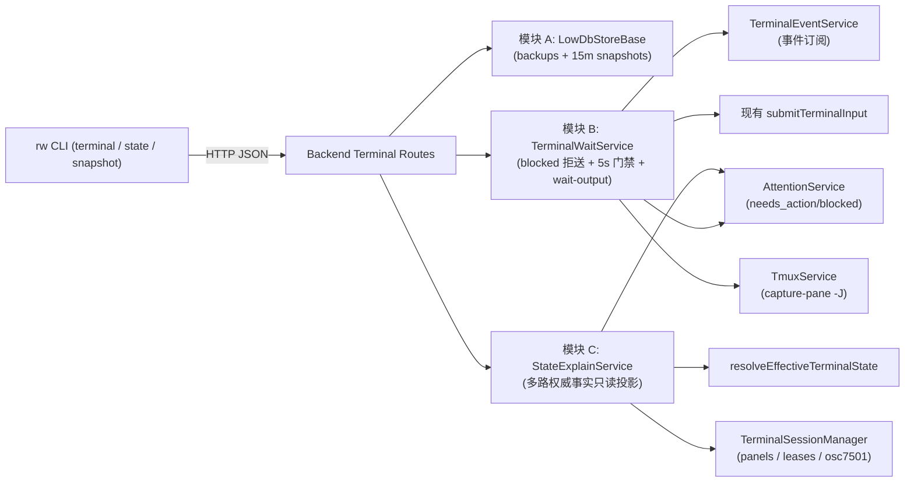
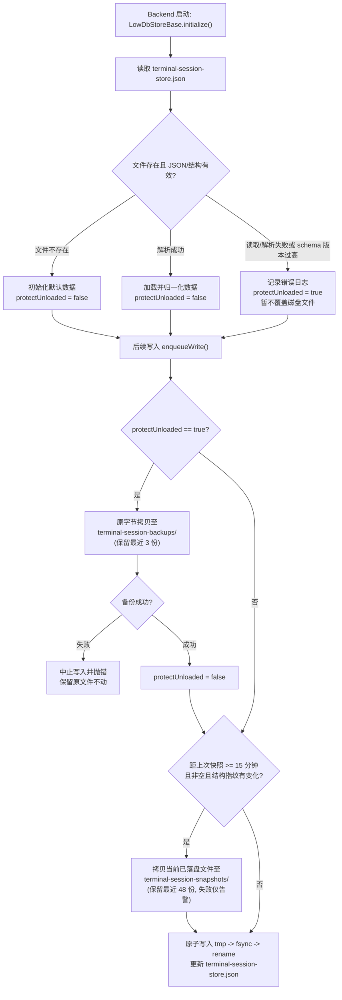
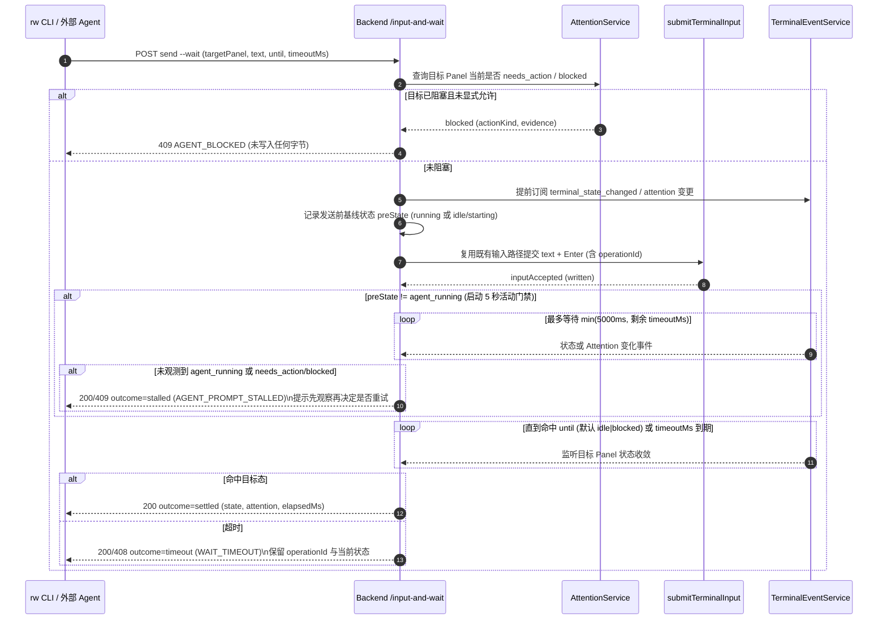
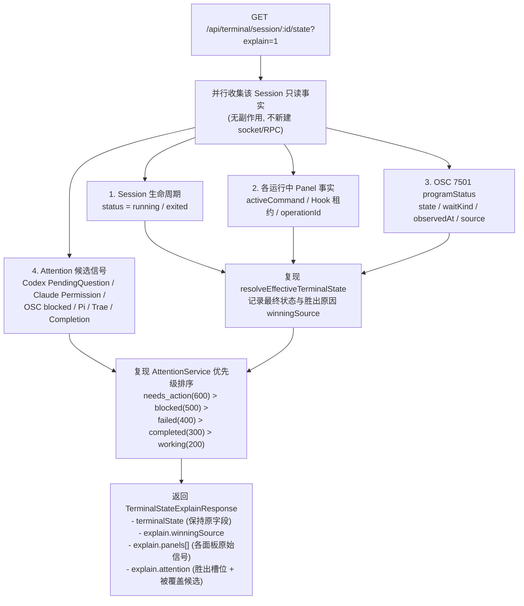

# Herdr 高价值工程能力借鉴实施方案（持久化兜底 + 通用终端编排原语 + 状态可解释诊断）

当用户在 Runweave 中长期运行多个终端/Agent，并通过 CLI 或外部 Agent 编排终端任务、排查状态异常时，本方案补齐三项低风险、高 ROI 的工程能力：防止 `terminal-session-store.json` 损坏覆盖的冻结备份与节流历史快照、面向通用终端控制的 `send --wait`（含阻塞态拒送与 5 秒活动门禁）/`wait-output`/`snapshot --unwrap`、以及 `rw terminal state --explain` 多路状态可解释诊断。

---

## 1. 目标与非目标

### 目标

1. **模块 A：Session Store 防损坏保护与节流历史快照**
   - 在 `LowDbStoreBase` 加载与写入链路中引入 `protectUnloaded` 机制：当 `terminal-session-store.json` 解析失败、损坏或读取异常时，在任何新写入覆盖之前先将原文件字节级备份到同目录 `terminal-session-backups/`（最多保留 3 份）；备份失败则拒绝覆盖原文件。
   - 引入 `terminal-session-snapshots/` 定期历史快照：最多保留 48 份，按 15 分钟节流（跨重启有效），并按结构指纹去重，防止升级回退、误操作或崩溃瞬间冲掉全部历史布局。
2. **模块 B：通用终端编排原语（`send --wait`、`wait-output`、`snapshot --unwrap`）**
   - `rw terminal send` 新增 `--wait`、`--until <idle|blocked>`、`--timeout-ms <ms>` 与 `--reject-if-blocked`（`--wait` 默认开启）：
     - 发送前先核对目标 Panel 是否已有结构化 `needs_action` / `blocked`（复用 `AttentionService`）；已阻塞时返回明确错误码 `AGENT_BLOCKED` 且**不写入任何字节**。
     - 从非 `agent_running` 态提交后，执行 **5 秒活动门禁**：必须在 5 秒内通过 `TerminalEventService` 观测到进入 `agent_running` 或 `needs_action/blocked`，否则返回 `AGENT_PROMPT_STALLED`，避免把旧的 `agent_idle` 误判为新轮次已完成。
     - 通过活动门禁后，事件驱动等待目标状态，超时返回 `WAIT_TIMEOUT`（明确标注“输入已提交，结果未知，切勿盲目重发”）。
   - 新增 `rw terminal wait-output <terminalSessionId> (--match <text> | --regex <pattern>) [--panel <id>] [--lines <n>] [--timeout-ms <ms>]`：面向普通命令（构建、测试、服务启动）的有界输出等待，不耦合 Agent 生命周期。
   - `rw terminal snapshot` 新增 `--unwrap`：对 tmux 面板复用 `-J` 软换行拼接输出，避免长日志、堆栈或 URL 被终端列宽截断。
3. **模块 C：状态与 Attention 可解释诊断（`rw terminal state --explain`）**
   - 扩展 `GET /api/terminal/session/:terminalSessionId/state?explain=1`（完全向后兼容），在不改变 `TerminalState` 和 `AttentionService` 判定规则的前提下，返回结构化决策解释：生效状态与来源、各 Panel 原始信号（Shell `activeCommand`、Hook 活动租约、OSC 7501 `programStatus`、Codex 待答、Claude `PermissionRequest`、Pi/Trae 等待态）、以及当前命中的 Attention 槽位与被更高优先级覆盖的候选信号。
   - `rw terminal state <terminalSessionId> --explain [--json]` 直观输出该诊断结果。

### 非目标（不做什么）

- **不引入屏幕文本启发式检测**：严格遵守 `DSC-010`，绝不通过扫描终端输出中的 `"Allow?"`、`"error"` 或静默时长来推断 `blocked` / `needs_action` / `agent_running`。
- **不改写 `TerminalState` 枚举与现有 Hook/OSC/Attention 判定逻辑**：所有新增能力只作为既有权威事实的消费者或只读诊断视图。
- **不在本方案内实现开放式 `report-agent` 协议、插件系统或声明式 `layout.apply`**（作为后续独立议题按需评估）。
- **不新增单元测试文件**：遵循仓库规范，通过 typecheck、lint、architecture check 及真实 Backend + `rw` CLI 交互取证验证。

---

## 2. 总体架构与核心流程图

### 2.1 三项能力在 Runweave 中的落点总览



---

### 2.2 模块 A：Session Store 防损坏保护与节流快照流程



---

### 2.3 模块 B：`rw terminal send --wait` 原子提交与活动门禁流程



---

### 2.4 模块 C：`rw terminal state --explain` 多路状态决策投影流程



---

## 3. 详细设计与接口合约

### 3.1 模块 A：Session Store 防损坏备份与节流历史快照

- **存储目录布局**（位于 `path.dirname(storagePaths.terminalSessionStoreFile)` 下）：
  - 主文件：`terminal-session-store.json`
  - 损坏/异常保护目录：`terminal-session-backups/session-<timestamp>-<pid>.json`（最多保留 3 份，按文件名时间升序淘汰最旧）
  - 定期历史快照目录：`terminal-session-snapshots/session-<timestamp>-<pid>.json`（最多保留 48 份）
- **核心规则**：
  1. **读取失败处理**：`LowDbStoreBase.initialize()` 读取主文件前先检测文件是否存在；若存在但 JSON 解析失败或读回结构非法（非对象、缺少基本数组或包含高于支持版本的 `schemaVersion`），**不得静默覆盖**：记录 `warn` 日志并置 `protectUnloaded = true`，内存回退默认空结构以保证服务可起，待首次写入前先执行原字节备份。
  2. **备份失败阻断写入**：当 `protectUnloaded === true` 且拷贝原文件到 `terminal-session-backups/` 失败时，本次 `write()` 必须抛错并保留主文件原样；拷贝成功后清零 `protectUnloaded` 并执行后续写入。
  3. **15 分钟节流与去重**：每次正常保存前检查 `terminal-session-snapshots/` 最新文件的 `mtimeMs`；若距当前时间 `< 15 * 60 * 1000` ms 直接跳过。超过 15 分钟时，计算当前主文件的轻量结构指纹（基于排序后的 `projectId`、`sessionId + cwd + status`、`panelId + terminalSessionId` 的 SHA-256，排除 `lastActivityAt` 等高频噪声字段）；指纹与最新快照一致则跳过，不同则拷贝并按 48 份上限清理旧文件。快照失败只打 `warn` 日志，不阻断主写入。
  4. **原子写入加固**：使用临时文件写入 + `fileHandle.sync()` + `rename()`，避免断电导致半截 JSON。
- **兼容与回滚**：纯本地附加目录，不改变 `terminal-session-store.json` 的任何字段结构；回滚只需还原代码，已生成的备份/快照目录可安全忽略或手动删掉。

### 3.2 模块 B：通用终端编排原语

#### B.1 共享类型（`packages/shared/src/terminal/wait.ts`）

```ts
export type TerminalWaitTargetState = "idle" | "blocked";

export interface TerminalSendAndWaitRequest {
  operationId: string;
  data: string;
  panelId?: string;
  role?: string;
  mode?: import("./input").TerminalInputMode;
  submit?: boolean;
  wait: {
    until?: TerminalWaitTargetState[]; // 默认 ["idle", "blocked"]
    timeoutMs?: number; // 1_000 .. 600_000，默认 120_000
    activityGateMs?: number; // 默认 5_000，上限 30_000
    rejectIfBlocked?: boolean; // 默认 true
  };
}

export type TerminalWaitOutcome =
  | "settled"
  | "stalled"
  | "timeout"
  | "session_exited";

export interface TerminalSendAndWaitResponse {
  operationId: string;
  terminalSessionId: string;
  panelId: string | null;
  inputAccepted: boolean;
  outcome: TerminalWaitOutcome;
  matchedState: TerminalWaitTargetState | null;
  terminalState: import("./state").TerminalState;
  attentionState: import("../attention").AttentionState | null;
  attentionActionKind?: import("../attention").AttentionActionKind;
  elapsedMs: number;
  note?: string;
}

export interface TerminalWaitOutputRequest {
  panelId?: string;
  match?: string; // 字面量子串匹配（与 regex 二选一）
  regex?: string; // 正则匹配（长度上限 512，按行匹配）
  lines?: number; // 默认 120，范围 1..1000
  unwrap?: boolean; // 默认 true
  timeoutMs?: number; // 0..300_000，默认 60_000
}

export interface TerminalWaitOutputResponse {
  terminalSessionId: string;
  panelId: string | null;
  matched: boolean;
  matchedLine: string | null;
  snapshot: string;
  elapsedMs: number;
}
```

#### B.2 Backend 路由与实现规则

- `POST /api/terminal/session/:id/send-and-wait`
  - **阻塞态拒送**：调用 `AttentionService`（只读、无副作用）检查目标 `panelId` 是否已处于 `needs_action` 或 `blocked`；若命中且 `rejectIfBlocked !== false`，直接返回 `HTTP 409`，`code: "AGENT_BLOCKED"`，附带 `panelId`、`actionKind`、`evidence`，**不触发任何输入写入**。
  - **先订阅后写入**：在调用现有 `submitTerminalInput` 之前先向 `TerminalEventService.subscribe(...)` 注册监听，消除写入与事件到达之间的竞态。
  - **5 秒活动门禁**：若发送前目标 Panel 的有效状态不是 `agent_running`，写入后进入活动门禁阶段，等待 `agent_running` 或 `needs_action`/`blocked`（同时监听 session 退出）。若 `activityGateMs` 内未观测到活动，返回 `outcome: "stalled"`，并在 `note` 明确提示“输入已提交但未观测到运行态变化，请先读取快照确认，不要盲目重发”。
  - **安全与资源边界**：单进程同时活跃的 wait 请求上限 32 个（超限返回 `429`）；客户端断开 HTTP 连接（`req.on("close")`）时立即取消订阅与定时器，不泄漏监听器。
- `POST /api/terminal/session/:id/wait-output`
  - 复用现有快照/tmux `capture-pane -J -p -S -<lines>`，首次立即检查（已存在匹配立即返回），之后按 250ms 节流轮询直到匹配或超时；正则编译失败返回 `400 INVALID_REGEX`。
- `GET /api/terminal/session/:id/snapshot`（或现有 `scrollback` 路径扩展 `?unwrap=1`）
  - tmux 运行态优先使用 `capture-pane -J -p`（保留软换行拼接后的完整逻辑行）；普通 PTY 回退现有持久化 scrollback 并在响应中标明 `unwrapped: false`。
- **CLI 命令扩展**（`packages/runweave-cli/src/commands/terminal.ts`）：
  - `rw terminal send <id> --text ... --wait [--until idle,blocked] [--timeout-ms 120000] [--allow-blocked]`
  - `rw terminal wait-output <id> (--match <text> | --regex <pattern>) [--panel <id>] [--lines 120] [--timeout-ms 60000]`
  - `rw terminal snapshot <id> [--lines 120] [--unwrap]`

### 3.3 模块 C：状态与 Attention 可解释诊断（`--explain`）

- **接口合约**：
  - `GET /api/terminal/session/:terminalSessionId/state?explain=1`
  - 缺省 `explain` 时返回原 `{ terminalState }`，完全兼容现有 Web/iOS/CLI 客户端。
  - 携带 `explain=1` 时返回 `{ terminalState, explain }`，其中 `explain` 包含：
    - `sessionStatus`: `"running" | "exited"`
    - `winningSource`: `"session_exited" | "panel_aggregation" | "state_service" | "persisted_fallback"`
    - `panels[]`: 每个 Panel 的 `panelId`、`alias`、`status`、`activeCommand`、`terminalState`、`agentLease`（`phase`、`provider`、`operationId`、`clearedAt`）、`oscProgramStatus`（`state`、`waitKind`、`source`、`observedAt`）、`pendingPermissionRequest`（仅含布尔与时间戳，**严禁暴露命令正文/敏感参数**）
    - `attention`: `{ activeSlot: AttentionSlot | null, suppressedCandidates: Array<{ state, actionKind?, panelId, evidence, reason }> }`
- **CLI 展示**：`rw terminal state <id> --explain` 默认输出简洁易读的多行诊断摘要，`--json` 输出完整结构化 JSON。

---

## 4. 修改与新建文件清单

| 模块 | 文件路径                                                                   | 操作 | 职责说明                                                                                                                  |
| :--- | :------------------------------------------------------------------------- | :--- | :------------------------------------------------------------------------------------------------------------------------ |
| A    | `backend/src/terminal/store/store-recovery.ts`                             | 新建 | 封装原子写、原字节冻结备份（3 份上限）、15 分钟节流去重快照（48 份上限）与结构指纹计算                                    |
| A    | `backend/src/terminal/store/lowdb-store-base.ts`                           | 修改 | 在 `initialize()` 接入读取异常检测与 `protectUnloaded` 标记；在统一写入路径调用 `store-recovery.ts`                       |
| B    | `packages/shared/src/terminal/wait.ts`                                     | 新建 | 定义 `TerminalSendAndWaitRequest/Response`、`TerminalWaitOutputRequest/Response` 共享协议                                 |
| B    | `packages/shared/package.json`                                             | 修改 | 导出 `./terminal/wait` 子路径                                                                                             |
| B    | `backend/src/terminal/application/terminal-wait-service.ts`                | 新建 | 实现 `sendAndWait`（阻塞拒送 + 先订阅后写入 + 5s 活动门禁 + 事件驱动等待）与 `waitForOutput`（有界轮询 + 客户端断开清理） |
| B    | `backend/src/routes/terminal/wait.ts`                                      | 新建 | 注册 `POST /session/:id/send-and-wait` 与 `POST /session/:id/wait-output` 路由                                            |
| B    | `backend/src/routes/terminal/scrollback.ts` / `sessions/`                  | 修改 | 支持 `unwrap=1`（tmux `capture-pane -J -p` 软换行拼接）                                                                   |
| B    | `packages/runweave-cli/src/client/terminal-http-client.ts`                 | 修改 | 封装 `sendAndWait`、`waitOutput`、`getStateExplain` 与 `unwrap` 参数                                                      |
| B    | `packages/runweave-cli/src/commands/terminal.ts`                           | 修改 | 扩展 `send --wait`、`wait-output`、`snapshot --unwrap`、`state --explain` 子命令与参数解析                                |
| C    | `packages/shared/src/terminal/events.ts`                                   | 修改 | 在 `TerminalStateResponse` 上新增可选 `explain?: TerminalStateExplain`                                                    |
| C    | `backend/src/terminal/application/terminal-state-explain.ts`               | 新建 | 汇总 session/panel/lease/OSC 7501/Attention 候选信号的只读解释投影（脱敏）                                                |
| C    | `backend/src/routes/terminal/state.ts`                                     | 修改 | `GET /session/:terminalSessionId/state` 支持 `?explain=1`                                                                 |
| 文档 | `docs/architecture/terminal-state.md`、`docs/cli/terminal-task-control.md` | 修改 | 补充 `--explain`、持久化备份目录与通用 `send --wait` / `wait-output` 合同说明                                             |

---

## 5. 分阶段实施顺序

1. **Phase 1（优先，最低风险、立即收益）**：落地 **模块 A**（`store-recovery.ts` + `lowdb-store-base.ts`），验证损坏保护与 15 分钟节流快照。
2. **Phase 2（排障先行）**：落地 **模块 C**（`terminal-state-explain.ts` + `state.ts` + `rw terminal state --explain`），为 Phase 3 的等待门禁调试提供直接可观测性。
3. **Phase 3（编排增强）**：落地 **模块 B**（`terminal-wait-service.ts` + 路由 + `rw` CLI `send --wait` / `wait-output` / `snapshot --unwrap`），并更新文档。

---

## 6. 验收标准与验证方式

### 静态与架构门禁（每阶段完成后执行）

```bash
pnpm --filter @runweave/shared typecheck \
  && pnpm --filter @runweave/backend typecheck \
  && pnpm --filter @runweave/cli typecheck \
  && pnpm cli:build \
  && pnpm architecture:check \
  && pnpm docs:check
```

预期：全部退出码为 `0`，无类型错误、边界违例或文档断链。

### 真实环境行为验收清单

1. **模块 A（持久化兜底）**
   - **损坏保护**：向隔离 Profile 的 `terminal-session-store.json` 写入非法 JSON（如 `{broken`），启动 Backend 并触发一次新 session 创建；验证 `terminal-session-backups/` 生成包含原始 `{broken` 字节的备份文件，且新写入正常落盘；再将备份目录设为只读模拟备份失败，验证写入被拒绝且原损坏文件未被覆盖。
   - **节流与去重**：正常创建/修改 session，验证首次落盘生成 1 份快照；15 分钟内多次高频写入不新增快照；修改时间窗口或文件 mtime 模拟超过 15 分钟后，若布局未变仍不新增，新增 session 后再写则生成第 2 份快照。
2. **模块 B（通用编排原语）**
   - **阻塞态拒送**：在测试终端触发一个结构化 `needs_action`（如 Codex 待答或 OSC 7501 `blocked`），执行 `rw terminal send <id> --text "hello" --wait --json`；预期返回 `AGENT_BLOCKED`（非 0 退出码），且目标终端未收到 `"hello"` 输入。
   - **5 秒活动门禁**：对处于 `shell_idle` 或不会进入 `agent_running` 的面板执行 `rw terminal send <id> --text "echo hi" --wait --timeout-ms 15000 --json`；预期约 5 秒后返回 `outcome: "stalled"`，不会误报 `settled`。
   - **正常等待完成**：对空闲受支持 Agent 执行 `rw terminal send <id> --text "reply ok" --wait --json`；预期先经过 `agent_running`，完成后事件驱动返回 `outcome: "settled"`、`matchedState: "idle"`。
   - **`wait-output` 与 `--unwrap`**：在普通 shell 运行会延迟输出特定标记与超长单行 URL 的命令；验证 `rw terminal wait-output <id> --match "<marker>"` 在输出出现后立刻返回，且 `rw terminal snapshot <id> --unwrap` 输出完整不断行的 URL。
3. **模块 C（可解释诊断）**
   - 对分别处于 `shell_idle`、`agent_running`、`needs_action` 的终端执行 `rw terminal state <id> --explain --json`；验证 `winningSource`、各 Panel 原始信号与 `attention.activeSlot` 均与真实状态一致，且输出中不包含任何命令敏感参数或用户问题正文。

---

## 7. 高风险点与防回归

- **长连接监听器泄漏风险**：`send-and-wait` 订阅 `TerminalEventService` 时，必须在 `settled`、`stalled`、`timeout`、异常抛出以及 HTTP 连接提前断开（`req.on("close")`）的所有出口统一调用 `unsubscribe()` 并清理定时器，避免长时间运行后 Backend 内存上涨。
- **单次写入竞态**：`LowDbStoreBase` 所有写入已在 `enqueueWrite` 串行队列内，但备份与快照的目录检查和拷贝也必须留在同一串行队列内执行，防止并发写交错。
- **敏感信息不外泄**：`state?explain=1` 会通过常规鉴权 HTTP 接口返回，严格沿用 `AttentionService` 的脱敏边界，只返回状态、来源枚举、时间戳与面板标识，不回传审批命令全文或对话正文。
- **旧版 Backend 兼容**：`rw` CLI 调用新端点遇到 `404`/`501` 时应明确提示“当前 Backend 不支持该能力，请升级服务端”，不静默回退到盲等猜测。
