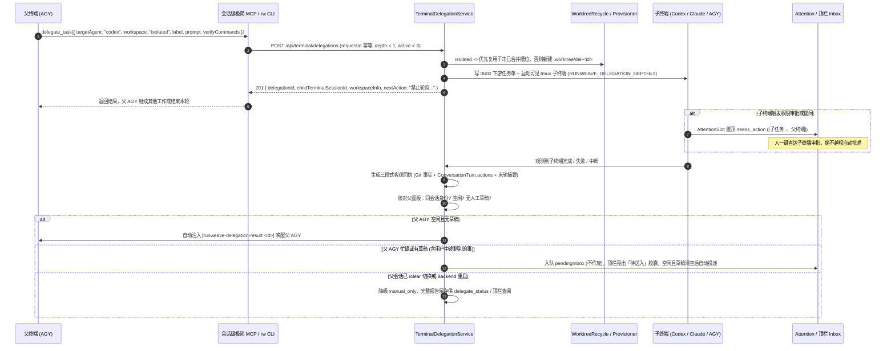

# 以 AGY 为主力的终端内跨 CLI 子 Agent 委派与父子谱系实施计划

> 场景与成功标准：当用户在 Runweave 终端里使用主力 **AGY**（同时兼容 Codex / Claude Code / Pi）处理复杂需求，希望把独立子任务委派给异构 CLI（如 Codex、Claude Code 或另一个独立 AGY 终端）并在可见终端/隔离工作区并行执行时，AGY 通过 Runweave 会话级注入的极简委派 MCP（3 个强 Schema 工具，CLI `--prompt-file` 作为全 CLI 通用兜底）发起委派；Backend 优先借用已合并干净 Worktree 槽位（无槽位才新建）拉起带父子谱系的可见 tmux 子终端，向下游交付落盘结构化任务单，向上游通过「待投递收件箱（Pending Inbox）」安全回传包含**客观 Git 事实 + 统一动作骨架与真实退出码 + 末轮摘要**的三段式证据回执；高风险审批始终通过 Attention 标注父子关系交由人拍板，子终端在 UI 上轻折叠在父 Tab 角标下且随时可人工接管。

---

## 1. 目标与非目标

### 目标

1. **明确模型边界：与 AGY 原生子 Agent 严格分工，不抢活、不冲突**
   - **同模型内部轻量探索、读代码、并行小任务**：继续一律走 AGY 进程内原生 `invoke_subagent` / `/swarm`（原生通道天然共享上下文与协议，最丝滑）。
   - **Runweave 终端委派（Terminal Delegation）专攻两类原生做不到的刚需**：
     1. **跨 CLI 异构协作**：AGY 主控 → 委派 **Codex / Claude Code / Pi / 独立 AGY** 实现模块、做对照方案或执行专项验证；
     2. **可见现场与可接管并行**：子任务跑在真实 tmux 终端里（支持复用干净 Worktree 槽位或新建隔离 Worktree），桌面与 iOS 随时可点开看 TUI、看 Diff/Browser 预览，或直接敲键盘接管，Backend/桌面重启不丢进程。

2. **让模型调用更稳：会话级极简 MCP 为 AGY 主入口，CLI `--prompt-file` 为通用兜底**
   - **AGY 主入口（解决 bash 引号转义炸裂与参数拼错）**：在 Runweave 托管终端启动 `agy` 时，通过 `agy --settings <0600 临时配置>` 会话级注入极简委派 MCP（仅暴露 **3 个工具**：`delegate_task`、`delegate_status`、`delegate_cancel`），**不修改全局 `~/.gemini/antigravity-cli/settings.json`**，也不增加常驻 `runweave-mcp` 的上下文预算负担。
   - **硬防轮询契约**：借鉴 T3 Code 实测经验，`delegate_task`（异步模式）的返回体固定携带明确 `nextAction` 指令：_“子任务结束后系统会自动回传唤醒你；禁止 sleep 或轮询，请继续手头其他工作或直接结束本轮。”_
   - **全 CLI 通用入口**：在 `rw` CLI 提供 `rw terminal delegate start | list | show | wait | cancel`，强制支持 `--prompt-file` 读取落盘任务正文，供 Codex / Claude / Pi 及脚本复用同一套 Backend HTTP API。

3. **解决真终端唤醒断链：两档可控回传收件箱（Pending Inbox）**
   - 克服传统终端“中途有人打过字就永久作废自动回传”的脆弱体验，将回传拆成两档：
     - **立即自动唤醒**：子任务结束时，若父面板处于 `agent_idle`、无未发送人工草稿、且父会话身份未变，自动注入 `[runweave-delegation-result:<delegationId>]` 唤醒父 AGY；
     - **忙碌/有草稿时排队不作废**：若父 AGY 正在跑、用户正在敲草稿、或用户中途切进去和主 AGY 聊了两句，回执进入该父终端的 **`pendingInbox`** 排队并在父终端顶栏显示轻量胶囊「`N 个子任务已完成 · 立即送入 / 预览`」；待父面板回到 `agent_idle` 且草稿清空后自动投递（或由用户点「立即送入」主动触发）；
     - **明确安全熔断**：只有父会话显式切换（`/clear` / `conversationId` 变更）、父终端关闭或 Backend 重启时，才将未送达回执降级为 `manual_only` 只读归档，避免误注入错误上下文。

4. **防止上下游互相忽悠：落盘结构化任务单 + 三段式客观证据回执**
   - **下游任务单（Downstream Brief）**：由 Backend 落盘为 `0600` 受管任务文件交付子终端，头部自动写明：目标目录与分支、**显式声明工作区是否包含主目录未提交改动**（隔离 Worktree 默认不含主目录未提交改动，防下游对着旧代码白干）、权限范围与可选必跑验收命令。
   - **上游客观回执（Upstream Receipt）**：子终端完成后，Backend 不仅抽子模型末轮回复，而是生成**三段式硬证据**：
     1. **客观 Git 事实**：目标分支、最新 Commit、`git diff --stat`、未提交文件数；
     2. **统一动作骨架**（直接复用 [通用旁聊方案](./2026-11-28-universal-side-chat-and-inject-back.md) 在 `app-server` 建立的 `ConversationTurn.actions`）：实际改了哪些文件、跑了哪些验证命令及**真实退出码**（没跑测试或挂了，父 AGY 一眼识破）；
     3. **子模型末轮结论摘要 + 完整报告文件路径**（总注入预算 `<= 16 KiB`）。

5. **最大化复用已有 Worktree（含 Pinned 与同工作区双终端并发）+ 防失控护栏 + UI 轻折叠**
   - **默认不无谓造新 Worktree**，提供清晰三态工作区策略：
     - **`workspace: "same"`（默认优先）**：直接与父终端共享当前工作区与分支启动第二个独立子终端（双终端并发，零冷启动、零事后清理负担）；下游任务单自动附带**同目录并发守则**（“仅修改本任务相关文件，禁止执行 `git checkout` / `git reset --hard` 影响同目录其他 Agent 改动”），上游回执依托子终端独立的 `ConversationTurn.actions.editedFiles` 精准归因该子任务自身改过的文件；
     - **`workspace: "isolated"`（需要独立分支时，默认策略 `recycle_or_create`）**：优先借用 [Worktree 治理方案](./2026-11-28-worktree-lifecycle-cleanup-and-recycle.md) 中任意**干净、已合入、无运行中 Agent 的已有 Worktree（包含 Pinned 常驻槽位与未 Pin 热槽位，Pinned 槽位复用后保持 Pinned 永不被删）**原地 `checkout -B` 秒开；无干净空闲槽位时才调用 `WorktreeProvisioner` 新建 `.worktree/del-<shortId>`；
     - 也允许调用方显式指定某个已有 `targetProjectId`（含 Pinned Worktree）以同分支共享并行方式拉起子终端。
   - **强护栏**：`RUNWEAVE_DELEGATION_DEPTH=1` + 存储谱系双校验（首期严格单层，禁止孙终端）；单父终端活跃子任务上限 **3**；高风险权限/认证审批始终冒泡至 Attention 由人拍板（绝不让父 Agent 替人越权批准）；人工在子终端敲键盘立即标为 `human_takeover` 并停止自动回传。
   - **UI 收口**：子终端默认轻折叠在父终端 Tab 角标（`↳ N` + 最高优先级状态圆点），点击展开围观或接管；关闭父终端时弹窗确认如何处置仍在运行的子终端。

### 非目标（本次不做）

- **不做多层嵌套树（孙终端）或重型多角色公司制工作流**（社区实证多层嵌套会显著放大错误并烧光额度，首期严格扁平单层）。
- **绝不让父 Agent 替人自动审批子终端的高风险权限/写外网/认证请求**（权限审批必须由人在 Attention 中确认；澄清类问答的父 Agent 代答留待 Phase 3 审慎评估）。
- **不将 AGY 内部原生 `invoke_subagent` 强行改造成 tmux 终端**。
- **不自动合并或推送子 Worktree 的分支**：合并与提交由父 Agent 或人工显式执行。
- **不新增单元测试文件**。

---

## 1.5 可行性评估、与 T3 Code 差异对比及社区方案调研

### 可行性结论与风险边界

| 能力模块                             | 可行性                 | 关键依据与边界                                                                                                                                                                                   |
| ------------------------------------ | ---------------------- | ------------------------------------------------------------------------------------------------------------------------------------------------------------------------------------------------ |
| AGY 会话级极简 MCP（3 工具）         | **高**                 | AGY 原生支持 `--settings <file>` 临时配置注入且自带 MCP 协议调用；仅暴露 `delegate_task` / `delegate_status` / `delegate_cancel` 三个强 Schema 工具，避免 bash 引号转义损坏与常驻 MCP 上下文膨胀 |
| 复用已有 Worktree / 同目录双终端并行 | **高**                 | 直接复用 Runweave 现有 `WorktreeRecycleService`、`WorktreeProvisioner` 与 `createTerminalSession`，在同目录共享或干净已合并槽位原地复用，零新协议栈                                              |
| Pending Inbox 异步回传与唤醒         | **中高**               | Runweave 已有 `terminal-state-service`、tmux 面板输入提交（`terminalInputAdmission`）与 `app-server` 线程事件；需靠会话 ID / 空闲态 / 草稿检测三道闸门避免误注入                                 |
| 三段式客观证据回执                   | **高**                 | Git 状态由 Backend 直接查本地仓库，动作骨架复用 `app-server` 的 `ConversationTurn.actions`，不依赖子模型口头汇报                                                                                 |
| 跨模型权限自动代批 / 多层嵌套        | **低（首期明确排除）** | 社区与工程实践均证实多层嵌套会放大幻觉与额度消耗，且父 Agent 替人批准高风险权限存在越权风险，首期强制 `depth=1` 且审批冒泡至人                                                                   |

### 与 T3 Code（`pingdotgg/t3code`）的架构差异

| 维度                   | T3 Code（`v0.1.14-nightly` 参考实现）                                           | Runweave 本方案（AGY 主力终端委派）                                                                                                                          |
| ---------------------- | ------------------------------------------------------------------------------- | ------------------------------------------------------------------------------------------------------------------------------------------------------------ |
| **运行载体与进程模型** | 应用内结构化 Thread / Session 管理器驱动各 Provider SDK/RPC，统一由宿主调度回合 | 真实可见 **tmux 终端 + 原生 CLI TUI**（AGY / Codex / Claude / Pi），支持桌面与 iOS 实时围观、随时敲键盘接管，重启不丢进程                                    |
| **子任务触发与防轮询** | 在编排层注册子 Thread 工具并在提示词/返回值里显式禁止模型 `sleep` 轮询          | 会话级 3 工具 MCP（`agy --settings`）+ `rw terminal delegate` CLI 兜底，同样在异步返回值写死 `nextAction` 禁轮询契约                                         |
| **提问 / 审批路由**    | 通过应用内 Reactors 把子线程事件汇总到主 UI 或由协调器响应                      | 高风险权限/认证审批强制路由至 **Attention** 并标注 `[子任务 ← 父终端]`，始终交由人拍板；人工切入子终端即进入 `human_takeover`                                |
| **结果回传机制**       | 内存/DB 事件总线直接向父 Thread 追加消息（无真实 TUI 人工草稿冲突）             | 真终端存在“用户正在打字或中途插入对话”的现场，因此设计 **Pending Inbox**（空闲无草稿自动注入；忙碌/有草稿排队胶囊待投递；`/clear` 切会话降级 `manual_only`） |
| **上下文与可信度**     | 直接读取子 Thread 结构化 turn/tool 事件流                                       | Backend 汇总 **Git 客观事实 + `ConversationTurn.actions` 动作骨架/退出码 + 末轮摘要**，避免仅靠自然语言回复导致上下游误判                                    |

### 社区主流方案调研与取舍

1. **CLI 原生进程内子 Agent（如 AGY `invoke_subagent` / `/swarm`、Claude Code Agent Teams / `Task` 工具）**
   - _优势_：同模型、进程内原生协议，共享上下文最丝滑，几乎无胶水成本。
   - _局限_：绑定单一厂商/CLI（AGY 无法原生拉起 Codex 或 Claude Code），子 Agent 过程多为黑盒折叠日志，难以直接在独立 tmux/Worktree 里随时人工接管。
   - _取舍_：同模型轻量探索继续走 AGY 原生 `invoke_subagent`，Runweave 终端委派只覆盖**跨 CLI 异构协作**与**可见可接管终端并行**。
2. **tmux 多窗格编排器（社区常见 `ccmux`、`tmux-agent`、手写 `tmux send-keys` 脚本）**
   - _优势_：终端可见、不锁死 CLI 厂商、可直接人工接管。
   - _常见坑点_：纯靠 bash 拼 `tmux send-keys` 极易因长 prompt 引号/换行转义炸裂；缺乏结构化结束检测导致父模型反复 `sleep` 轮询或盲猜完成；用户中途敲字易与回调冲突。
   - _取舍_：保留 tmux 可见现场优势，但用**会话级 3 工具 MCP + 落盘 `0600` 任务单（`--prompt-file`）+ `terminal-state-service` 观测 + Pending Inbox** 补齐稳定性短板。
3. **重型多 Agent 框架 / 多层角色工作流（CrewAI / AutoGen / LangGraph 多层主管树）**
   - _常见坑点_：角色提示词冗余、多层委派误差级联、Token 消耗不可控，且脱离开发者真实的本地 Git/IDE/CLI 工作流。
   - _取舍_：坚持**扁平单层（`RUNWEAVE_DELEGATION_DEPTH=1`）+ 活跃子任务上限 3 + 客观 Git/退出码回执**，把复杂度压在可控边界内。

---

## 2. 核心设计、状态流转与协议契约

### 2.1 端到端协作与 Pending Inbox 时序



### 2.2 共享协议（新建 `packages/shared/src/terminal/delegation.ts`）

```ts
export type DelegationTargetAgent = "agy" | "codex" | "claude" | "pi" | "traex";
export type DelegationWorkspaceMode = "same" | "isolated";
export type DelegationWorkspaceStrategy = "recycle_or_create" | "always_create";

export type DelegationStatus =
  | "starting"
  | "running"
  | "blocked" // 子终端触发 needs_action / blocked
  | "completed"
  | "failed"
  | "cancelled"
  | "human_takeover"; // 人工切入子终端敲键盘接管

export type DelegationDeliveryStatus =
  | "pending" // 尚未结束或正在等待父面板空闲/无草稿（位于 pendingInbox）
  | "delivered" // 已成功注入父面板
  | "manual_only" // 人工接管、父会话切换、父终端关闭或重启后降级只读
  | "skipped"; // 调用方显式 callbackMode="none" 或同步 --wait 已消费

export interface DelegationObjectiveReceipt {
  /** 客观 Git 现场事实 */
  git: {
    branch: string | null;
    headCommit: string | null;
    diffStat: string | null; // git diff --stat 简报（<= 4 KiB）
    dirtyFilesCount: number;
  };
  /** 复用统一 ConversationTurn.actions 汇总出的关键动作与验证退出码 */
  actions: {
    editedFiles: string[];
    commands: Array<{
      command: string;
      exitCode: number | null;
      failedExcerpt?: string;
    }>;
  };
  /** 子模型末轮净结论摘要（<= 8 KiB） */
  finalSummary: string | null;
  /** 完整归档报告路径（位于 Backend 数据目录） */
  artifactPath: string;
}

export interface CreateDelegationRequest {
  requestId: string; // UUID 幂等去重
  parentTerminalSessionId: string;
  parentPanelId?: string;
  targetAgent: DelegationTargetAgent;
  model?: string;
  label: string; // 短标签（<= 40 字符）
  prompt: string; // 上限 48 KiB
  workspace: DelegationWorkspaceMode; // "same" | "isolated"
  workspaceStrategy?: DelegationWorkspaceStrategy; // 缺省 "recycle_or_create"
  worktreeName?: string; // 指定新目录名时强制新建
  baseRef?: string;
  /** 可选提示子任务完成前必跑的验证命令清单（写入下游任务单） */
  verifyCommands?: string[];
  /** 可选权限收紧提示；绝不能高于 Runweave 为目标 CLI 配置的允许上限 */
  permissionCeiling?: "supervised" | "default";
  callbackMode?: "async_inbox" | "none"; // 默认 "async_inbox"
}

export interface CreateDelegationResponse {
  delegation: TerminalDelegationRecord;
  /** 给主模型的确定性后续指引，防止盲目 sleep/轮询 */
  nextAction: string;
}

export interface TerminalDelegationRecord {
  delegationId: string;
  requestId: string;
  parentTerminalSessionId: string;
  parentPanelId: string;
  parentThreadId: string | null;
  parentProvider: string | null;
  childTerminalSessionId: string | null;
  childPanelId: string | null;
  childProjectId: string;
  workspaceOutcome: "same" | "recycled_worktree" | "created_worktree";
  /** 明确告诉上下游：隔离 Worktree 不含主目录未提交改动 */
  uncommittedChangesExcluded: boolean;
  targetAgent: DelegationTargetAgent;
  label: string;
  depth: number; // 固定为 1（禁止 >= 2）
  status: DelegationStatus;
  deliveryStatus: DelegationDeliveryStatus;
  deliveryDeferredReason?: "parent_busy" | "parent_has_draft" | null;
  receipt: DelegationObjectiveReceipt | null;
  createdAt: string;
  updatedAt: string;
  finishedAt: string | null;
  error?: string;
}
```

### 2.3 AGY 会话级极简 MCP 与 CLI 契约

1. **会话级临时 MCP（`packages/runweave-cli/src/mcp/delegation-mcp-server.ts` 或 Backend 轻量 stdio 桥接）**：
   - Runweave 启动托管 `agy` 终端时，若启用终端委派功能，生成仅当前会话生效的 `0600` 临时 settings JSON 并通过 `agy --settings <file>` 传入（不改全局 `~/.gemini/antigravity-cli/settings.json`），挂载名为 `runweave-delegate` 的极简 MCP，仅暴露 **3 个工具**（总 Schema 严格控制在极低字节内，且不计入静态 `runweave-mcp` 预算）：
     - `delegate_task`：发起跨 CLI 或隔离 Worktree 子终端（描述明确标注：**同模型轻量探索继续用原生 `invoke_subagent`，仅跨 CLI 或需可见独立 Worktree 时调用本工具**）；
     - `delegate_status`：查看已发起子任务的状态、客观回执或阻塞原因（明确禁止轮询循环）；
     - `delegate_cancel`：取消进行中的子任务（可选是否同时关闭子终端）。
2. **全 CLI 通用命令行（`packages/runweave-cli/src/commands/terminal-delegate.ts`）**：

   ```bash
   # 推荐多行任务通过 --prompt-file 避免 shell 引号转义问题
   rw terminal delegate start \
     --agent codex \
     --label "后端协议实现" \
     --workspace isolated \
     --prompt-file /path/to/brief.md \
     --verify "pnpm --filter @runweave/shared typecheck" \
     --json

   # 短任务同步等待（复用 TerminalWaitService，命中 idle 或 blocked 立即返回）
   rw terminal delegate start --agent claude --label "边界核对" --workspace same \
     --wait --timeout-ms 180000 --prompt-file /path/to/check.md --json

   rw terminal delegate list [--parent <terminalSessionId>] --json
   rw terminal delegate show <delegationId> --json
   rw terminal delegate deliver <delegationId> --json   # 手动立即送入 pendingInbox 项
   rw terminal delegate cancel <delegationId> [--close-terminal] --json
   ```

### 2.4 Pending Inbox 投递与防污染硬规则

1. **延迟而不轻易作废**：
   - 子任务完成时若父面板为 `agent_running` 或 `hasPendingTerminalInput(session, panelId)` 为真：保持 `deliveryStatus = "pending"` 并记录 `deliveryDeferredReason`（`"parent_busy"` 或 `"parent_has_draft"`）；
   - 订阅 `TerminalEventService` 与草稿清空事件：一旦父面板回到 `agent_idle`、草稿为空、且 `parentThreadId` 与 `operationGeneration` 仍匹配，按 FIFO 顺序自动投递下一条待送回执；
   - 用户也可直接点击父终端顶栏的「`N 个子任务已完成`」胶囊，选择「预览报告」或「立即送入」。
2. **明确隔离与防误判**：
   - 回传文本固定以 `[runweave-delegation-result:<delegationId>]` 开头，总注入文本上限 **16 KiB**（超出时保留完整 Git 事实与失败命令列表，正文截断并指向 `artifactPath`）；
   - 同步在 `backend/src/terminal/code-review/requirements.ts` 与 `backend/src/task-supervision/` 中排除 `[runweave-delegation-result:*]` 标记，防止自动回执被误判为用户新提的业务需求。
3. **重启与切换保护**：
   - 父面板执行 `/clear` 切换新 `threadId` 或 Backend 重启后，重启前尚未送达的 `pending` 回执一律转为 `manual_only`，绝不往重启后或新话题的终端盲注文本。

---

## 3. 修改与新增文件清单

| 文件路径                                                                           | 操作            | 职责说明                                                                                                         |
| :--------------------------------------------------------------------------------- | :-------------- | :--------------------------------------------------------------------------------------------------------------- |
| `packages/shared/src/terminal/delegation.ts`、`attention.ts`、`runtime/session.ts` | 新建/修改       | 定义委派、客观回执、Pending Inbox、子终端谱系与 Attention 父子标注类型                                           |
| `backend/src/terminal/delegation/store.ts`                                         | 新建            | 持久化 `terminal-delegations.json`（原子写入；重启将未送达回执降级 `manual_only`）                               |
| `backend/src/terminal/delegation/brief.ts`                                         | 新建            | 生成 `0600` 下游结构化任务单（自动注入工作区/分支/未提交改动声明/验收命令）                                      |
| `backend/src/terminal/delegation/receipt.ts`                                       | 新建            | 组装三段式上游客观回执（Git 事实 + 统一 `ConversationTurn.actions` + 末轮摘要 + 归档文件）                       |
| `backend/src/terminal/delegation/inbox-delivery.ts`                                | 新建            | 实现 Pending Inbox 排队、空闲/无草稿自动投递、手动送入与会话漂移降级                                             |
| `backend/src/terminal/delegation/service.ts`                                       | 新建            | 编排委派全生命周期：深度/并发限流、优先槽位复用/新建 Worktree、多 CLI 启动、状态与人工接管监听                   |
| `backend/src/routes/terminal/delegation.ts` 与 `routes/terminal/index.ts`          | 新建/修改       | 注册 `POST/GET /api/terminal/delegations`、`GET /:id`、`POST /:id/wait`、`POST /:id/deliver`、`POST /:id/cancel` |
| `backend/src/attention/attention-service.ts`                                       | 修改            | 为委派子终端 `AttentionSlot` 注入 `delegation` 父子上下文                                                        |
| `backend/src/terminal/code-review/requirements.ts` 与 `task-supervision/`          | 修改            | 过滤 `[runweave-delegation-result:*]` 自动回执，防止污染需求提取                                                 |
| `backend/src/terminal/runtime/agent-adapters.ts`                                   | 修改            | 为 Runweave 托管 `agy` 终端提供可选会话级 `--settings` 临时 MCP 注入                                             |
| `packages/runweave-cli/src/commands/terminal-delegate.ts`、`mcp/delegation-mcp.ts` | 新建            | 提供 `rw terminal delegate` 子命令（含 `--prompt-file`）与极简 3 工具 stdio MCP                                  |
| `frontend/src/components/terminal/session/session-tab.tsx`、`workspace/header.tsx` | 修改            | 父 Tab 折叠角标（`↳ N` + 状态点）、顶栏「待送入子任务」胶囊与预览抽屉、关闭父终端级联确认弹窗                    |
| `packages/app-ios/Sources/RunweaveIOS/Contracts/` 与 `Features/Home/`              | 修改（Phase 2） | 手机首页父子终端归组与 Attention `[子任务 ← 父终端]` 标注直达                                                    |
| `docs/cli/terminal-task-control.md` 与 `docs/architecture/terminal-state.md`       | 修改            | 同步终端委派、Pending Inbox、深度护栏与客观回执合同                                                              |

---

## 4. 分阶段迭代建议

- **Phase 1（后端闭环 + AGY 极简 MCP + 客观回执 + Pending Inbox）**：
  - 完成 `TerminalDelegationService`、三段式客观回执（依赖统一 `ConversationTurn.actions`）、Pending Inbox 投递、`rw terminal delegate` CLI 与 AGY 会话级极简 3 工具 MCP。
  - 先跑通最核心日常场景：**AGY 主控 → 委派 Codex（优先复用干净槽位或新建 Worktree）写代码 → 客观带回 Git Diff 与命令退出码并安全唤醒 AGY**。
- **Phase 2（UI 父子谱系 + Attention 冒泡 + 移动端归组）**：
  - 落地桌面父 Tab 轻折叠角标、顶栏「待送入」胶囊、关闭父终端级联确认，以及桌面/iOS Attention 父子标注与一键直达审批。
- **Phase 3（可选体验增强，视前两期实测决定）**：
  - ① 澄清类提问（非权限审批）先通知父 AGY 尝试代答（类似 T3 `DelegatedTaskQuestionReactor`），拿不准再升级 Attention 问人；
  - ② 增加 `headless` 轻量跨 CLI 同步咨询模式（如 AGY 用 15 秒向 Codex 拿一段第二意见，不拉起完整 tmux TUI）。

---

## 5. 高风险点与安全/兼容回滚

1. **无限递归套娃与本地算力/额度爆炸**：
   - `RUNWEAVE_DELEGATION_DEPTH=1` 环境变量 + Backend 谱系记录双拦截，硬拒绝 `depth >= 1` 的二次委派（`403 delegation_depth_exceeded`）；单父终端活跃子任务上限固定 **3**（本地 Mac 实证甜点并发为 2–3）。
2. **上下文预算门禁保护（`#1080`）**：
   - 委派 MCP 通过 `agy --settings` 会话级按需挂载，不侵入 `runweave-mcp` 静态 Schema；若配套文档/Skill 有新增，必须通过 `pnpm context:budget` 校验。
3. **权限越权风险**：
   - 子终端权限绝不高于 Runweave 为该 CLI 配置的允许边界，高风险审批始终交给 Attention 由人确认，绝不自动放行。
4. **上游/下游信息误导**：
   - 隔离 Worktree 必定在下游任务单头部明确提示“不含主目录未提交改动”；上游回执必定附带客观 `git diff --stat` 与真实命令退出码，避免只凭自然语言总结误判。
5. **兼容与回滚**：
   - 新增字段全部可选，旧客户端把子终端按普通终端展示仍可查看与关闭；关闭 AGY 会话级 MCP 注入开关即可立即退回纯手动/CLI 模式。

---

## 6. 验收标准与验证方式

配套新增测试计划：[docs/testing/terminal/terminal-delegation.testplan.yaml](../testing/terminal/terminal-delegation.testplan.yaml)（`DELEG-001` 至 `DELEG-012`），并回归 [independent-code-review.testplan.yaml](../testing/terminal/independent-code-review.testplan.yaml) 与 [attention-needs-action-convergence.testplan.yaml](../testing/platform/attention-needs-action-convergence.testplan.yaml)。

### 静态与构建检查

- [ ] `pnpm testplan:validate docs/testing/terminal/terminal-delegation.testplan.yaml` 与 `pnpm docs:check` 通过。
- [ ] `pnpm --filter @runweave/shared typecheck`、`pnpm --filter @runweave/backend typecheck`、`pnpm --filter @runweave/frontend typecheck`、`pnpm cli:build` 通过。
- [ ] `pnpm lint`、`pnpm architecture:check`、`pnpm context:budget`（Phase 2 后加 `pnpm ios:build`）通过。

### 关键验收场景（以 [terminal-delegation.testplan.yaml](../testing/terminal/terminal-delegation.testplan.yaml) 为准）

- [ ] **`DELEG-001` ~ `DELEG-002`（AGY 极简 MCP + 三段式客观回执）**：`agy --settings` 仅会话级注入 3 工具不改全局配置、返回防轮询 `nextAction`；AGY 派 Codex 完成任务并自动回传含 Git 事实、统一动作骨架与真实退出码的客观回执。
- [ ] **`DELEG-003` ~ `DELEG-004`（Pending Inbox 与安全熔断）**：父 AGY 忙碌、有草稿或中途聊别的事时回执稳稳排队不作废、顶栏亮出待送入胶囊并在空闲无草稿时安全投递；父会话 `/clear` 切换或 Backend 重启后严格降级 `manual_only`。
- [ ] **`DELEG-005` ~ `DELEG-006`（Worktree 槽位复用与同步 `--wait`）**：隔离委派优先复用干净已合并槽位保留缓存、无槽位才新建，任务单明示不含未提交改动；CLI `--prompt-file --wait` 命中空闲或阻塞即时返回。
- [ ] **`DELEG-007` ~ `DELEG-009`（Attention 冒泡、防套娃与人工接管）**：子终端审批/提问带父子标签置顶 Attention 且绝不自动放行权限；子终端二次委派返回 `403`、并发超限返回 `409`；人工在子终端敲键盘切入 `human_takeover` 停止自动回传。
- [ ] **`DELEG-010` ~ `DELEG-012`（UI 谱系折叠、去重防污染与 iOS 对齐）**：桌面父 Tab 角标折叠与关闭级联确认；`cancel`、幂等 `requestId` 与自动回执不污染 Review/监督；原生 iOS 父子归组与 Attention 直达。
