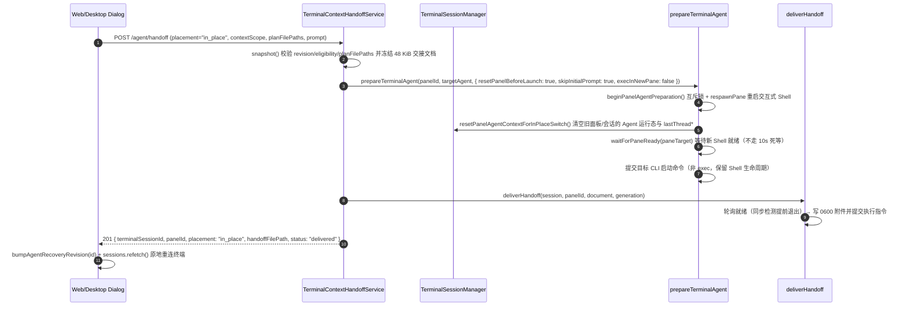

# 同目录原位换 Agent 与计划交接执行实施计划

> 场景与成功标准：当用户在 Desktop/Web 终端的**原项目目录**中与某原生 CLI（如 Claude Code）讨论并生成了实施计划（落盘为 `docs/plans/*.md` 或直接写在回复中），或中途想换另一家原生 CLI（如 Codex）接手执行时，点击顶栏「换 Agent」入口即可在同一项目目录内**原位替换当前面板**（也保留同目录「交接到新终端」选项，不强制创建新 Worktree）：弹窗自动识别刚生成的计划文件并提供一键执行预设，目标 CLI 在原面板内启动并直接拿到计划引用/上下文与执行指令开工；Tab、Browser 绑定与随记关联保持不变，原有协议与 iOS 客户端完全向后兼容。

---

## 1. 目标与非目标

### 目标

1. **后端原位替换能力（Backend + Shared）**
   - 扩展 Context Handoff 协议：预览响应增加 `canInPlaceHandoff`、`inPlaceUnavailableReason` 与 `detectedPlanFiles`；提交请求增加可选字段 `placement?: "new_terminal" | "in_place"`（缺省 `"new_terminal"`）、`contextScope?: "full_conversation" | "plan_focused"`（缺省 `"full_conversation"`）及 `planFilePaths?: string[]`；响应增加 `placement`。
   - 当 `placement === "in_place"` 时，在**同一 `terminalSessionId` + 同一 `panelId` + 原项目目录**上冻结来源上下文后，执行原位 `respawnPane`、清理旧 Agent 运行态上下文、在持久交互式 Shell 中启动目标原生 CLI，并将受管交接附件与执行指令投递到目标 CLI。
   - 严格守卫前置条件：仅允许 `tmux` 运行时、持久交互式 Shell、空闲面板（非 `agent_running` / `agent_starting`）、同工作区（`targetProjectId === sourceProjectId`）及 `portable_handoff` 模式；任一前置校验失败在 `respawnPane` 之前返回 `409`，原面板零副作用。

2. **打通「原项目目录生成计划 → 交接执行」高频链路**
   - **自动探测计划文件**：`handoff-preview` 从来源对话最近几轮正文提取引用路径（及来源目录下最近修改的 `docs/plans/*.md` 候选，经 `realpath` 校验必须严格位于来源项目目录 `cwd` 内且为可读普通文件），返回最多 5 份候选 `detectedPlanFiles`。
   - **支持「以计划为主（`plan_focused`）」精简交接**：当用户勾选计划文件并选择 `plan_focused` 时，受管交接文档仅保留「首条原始目标 + 已选计划文件清单（相对路径与绝对路径，指示以此为执行基准）+ 末轮结论摘要」，不再把几十 KiB 历史来回讨论全塞进执行 Agent 上下文；选择 `full_conversation` 时仍保留完整 48 KiB 便携对话并在头部附加计划文件清单。
   - **修复未落盘超长计划被砍头的问题**：[handoff-budgeter.ts](../../packages/shared/src/terminal/handoff-budgeter.ts) 在单条末轮回复超过剩余预算时，由「仅保留末尾（`tail=true`）」升级为「首尾各半 + 中间省略标记」，避免长计划的目标与前序任务被截掉。

3. **显式快捷入口与统一交接弹窗（Web / Electron Desktop）**
   - 在桌面终端顶栏（[header.tsx](../../frontend/src/components/terminal/workspace/header.tsx)）增加显式「换 Agent」快捷按钮（紧邻「阅读会话」），不再只藏在「更多操作」和 Tab 右键菜单里。
   - 升级 [context-handoff-dialog.tsx](../../frontend/src/components/terminal/session/context-handoff-dialog.tsx)：
     - 默认保持在**原项目目录** + **原位替换当前面板**（不展示多余的 Worktree 切换干扰；切到「交接到新终端」时才按需展示目标工作区选择器，且默认仍为「当前工作区」）。
     - 自动预选与 `sourceProvider` 不同的目标 Agent（例如 `claude → codex`、`codex → claude`）。
     - 若检测到 `detectedPlanFiles`，默认勾选最新一份、默认切到「以计划为主（精简上下文）」，并提供一键指令预设芯片（`按计划开始实施` / `继续修复并验证` / `先读上下文等我确认`），其中检测到计划时自动预填「按计划开始实施」指令（可随时编辑或清空），实现真正的一键交接开工。
   - 原位替换提交成功后，保持在当前 Tab 与 Panel，调用 `bumpAgentRecoveryRevision(id)` 与 `sessions.refetch()`，确保 xterm 干净重连到新 CLI。

### 非目标（本次不做）

- **不自动创建新 Worktree，不做跨 Worktree 拷贝未提交计划文件**（跨 Worktree 仅保留原有「交接到新终端」基础能力）。
- **不做多跳交接链持久化（`handoffChain`）与「阅读会话」跨段合并/切回 UI**。
- **不改写 iOS 客户端代码（`packages/app-ios`）**：仅保证共享协议向后兼容（新增请求字段全部可选且有兼容默认值）。
- **不扩展 `agy` 作为交接来源**：`sourceProvider` 保持 `codex | claude | pi | traex`（目标 Agent 仍支持 `codex | claude | pi | traex | agy`）。
- **不做同终端分屏接力或隐藏 pane 管理**；不引入 LLM 二次总结；不新增单元测试文件。

---

## 2. 核心设计、状态迁移与关键约束

### 2.1 协议契约（`packages/shared/src/terminal/context-handoff.ts`）

```ts
export const HANDOFF_PLACEMENTS = ["new_terminal", "in_place"] as const;
export type HandoffPlacement = (typeof HANDOFF_PLACEMENTS)[number];

export const HANDOFF_CONTEXT_SCOPES = [
  "full_conversation",
  "plan_focused",
] as const;
export type HandoffContextScope = (typeof HANDOFF_CONTEXT_SCOPES)[number];

export interface HandoffPlanFileCandidate {
  /** 相对来源项目目录的路径，如 docs/plans/2026-11-28-foo.md */
  relativePath: string;
  /** 来源项目目录下的绝对路径 */
  absolutePath: string;
  /** 文件大小（字节） */
  sizeBytes: number;
  /** 来源：对话末段提及 或 工作区最近修改 */
  source: "mentioned" | "recent_plan";
}

export interface TerminalContextHandoffPreview extends HandoffCoverage {
  // ...既有字段保持不变
  canInPlaceHandoff: boolean;
  inPlaceUnavailableReason: string | null;
  detectedPlanFiles: HandoffPlanFileCandidate[];
}

export interface CreateTerminalContextHandoffRequest {
  // ...既有字段保持不变
  placement?: HandoffPlacement; // 缺省 "new_terminal"
  contextScope?: HandoffContextScope; // 缺省 "full_conversation"
  planFilePaths?: string[]; // 选中的相对路径（最多 5 个，须位于来源 cwd 内）
}

export interface CreateTerminalContextHandoffResponse {
  // ...既有字段保持不变
  placement: HandoffPlacement;
}
```

兼容与安全边界：

- 旧客户端（包括当前 iOS `ContextHandoffSheet.swift`）请求体不含 `placement` / `contextScope` / `planFilePaths`，路由 schema 默认补齐为 `placement: "new_terminal"`、`contextScope: "full_conversation"`、`planFilePaths: []`。
- **路径安全边界**：`planFilePaths` 必须逐项经 `path.resolve(cwd, rel)` 与 `realpath` 校验——拒绝绝对路径穿越、`..` 逃逸、指向 `cwd` 之外的符号链接及非常规文件；校验不通过返回 `400` 或 `403`。
- `contextScope === "plan_focused"` 且 `planFilePaths` 为空时返回 `400`（`"以计划为主交接时至少选择一份计划文件"`）。
- `operationId` 幂等指纹继续覆盖完整请求体（包含新增字段），`expectedSourceRevision` 乐观锁保持不变。

### 2.2 计划文件探测与 `plan_focused` 文档组装

1. **探测规则（新增辅助模块 `backend/src/terminal/application/handoff-plan-files.ts`）**：
   - 仅在来源目录 `cwd` 下探测：
     - **来源 1（`mentioned`，优先）**：从来源对话最后 6 轮消息文本中提取形如 `docs/plans/[^\s)'"<>]+\.md` 或 `.runweave/handoffs/[^\s)'"<>]+\.md`（以及以 `.md` 结尾的相对路径或 `cwd` 前缀绝对路径），经 `realpath` 确认位于 `cwd` 内且为可读普通文件。
     - **来源 2（`recent_plan`）**：读取 `${cwd}/docs/plans/`（若存在，非递归）下最近 24 小时内修改的 `.md` 文件，按 `mtimeMs` 降序补足。
   - 按 `realpath` 去重，最多返回 5 条（`mentioned` 排在 `recent_plan` 之前，同组按最近出现/最新修改排序）。
2. **`plan_focused` 交接文档格式（不超 48 KiB 预算）**：
   - 包含：
     - 标准头（`Source Provider`、`Source Thread ID`、`Source Directory`、`rw session-search` 兜底提示）
     - `## Primary Plan Files (Read & Execute Directly)`：列出每份已选计划文件的相对路径与绝对路径，明确指示目标 Agent 先完整读取这些文件并以此为执行基准
     - `## Original Task`：保留首条用户目标
     - `## Latest Turn Conclusion`：仅保留最后一轮可见问答（同样受预算保护，单条超长按首尾各半截断）
   - 若为 `full_conversation` 且勾选了 `planFilePaths`：在现有 48 KiB 便携文档头之后插入 `## Referenced Plan Files` 区块（计入 48 KiB 硬预算），保证计划路径醒目置顶。
3. **未落盘超长末轮截断修复（[handoff-budgeter.ts](../../packages/shared/src/terminal/handoff-budgeter.ts#L80-L89)）**：
   - 当最后一条消息独自超出剩余预算 `room` 时：若 `room` 足够容纳省略标记（如 `\n\n[...middle omitted...]\n\n`），按约 50% 头部 + 省略标记 + 50% 尾部截取（均严格对齐 UTF-8 字符边界），使总字节严格 `<= 49,152` 且同时保留计划开头与结尾结论。

### 2.3 原位替换可用性判定规则

在 `TerminalContextHandoffService.snapshot()` 与 `create()` 提交前共用同一判定函数 `evaluateInPlaceEligibility(session, panel, tmuxAvailable)`：

| 条件检查                                                               | 不满足时结果                                                                                      |
| ---------------------------------------------------------------------- | ------------------------------------------------------------------------------------------------- |
| `session.runtimeKind !== "tmux"` 或 `tmuxService` 不可用               | `canInPlaceHandoff: false`，`"当前终端未使用 tmux，仅支持交接到新终端"`                           |
| `!isInteractiveShellLaunch(session.command, session.args)`             | `canInPlaceHandoff: false`，`"当前终端启动命令不是持久交互式 Shell，仅支持交接到新终端"`          |
| `panel` 不存在、`panel.status !== "running"` 或无 `tmuxPaneId`         | `canInPlaceHandoff: false`，`"当前终端面板不可用，仅支持交接到新终端"`                            |
| `panel.terminalState?.state === "agent_running"` 或 `"agent_starting"` | `canInPlaceHandoff: false`，`"当前 Agent 正在执行中，请等待空闲后再原位切换，或改用交接到新终端"` |
| 以上全通过                                                             | `canInPlaceHandoff: true`，`inPlaceUnavailableReason: null`                                       |

此外，`create()` 收到 `placement === "in_place"` 时在任何写操作前额外拦截：

- `targetProjectId !== preview.sourceProjectId` → `409`（`code: "handoff_in_place_requires_same_workspace"`，`"跨工作区交接仅支持交接到新终端"`）。
- `mode === "native_fork"` → `409`（`code: "handoff_in_place_incompatible_mode"`，`"原位切换不支持 Codex 原生 Fork，请使用便携交接或交接到新终端"`）。
- `!eligibility.canInPlaceHandoff` → `409`（`code: "handoff_in_place_unavailable"`，透传 `inPlaceUnavailableReason`）。

### 2.4 原位替换核心时序与关键避坑点



**已核实必须处理的三处底层细节**：

1. **清空旧面板运行态与 `lastThread*`**：原位 `respawnPane` 后必须通过 `TerminalManagerPanelOperations.resetPanelAgentContextForInPlaceSwitch(sessionId, panelId, operationId)` 原子清空旧面板的 `threadId`、`threadProvider`、`lastThreadId`、`lastThreadProvider`、`lastThreadStatus`、`lastThreadUpdatedAt`、`codexContext`、`claude`、`pi`、`piLastCompletionKey`、`agy`、`pendingPermissionRequest`、`pendingAgyQuestion`、`oscProgramStatus`、`activeCommand`、`preview`、`latestReply` 并通过 `upsertPanel` 落盘（单/活跃面板时同步清理 session 级旧指针），否则 `text-attachment-delivery.ts` 的 `currentThreadId()` 会回退读到旧 `lastThreadId` 触发 `409 附件目标已变化`，或被旧 `panel.pi`/`codexContext` 误判已就绪。原生会话文件留在本地磁盘不受影响。同时 `deliverHandoff` 的 `threadId` 读取与 `text-attachment-delivery.ts` 对齐。
2. **`resetPanelBeforeLaunch` 走 `waitForPaneReady` 且 `execInNewPane: false`**：避免 `agent-preparation.ts` 的 10 秒固定等待，且保持交互式 Shell 存活（目标 CLI 退出不销毁面板）。
3. **半途失败边界与秒退检测**：`deliverHandoff` 轮询期间同时检查 `TMUX_AGENT_PREPARE_EXIT_OPTION`（命中 `exit:${generation}:` 立即中止，不白等 30 秒）；若失败发生在 `respawnPane` 之前则返回原错误且原面板零副作用；若发生在 `respawnPane` 之后则返回 `409 handoff_delivery_unconfirmed` 并携带 `{ terminalSessionId: id, panelId, placement: "in_place" }`，前端仍触发 `bumpAgentRecoveryRevision(id)` 重建画面并展示错误提示。

---

## 3. 任务拆解与文件修改范围

### 任务 1：共享协议、预算截断修复与路由校验

- **文件**：
  - [packages/shared/src/terminal/context-handoff.ts](../../packages/shared/src/terminal/context-handoff.ts)
  - [packages/shared/src/terminal/handoff-budgeter.ts](../../packages/shared/src/terminal/handoff-budgeter.ts)
  - [backend/src/routes/terminal/context-handoff.ts](../../backend/src/routes/terminal/context-handoff.ts)
- **改动**：
  - 定义 `HANDOFF_PLACEMENTS`、`HandoffPlacement`、`HANDOFF_CONTEXT_SCOPES`、`HandoffContextScope`、`HandoffPlanFileCandidate`，扩展预览/请求/响应类型。
  - 在 [handoff-budgeter.ts](../../packages/shared/src/terminal/handoff-budgeter.ts) 中：
    - 升级单条超预算末轮回复为「首尾各半 + 中间省略标记」（严格保持 UTF-8 边界与 `<= 49,152` 字节）；
    - 新增可选参数支持在文档中注入 `planFiles` 区块，并提供 `budgetPlanFocusedHandoff(...)` 生成「以计划为主」的精简交接文档。
  - 路由 `schema` 增加 `placement`（默认 `"new_terminal"`）、`contextScope`（默认 `"full_conversation"`）与 `planFilePaths`（默认 `[]`，上限 5 项）。
- **验证**：`pnpm --filter @runweave/shared typecheck && pnpm --filter @runweave/backend typecheck`。

### 任务 2：面板重置、`prepareTerminalAgent` 原位启动与投递加固

- **文件**：
  - [backend/src/terminal/manager/panel-operations.ts](../../backend/src/terminal/manager/panel-operations.ts)
  - [backend/src/terminal/application/agent-preparation.ts](../../backend/src/terminal/application/agent-preparation.ts)
  - [backend/src/terminal/application/handoff-delivery.ts](../../backend/src/terminal/application/handoff-delivery.ts)
- **改动**：
  - 在 `TerminalManagerPanelOperations` 实现 `resetPanelAgentContextForInPlaceSwitch(sessionId, panelId, operationId)`。
  - 在 `PrepareTerminalAgentInternalOptions` 新增 `resetPanelBeforeLaunch?: boolean`（`respawnPane` → 重置旧 Agent 上下文 → `waitForPaneReady` → 非 `exec` 启动目标 CLI）。
  - 在 `handoff-delivery.ts` 对齐 `threadId` 读取，并在就绪轮询中检测 `TMUX_AGENT_PREPARE_EXIT_OPTION` 提前退出快速失败。
- **验证**：`pnpm --filter @runweave/backend typecheck && pnpm --filter @runweave/backend lint`。

### 任务 3：计划文件探测与 `TerminalContextHandoffService` 原位/计划交接逻辑

- **文件**：
  - 新建：`backend/src/terminal/application/handoff-plan-files.ts`
  - 修改：[backend/src/terminal/application/context-handoff.ts](../../backend/src/terminal/application/context-handoff.ts)
  - 修改：[backend/src/terminal/application/handoff-budgeter.ts](../../backend/src/terminal/application/handoff-budgeter.ts)
- **改动**：
  - 实现 `detectPlanFiles(cwd, turns)` 与 `validatePlanFilePaths(cwd, relativePaths)`（严格 `realpath` 归属 `cwd` 校验）。
  - 在 `TerminalContextHandoffService` 实现 `evaluateInPlaceEligibility()`、`preview()` 返回 `canInPlaceHandoff` / `inPlaceUnavailableReason` / `detectedPlanFiles`；`create()` 支持 `placement: "in_place" | "new_terminal"` 与 `contextScope: "plan_focused" | "full_conversation"`。
  - 规范 `in_place` 半途失败错误（`switchedInPlace` 标记控制是否返回 `handoff_delivery_unconfirmed`）。
- **验证**：`pnpm --filter @runweave/backend typecheck && pnpm --filter @runweave/backend lint && pnpm architecture:check`。

### 任务 4：Web / Desktop 显式入口与同目录计划交接弹窗升级

- **文件**：
  - [frontend/src/components/terminal/workspace/header.tsx](../../frontend/src/components/terminal/workspace/header.tsx)
  - [frontend/src/components/terminal/session/session-tab.tsx](../../frontend/src/components/terminal/session/session-tab.tsx)
  - [frontend/src/components/terminal/session/context-handoff-dialog.tsx](../../frontend/src/components/terminal/session/context-handoff-dialog.tsx)
- **改动**：
  - **显式入口**：在 [header.tsx](../../frontend/src/components/terminal/workspace/header.tsx) 顶栏「阅读会话」旁新增桌面端快捷按钮「换 Agent」（`ArrowLeftRight` 图标）；同步更新「更多操作」菜单和 [session-tab.tsx](../../frontend/src/components/terminal/session/session-tab.tsx) 右键菜单文案为「换 Agent / 交接…」。
  - **弹窗交互升级（[context-handoff-dialog.tsx](../../frontend/src/components/terminal/session/context-handoff-dialog.tsx)）**：
    - 标题改为「换 Agent / 交接执行」。
    - **切换方式**：默认选中「原位替换当前面板（当前目录）」（不可用时灰置并展示原因，自动落到「交接到新终端」）；仅在选「交接到新终端」且存在多个可选工作区时展示工作区选择（默认仍为「当前工作区」）。
    - **目标 Agent 智能预选**：自动预选与 `sourceProvider` 不同的目标 Agent（`claude → codex`，其他 → `claude`）。
    - **计划文件区块（仅当 `detectedPlanFiles.length > 0` 时展示）**：列出探测到的计划文件复选框（默认勾选第 1 份），并提供「交接上下文范围」切换（`仅带计划与目标（推荐）` / `完整对话 + 计划`）。
    - **快捷执行指令预设**：提供 3 个轻量点击按钮（`按计划开始实施`、`继续排查并修复`、`仅接收上下文等我确认`）；探测到计划文件且未手动编辑指令时，默认预填「请先完整阅读上述计划文件，按计划在当前项目目录开始实施并完成验证。」（可随时修改或清空）。
    - **提交后行为**：`in_place` 成功或半途未确认时调用 `bumpAgentRecoveryRevision(id)` + `sessions.refetch()` 原地重连；`new_terminal` 沿用新建终端跳转。
    - 稳定回调继续使用 `ahooks` 的 `useMemoizedFn`。
- **验证**：`pnpm --filter @runweave/frontend typecheck && pnpm --filter @runweave/frontend lint`。

---

## 4. 风险点与防护

| 风险点                                                              | 可能影响                             | 防护措施                                                                                                               |
| ------------------------------------------------------------------- | ------------------------------------ | ---------------------------------------------------------------------------------------------------------------------- |
| 原面板仍在执行工具调用时被 `respawnPane` 强杀                       | 截断写入、丢失最后回复               | `evaluateInPlaceEligibility` 在预览与提交双重拦截 `agent_running` / `agent_starting`，返回 `409`                       |
| `respawnPane` 后旧 `lastThreadId` 或 `panel.pi`/`codexContext` 残留 | 触发 `409 附件目标已变化` 或误判就绪 | `respawnPane` 时原子清空面板旧 Agent 运行态与 `lastThread*` 并落盘                                                     |
| 计划文件路径被恶意或误传为目录外路径（`../` 或 symlink）            | 读取工作区外敏感文件信息             | `validatePlanFilePaths` 严格经 `realpath` 核对前缀落在来源 `cwd` 内且为普通文件                                        |
| 未落盘超长计划单条超出 48 KiB 预算                                  | 旧实现截尾会砍掉计划开头             | 改为首尾各半 + 中间省略标记，保证目标/前序任务与结尾结论兼得                                                           |
| 新 CLI 启动秒退或 xterm 残留旧 TUI 画面                             | 干等 30 秒或画面错乱                 | `deliverHandoff` 实时监测 `TMUX_AGENT_PREPARE_EXIT_OPTION` 秒退；前端调用 `bumpAgentRecoveryRevision(id)` 强制重建画面 |

---

## 5. 验收标准与验证方式

### 静态检查门禁

```bash
pnpm --filter @runweave/shared typecheck \
  && pnpm --filter @runweave/backend typecheck \
  && pnpm --filter @runweave/backend lint \
  && pnpm --filter @runweave/frontend typecheck \
  && pnpm --filter @runweave/frontend lint \
  && pnpm architecture:check
```

预期结果：退出码为 `0`，无类型错误、lint 错误或架构边界违规。

### 端到端行为验收（配套测试计划）

配套用例已更新至 [portable-context-handoff.testplan.yaml](../../docs/testing/terminal/portable-context-handoff.testplan.yaml)（保留 `HANDOFF-001`～`006`，新增 `HANDOFF-007`～`010`）：

1. **`HANDOFF-007`（同目录原位切换核心路径）**：点击顶栏「换 Agent」在当前目录原位切换至另一家 CLI，核对同 `terminalSessionId`/`panelId`、Tab 不增加、关联状态保留、受管附件送达且画面干净重连。
2. **`HANDOFF-008`（运行中/非 tmux 护栏）**：面板处于 `agent_running` 或非 tmux 时，预览 `canInPlaceHandoff=false`，强传 `placement="in_place"` 返回 `409` 且原面板零副作用。
3. **`HANDOFF-009`（跨 Worktree / `native_fork` 互斥与旧协议兼容）**：非法组合返回 `409`，不传新字段的旧版请求按 `placement="new_terminal"` + `contextScope="full_conversation"` 兼容执行。
4. **`HANDOFF-010`（原项目目录计划探测与精简计划交接执行）**：来源会话在原项目目录生成 `docs/plans/*.md` 后，预览准确返回该计划文件；以 `contextScope="plan_focused"` + 执行指令原位（或同目录新终端）交接后，受管交接文件不含冗长历史闲聊、明确引用该计划绝对与相对路径、目标 CLI 直接收到执行指令并拒绝目录外非法路径（`400`/`403`）。
