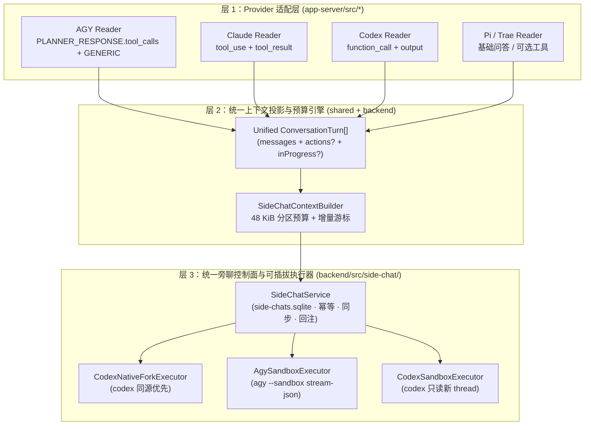

# 通用独立旁聊（统一上下文引擎 + 全 CLI 适配 + 结论回注）实施计划

> 场景与成功标准：无论用户在终端里运行的是主力 **AGY**，还是 **Codex / Claude Code / Pi / Trae**，点击顶栏「旁聊」图标即可在右侧无打断展开同一套只读旁聊体验；上层通过**统一的跨 CLI 上下文投影引擎**（问答正文 + 轻量动作骨架 + 进行中轮次实时快照 + 沙箱只读按需查代码）抹平底层差异，支持独立选择快模型、一键增量同步主会话最新进展、以及一键将旁聊结论「带回主终端」；Codex 同源同执行器场景自动走原生 `thread/fork` 零退化，现有 `side-chats.sqlite` 与双端协议完全向后兼容。

---

## 1. 目标与非目标

### 目标

1. **建立 Provider 无关的统一上下文投影层（App Server + Shared，一处建设、多处复用）**
   - 在 [packages/shared/src/terminal/conversation.ts](../../packages/shared/src/terminal/conversation.ts) 为 `ConversationTurn` 增加可选的 **`actions?: ConversationTurnActions`**（动作骨架）与 **`inProgress?: boolean`**（进行中轮次标识），仅在调用方显式传 `includeActions: true` 时生成，**绝不膨胀普通会话阅读与 Work History 流量**。
   - 在 [app-server/src/agents/conversation-reader.ts](../../app-server/src/agents/conversation-reader.ts) 统一编排各家原生读取器，把不同 CLI 的原始日志格式收口成同一套轻量动作骨架：
     - **AGY**（[app-server/src/agy/conversation-reader.ts](../../app-server/src/agy/conversation-reader.ts)）：解析 `PLANNER_RESPONSE.tool_calls` + 紧随 `GENERIC` 结果；
     - **Claude Code**（[app-server/src/claude/conversation-reader.ts](../../app-server/src/claude/conversation-reader.ts)）：解析 `tool_use` + `tool_result`；
     - **Codex**（[app-server/src/codex/conversation-reader.ts](../../app-server/src/codex/conversation-reader.ts)）：解析 `function_call` / `custom_tool_call` + `function_call_output`（参考既有 [analysis-evidence-reader.ts](../../app-server/src/agents/analysis-evidence-reader.ts)）；
     - **Pi / Trae**：按各自工具事件提取，缺失结构化工具字段时平滑退化为纯问答正文（`actions: undefined`）。
   - 该统一上下文投影引擎同时可供 **旁聊（Side Chat）** 与后续 **跨 CLI 上下文交接（Context Handoff）** 复用，不再按单个 CLI 写特例。

2. **旁聊上层完全统一，底层按能力自动路由双轨执行器（Backend）**
   - 放开 [backend/src/side-chat/source.ts](../../backend/src/side-chat/source.ts) 的 `SOURCE_NOT_CODEX` 限制，统一识别 `agy` / `codex` / `claude` / `pi` / `traex` 的来源会话身份、运行状态与上下文游标。
   - 将 [backend/src/side-chat/provider.ts](../../backend/src/side-chat/provider.ts) 抽离为统一的 `SideChatExecutor` + `SideChatExecutorRegistry`，由策略层按能力自动路由，**UI 与上层 `SideChatService` 零 Provider 分支**：
     - **原生 Fork 轨（`native_fork`）**：当来源为本地 `codex` 且执行器同样选 `codex`（未切异构模型）且存在已完成稳定轮次时，自动走既有 `codex app-server --stdio` 的 `thread/fork`（100% 保留原生状态）；若此时主 Codex 正在跑新一轮，额外附加统一的「进行中轮次动作骨架」。
     - **通用快照轨（`portable_snapshot`）**：当来源为 `agy` / `claude` / `pi` / `traex`，或用户为任意来源显式切换了异构执行器/快模型（如 Codex 终端用 AGY Flash 旁聊、AGY 终端用 Codex 旁聊）时，消费统一 `SideChatContextPackage`（总预算 **48 KiB**），交由只读沙箱执行器运行多轮问答（首期接入 **`agy` 执行器** 与 **`codex` 快照执行器**，后续可平滑扩展 `claude`）。

3. **旁聊闭环体验升级三件套（Desktop / Web + iOS 协议兼容）**
   - **一键「带回主终端」**：任意已完成的旁聊回复支持「填入主终端草稿（默认，主终端忙碌或空闲皆可安全使用）」与「空闲直发（后端二次核对 `agent_idle` + 无人工草稿 + 同会话身份后投递）」。
   - **旁聊独立选执行器与快模型**：创建旁聊时可选默认/指定执行器与轻量快模型（支持配置默认旁聊模型，如 AGY Flash），不改动主终端设置。
   - **一键「增量同步主会话最新进展」**：主会话推进新轮次后，旁聊顶栏显示「主会话新增 N 轮 · 同步上下文」，点击后只将新增轮次的问答 + 动作骨架（上限 16 KiB）增量附着到下一次提问中，不单独空烧模型请求。
   - **显式快捷入口**：在桌面终端顶栏（[header.tsx](../../frontend/src/components/terminal/workspace/header.tsx)）增加「旁聊」按钮与快捷键，右侧展开不切走当前终端 Tab。

### 非目标（本次不做）

- **旁聊绝不做文件修改、写命令执行、联网或审批交互**：所有执行器强制运行在“来源项目只读、无网络、无 MCP/Hooks/子 Agent/自动目标续接”的隔离沙箱中；需要动手改代码引导使用「带回主终端」或「交接到新终端」。
- **绝不把隐藏 `thinking / reasoning`、完整 `read_file` 文件正文、成功命令的冗长日志塞入旁聊 Prompt**：细节一律通过只读沙箱按需读文件获取，避免上下文瞬间膨胀和噪音污染。
- **不直接 `--resume` 来源 AGY 的主 `conversationId`**：AGY 无独立 `fork` 命令，直接 resume 会直接污染主会话的 `transcript.jsonl`，因此 AGY 旁聊永远创建全新独立会话。
- **不支持跨 SSH Shell 推断远端会话**；**不引入第三方直连 LLM API Key 管理**；**不把旁聊变成主 Tab 栏的一级终端**；**不新增单元测试文件**。

---

## 2. 统一上下文引擎设计（核心机制）

### 2.1 三层解耦架构



### 2.2 统一的动作骨架数据结构（[packages/shared/src/terminal/conversation.ts](../../packages/shared/src/terminal/conversation.ts)）

```ts
export interface ConversationTurnCommandAction {
  /** 执行的命令文本（归一化单行，截断 <= 240 字符） */
  command: string;
  /** 退出码；无法确认时为 null */
  exitCode?: number | null;
  /** 仅当 exitCode !== 0 或工具返回明确失败时附带末尾 <= 512 字节错误摘要 */
  failedExcerpt?: string;
}

export interface ConversationTurnActions {
  /** 本轮编辑/新建/删除的文件路径（优先相对 cwd，去重，单轮上限 24） */
  editedFiles: string[];
  /** 本轮读取/检索的关键文件路径（去重，单轮上限 24，不带文件内容） */
  readFiles: string[];
  /** 本轮执行的命令摘要（单轮上限 12） */
  commands: ConversationTurnCommandAction[];
  /** 明确的运行错误或中断提示（单轮上限 4，单条 <= 240 字符） */
  errors?: string[];
  /** 超出单轮条目上限时记录被省略的动作总数 */
  omittedCount?: number;
}

export interface ConversationTurn {
  id: string;
  messages: ConversationMessage[];
  rawTurnId?: string;
  /** 仅当查询传 includeActions=true 时按需填充；缺省表示未请求或来源无结构化工具数据 */
  actions?: ConversationTurnActions;
  /** true 表示主会话当前尚未结束的活跃轮次（仅用于实时进行中快照） */
  inProgress?: boolean;
}
```

### 2.3 各 Provider 原生工具到统一骨架的映射规则

所有映射在 `app-server` 读取阶段单遍流式完成，绝不做二次全文件重扫：

| Provider        | `editedFiles` 来源                                                           | `readFiles` 来源                                           | `commands` 来源                                                            | 明确丢弃                                                  |
| :-------------- | :--------------------------------------------------------------------------- | :--------------------------------------------------------- | :------------------------------------------------------------------------- | :-------------------------------------------------------- |
| **AGY**         | `tool_calls` 中 `edit_file` / `write_file` / `multi_edit` 的 `Path`          | `read_file` / `find_by_name` / `grep_search` 的路径        | `run_command` 的 `CommandLine` + 对应 `GENERIC` 结果中的退出码与失败尾段   | `thinking`、`read_file` 文件正文、退出码为 0 的命令长输出 |
| **Claude Code** | `tool_use` 中 `Edit` / `Write` / `MultiEdit` / `NotebookEdit` 的 `file_path` | `Read` / `Glob` / `Grep` 的 `file_path` / `path`           | `Bash` 的 `command` + 关联 `tool_result` 的 `is_error` 与失败尾段          | `thinking`、`tool_result` 成功时的长内容、sidechain 子链  |
| **Codex**       | `apply_patch` / 补丁工具解析出的目标路径                                     | `read_file` 等只读路径（若以 shell 读取则归入 `commands`） | `exec_command` / `shell_command` + `function_call_output` 退出码与失败尾段 | `reasoning`、成功命令的大段 stdout                        |
| **Pi / Trae**   | 若原生记录含结构化文件编辑工具则提取，否则留空                               | 若含结构化文件读取工具则提取，否则留空                     | 若含 shell 工具调用则提取，否则留空                                        | 冗长工具正文与内部元数据                                  |

### 2.4 确定性 48 KiB 分区预算裁剪（`SideChatContextBuilder`）

为避免“动作骨架挤爆正文”或“超长旧回复挤掉主线程此刻正在干什么”，总预算 **48 KiB（49,152 字节）** 按 4 个固定分区分配：

1. **头部与只读边界声明（~1.5 KiB，必留）**：
   - 来源 Provider、Thread ID、项目目录 `cwd`、当前分支（若可用）；
   - 明确声明只读旁聊边界，并给出沙箱自查指引：_“历史动作骨架仅列出读/改文件路径与失败命令摘要；若用户追问某个文件的具体代码或最新改动，请直接使用只读能力打开工作区对应文件核对，不要凭记忆猜测。”_
2. **首条原始任务（保底优先，超长截断保护）**：保留整段对话最初的用户目标，让旁聊理解大背景。
3. **进行中轮次实时快照（仅当主终端处于 `agent_running` 且存在 `inProgress` 轮次，独立上限 6 KiB）**：
   - 放入本轮用户新指令 + 本轮已落盘的最新动作骨架（刚改了哪些文件、正在跑什么命令、最新报错），让旁聊在主任务未完成时也能准确回答“它现在做到哪了”。
4. **已完成历史轮次（逆序从最新往前填满剩余 ~36–40 KiB）**：
   - 每轮按 `User → Action Digest（单轮硬上限 1.5 KiB）→ Assistant` 渲染；
   - 单轮 Action Digest 超 1.5 KiB 时按优先级保底：**`editedFiles` > 失败 `commands` > 成功 `commands` > `readFiles`**；
   - 若最后一条回复独自超过剩余预算，复用 `excerptHeadAndTail` 首尾各半保留；
   - 被裁掉的旧轮次插入标准 `Omitted History Marker`（标明省略轮次区间）。

> **为什么这套设计不需要像 T3 Code 那样强绑 MCP `t3_thread_read`？**
> T3 Code 的侧聊往往需要靠额外 MCP 回调去捞历史，而 Runweave 的旁聊执行器直接运行在**来源项目目录的只读沙箱**里：
>
> - 涉及**代码/文件细节** → 动作骨架给出精确路径，旁聊直接只读项目文件核对，拿到的还是磁盘最新真实代码；
> - 涉及**命令失败原因** → 失败命令自带末尾 512 字节错误摘要，90% 的报错追问直接命中；
> - 涉及**已推进的新轮次** → 通过「增量同步」按钮按需追加最多 16 KiB 的新轮次摘要。

---

## 3. 共享协议与 HTTP API 契约

### 3.1 共享类型扩展（[packages/shared/src/side-chat.ts](../../packages/shared/src/side-chat.ts)）

所有新增字段均可选且兼容 `side-chats.sqlite` 现有 `user_version = 1` 的 JSON 行：

```ts
export type SideChatSourceProvider =
  | "codex"
  | "agy"
  | "claude"
  | "pi"
  | "traex";
export type SideChatExecutorMode = "native_fork" | "portable_snapshot";
export type SideChatExecutorProvider = "codex" | "agy";

export interface SideChatSourceRef {
  terminalSessionId: string;
  panelId: string;
  expectedPrimaryThreadId: string;
  /** 最后一个已完成轮次 ID；当主会话首轮仍在运行（尚无已完成轮次）时允许为 "in_progress" 仅走 portable_snapshot */
  lastCompletedTurnId: string;
  sourceProvider?: SideChatSourceProvider;
}

export interface SideChatSourceSnapshot extends SideChatSourceRef {
  // ...既有字段保持不变
  sourceProvider?: SideChatSourceProvider;
  executorMode?: SideChatExecutorMode;
  executorProvider?: SideChatExecutorProvider;
  /** 已同步到旁聊的来源已完成轮次总数（用于计算增量新轮次） */
  syncedCompletedTurnCount?: number;
  /** 上次同步时的动作骨架摘要指纹（用于判断是否需要同步进行中进展） */
  syncedRevision?: string;
}

export interface SideChatExecutorOption {
  provider: SideChatExecutorProvider;
  available: boolean;
  reason: string | null;
  defaultModel: string | null;
  models: Array<{ id: string; label: string }>;
}

export interface SideChatCapabilities {
  supported: boolean;
  reason: string | null;
  source: SideChatSourceRef | null;
  activeSideChatId: string | null;
  /** 可选执行器与模型列表（前端统一渲染选择器，不写死 Provider） */
  executors?: SideChatExecutorOption[];
  recommendedExecutor?: {
    provider: SideChatExecutorProvider;
    model: string | null;
    mode: SideChatExecutorMode;
  } | null;
}

export interface SideChatSnapshot extends SideChatMessagePage {
  // ...既有字段保持不变
  /** 来源主会话相对上次同步新增的已完成轮次数（>=0） */
  sourceNewTurnsAvailable?: number;
  /** 主会话当前是否处于进行中轮次且有新动作可同步 */
  sourceHasInProgressDelta?: boolean;
}

export interface CreateSideChatRequest {
  operationId: string;
  source: SideChatSourceRef;
  executorProvider?: SideChatExecutorProvider;
  model?: string;
}

export interface SyncSideChatContextRequest extends SideChatWriteRequest {}

export interface SyncSideChatContextResponse extends SideChatWriteResponse {
  addedCompletedTurns: number;
  includedInProgress: boolean;
  syncedCompletedTurnCount: number;
}

export interface InjectSideChatToTerminalRequest {
  operationId: string;
  messageId: string;
  /** 默认填草稿由前端本地完成；直发路径由后端严格校验空闲与无草稿 */
  mode: "send_when_idle";
  prefixText?: string;
}
```

### 3.2 只读沙箱执行器矩阵

| 执行器                        | 适用场景                                                     | 底层运行方式                                                                                                                                                          | 安全隔离措施                                                                                                                                                                        |
| :---------------------------- | :----------------------------------------------------------- | :-------------------------------------------------------------------------------------------------------------------------------------------------------------------- | :---------------------------------------------------------------------------------------------------------------------------------------------------------------------------------- |
| **`CodexNativeForkExecutor`** | 来源=`codex` 且执行器=`codex` 且未要求跨模型                 | 既有 `codex app-server --stdio` + `thread/fork`                                                                                                                       | 既有细粒度 filesystem profile（项目只读、禁 tmp、禁网络/MCP/Hooks/子 Agent）                                                                                                        |
| **`AgySandboxExecutor`**      | 主力通用执行器（覆盖 AGY / Claude / Pi / Trae 及跨模型快问） | `agy --print --input-format stream-json --output-format stream-json --sandbox --disable-slash-commands --settings <temp-json>`（不支持流式输入时自动降级 `--resume`） | 剔除 `RUNWEAVE_*`/`TMUX*`/`CODEX_*`/`CLAUDE_*` 环境变量；启用 `--sandbox`；临时 `--settings` 关闭外部 hooks 与 MCP；空闲 15 分钟回收子进程（保留 `conversationId` 按需 `--resume`） |
| **`CodexSandboxExecutor`**    | 非 Codex 来源但用户显式选择用 Codex 跑旁聊                   | `codex app-server --stdio` + `thread/start`（新独立线程）                                                                                                             | 与 `CodexNativeForkExecutor` 复用同一套只读 sandbox profile                                                                                                                         |

### 3.3 增量同步与带回主终端规则

1. **增量同步（`POST /api/side-chats/:id/sync-context`）**：
   - 校验旁聊处于 `active`、当前无进行中 turn；
   - 调用统一 `ConversationReader(..., { includeActions: true })` 拉取 `syncedCompletedTurnCount` 之后的新增已完成轮次 + 当前 `inProgress` 轮次，经 `SideChatContextBuilder.buildDelta()` 裁剪至 **16 KiB** 内；
   - 写入 `StoredChat.pendingContextDelta` 并推进 `syncedCompletedTurnCount` / `syncedRevision`；在用户**下一次提问**时自动拼入 prompt 头部并在成功接收后清空（不单独消耗空轮次）。
   - 对于 `native_fork` 模式的 Codex 旁聊同样可用：新增进展作为只读增量块拼入下一次提问，无需销毁重开旁聊。
2. **结论带回主终端**：
   - **填入草稿（默认推荐）**：Web/iOS 前端直接将选中的旁聊回复包装为清晰引用文本写入主终端输入框草稿，用户在主终端可修改后发送——无论主终端忙碌还是空闲都 100% 安全。
   - **空闲直发（`POST /api/side-chats/:id/inject`）**：Backend 核对目标面板仍在运行、会话身份未漂移、`agent_idle` 且 `hasPendingTerminalInput` 为假后，通过既有 `sendInputToSession`（超长自动走受管文本附件）投递；否则返回 `409` 并引导回退为「填入草稿」。

---

## 4. 修改与新增文件清单

| 文件路径                                                                                                                                | 操作            | 职责说明                                                                                                               |
| :-------------------------------------------------------------------------------------------------------------------------------------- | :-------------- | :--------------------------------------------------------------------------------------------------------------------- |
| `packages/shared/src/terminal/conversation.ts`                                                                                          | 修改            | 新增 `ConversationTurnActions`、`ConversationTurnCommandAction` 及 `ConversationTurn.actions` / `inProgress`           |
| `packages/shared/src/side-chat.ts`                                                                                                      | 修改            | 扩展 `sourceProvider`、`executorMode`、`executorProvider`、`executors` 能力列表、增量同步与回注类型                    |
| `app-server/src/agy/conversation-reader.ts`                                                                                             | 修改            | 按 `includeActions` 解析 `PLANNER_RESPONSE.tool_calls` 与 `GENERIC` 退出码/失败摘要，并识别未结束轮次 `inProgress`     |
| `app-server/src/claude/conversation-reader.ts`、`codex/conversation-reader.ts`、`pi/session-reader.ts`、`agents/conversation-reader.ts` | 修改            | 各 Reader 统一接入 `includeActions` 轻量动作骨架抽取，经 `ConversationReader` 统一透出                                 |
| `app-server/src/server/http.ts` 与 `backend/src/terminal/application/conversation.ts`                                                   | 修改            | 对话读取接口透传可选查询参数 `includeActions=1`（默认关闭，零额外开销）                                                |
| `backend/src/side-chat/context-builder.ts`                                                                                              | 新建            | 实现统一 48 KiB 分区预算上下文组装器（初建快照 + 16 KiB 增量同步）                                                     |
| `backend/src/side-chat/executor.ts`                                                                                                     | 新建            | 定义 `SideChatExecutor` 统一接口与 `SideChatExecutorRegistry` 路由策略                                                 |
| `backend/src/side-chat/provider.ts`                                                                                                     | 修改            | 拆分为 `CodexNativeForkExecutor` 与 `CodexSandboxExecutor`，复用既有只读 sandbox profile                               |
| `backend/src/side-chat/agy-executor.ts`                                                                                                 | 新建            | 实现 `AgySandboxExecutor`（stream-json 常驻 + `--resume` 降级 + 环境变量隔离 + 15 分钟空闲回收）                       |
| `backend/src/side-chat/source.ts`、`service.ts`、`store.ts`                                                                             | 修改            | 放开全 CLI 来源身份解析；接入统一上下文引擎、双轨执行器路由、`syncContext()` 与 `injectToTerminal()`                   |
| `backend/src/routes/side-chat.ts`                                                                                                       | 修改            | 扩展 `POST /`；新增 `POST /:id/sync-context` 与 `POST /:id/inject`                                                     |
| `frontend/src/services/side-chat.ts`、`features/side-chat/`、`components/terminal/side-chat/`、`workspace/header.tsx`                   | 修改            | 顶栏显式「旁聊」入口；执行器/快模型下拉选择；「主会话新增 N 轮 · 同步」提示条；消息级「填入主终端草稿 / 空闲直发」动作 |
| `packages/app-ios/Sources/RunweaveIOS/Contracts/SideChat.swift` 及 `Features/Terminal/SideChat/`                                        | 修改（Phase 3） | 解码新可选字段，开放 AGY/全 CLI 旁聊入口，增加模型显示、增量同步与「填入输入框」动作                                   |
| `docs/architecture/terminal-state.md`                                                                                                   | 修改            | 更新「独立消息旁聊」章节，记录统一上下文投影与双轨执行器边界                                                           |

---

## 5. 分阶段迭代建议

- **Phase 1（统一上下文底座 + AGY 旁聊打通，核心里程碑）**：
  - 完成 `ConversationTurn.actions` 统一协议 + AGY/Claude/Codex 动作骨架抽取 + `SideChatContextBuilder` + `SideChatExecutor` 抽象 + `AgySandboxExecutor` + 桌面顶栏入口。
  - 交付即可在 **AGY / Claude / Pi / Codex** 任意终端无差别开启旁聊，且能准确回答“改了哪几个文件 / 跑了什么命令 / 报错是什么 / 当前进行中做到哪”。
- **Phase 2（闭环体验升级）**：
  - 补齐「带回主终端（填草稿 + 空闲直发）」、旁聊独立快模型选择、以及「主会话新增 N 轮 · 增量同步」。
- **Phase 3（移动端对齐）**：
  - 同步原生 iOS `SideChatView`，补齐全 CLI 入口、增量同步与「填入输入框」。

---

## 6. 高风险点与安全/兼容回滚

1. **AGY 旁聊 Hook 泄漏与主状态污染**：若子进程继承 `RUNWEAVE_HOOK_*` / `TMUX*`，旁聊结束会误推进主终端状态或发完成通知。必须在 `AgySandboxExecutor` 启动前严格过滤环境变量并通过临时 `--settings` 关闭外部 hooks，验收时硬核对主终端 `completionRevision` 未变化。
2. **AGY `--sandbox` 写保护实测验证**：实施 Phase 1 首步需实测当前本机 `agy --sandbox` 对文件写入与危险 shell 命令的实际拦截行为；若当前环境无法落实只读隔离，须在 `capabilities` 中显式标记 `agy` 执行器不可用并说明原因，绝不降级为无沙箱运行。
3. **普通会话阅读性能防回归**：`includeActions` 默认必须为 `false`，确保日常点击「阅读会话」、Work History 与预览列表完全零新增解析开销。
4. **兼容与回滚**：`ConversationTurn.actions`、`inProgress` 与 `SideChat` 新增字段全部可选，`side-chats.sqlite` 维持 `user_version = 1`，旧客户端与既有 Codex 旁聊记录无缝兼容。

---

## 7. 验收标准与验证方式

配套新增测试计划：[docs/testing/terminal/universal-side-chat.testplan.yaml](../testing/terminal/universal-side-chat.testplan.yaml)（`USC-001` 至 `USC-012`），并回归既有 [docs/testing/terminal/side-chat-messages.testplan.yaml](../testing/terminal/side-chat-messages.testplan.yaml)。

### 静态与构建检查

- [ ] `pnpm testplan:validate docs/testing/terminal/universal-side-chat.testplan.yaml` 与 `pnpm docs:check` 通过。
- [ ] `pnpm --filter @runweave/shared typecheck`、`pnpm --filter @runweave/app-server typecheck`、`pnpm --filter @runweave/backend typecheck`、`pnpm --filter @runweave/frontend typecheck` 通过。
- [ ] `pnpm lint`、`pnpm architecture:check`（Phase 3 后加 `pnpm ios:build`）通过。

### 关键验收场景（以 [universal-side-chat.testplan.yaml](../testing/terminal/universal-side-chat.testplan.yaml) 为准）

- [ ] **`USC-001` ~ `USC-002`（统一上下文与预算）**：AGY / Claude / Codex 统一动作骨架一致且默认读取零膨胀；48 KiB 总预算、6 KiB `inProgress` 上限与 1.5 KiB 单轮动作上限严格生效。
- [ ] **`USC-003` ~ `USC-006`（AGY 主力、只读隔离与跨模型路由）**：AGY 顶栏开旁聊零污染主会话；`agent_running` 态可感知进行中进展；`--sandbox` 写保护与 Hook/环境变量隔离生效；跨 CLI 快模型不改主终端配置且 Codex 同源保持 `native_fork`。
- [ ] **`USC-007` ~ `USC-009`（增量同步与结论回注）**：增量同步不空烧模型请求；「填入主终端草稿」忙闲皆安全；「空闲直发」严格校验空闲、无草稿、身份一致与幂等。
- [ ] **`USC-010` ~ `USC-012`（回收恢复与跨端对齐）**：空闲子进程回收后 `--resume` 无缝续问；Backend 重启只读恢复且兼容旧版 `side-chats.sqlite`；原生 iOS 全 CLI 旁聊、同步与填入输入框闭环。
