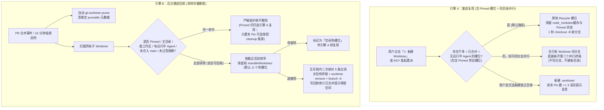

# Worktree 激进回收与默认槽位复用实施计划

> 场景与成功标准：当大型仓库并行开发导致 `.worktree/*` 持续膨胀（实测本仓库 5 个 Worktree 已占 42.5 GB 且残留 5 条 `prunable` 记录）时，系统以 **「Pinned = 永不折叠、永不删除的常驻主力槽位；所有已有 Worktree（含 Pinned）一律激进优先复用；多余未 Pin 目录后台自动安全回收」** 为核心规则彻底止住膨胀：**已置顶（Pinned）的 Worktree 永远不被折叠、永远不被自动/批量删除**，但**完全可以被拿来复用**（干净无运行中 Agent 时支持原地切新分支复用且保持 Pinned，忙碌或有改动时支持同分支直接开第二个并行终端共享工作区）；所有未 Pin 的 Worktree 在 PR 合并或分支合入主分支且工作区干净、无运行中 Agent 后，只保留可配置的少量热槽位（默认 `maxIdleWorktrees = 1`），超出上限的多余干净目录由 Backend **后台自动安全回收**（关空闲终端 + `git worktree remove` + 安全 `git branch -d` + 自动 `git worktree prune`），同时为含临时脏文件的顽固废弃目录提供展示文件清单后的显式强制清理，并为未合并的久置目录提供受控 `worktree.cleanup` 瘦身能力。

---

## 1. 目标与非目标

### 目标

1. **明确两类 Worktree 的铁律分级（Pinned vs 未 Pin）**
   - **置顶常驻槽位（`pinned === true`）与主项目根目录（`isPrimary === true`）**：
     - 视为用户特别关注的长期主力工作区：**永不折叠**（Rail 永久置顶展开）、**永不进入后台自动回收**、**永不在批量清理抽屉中被默认勾选**。
     - **完全允许被复用（不闲置浪费）**：当某 Pinned 子 Worktree 处于干净、已合入且无运行中 Agent 状态时，可作为首选常驻槽位原地切新分支复用（复用后继续保持 `pinned === true` 保护）；当其处于运行中或有改动状态时，允许直接在该 Worktree 同分支下打开第二个并行终端，避免为并发任务另建新目录。
     - 取消置顶（Unpin）后，立即回归普通未 Pin 池的自动回收规则。
   - **未 Pin 工作槽位（`pinned === false`）**：
     - 遵循 **「激进复用 + 激进自动回收」** 双引擎，常态下把一个大型仓库的未 Pin 闲置目录稳定压在 **0–1 个热槽位**，彻底杜绝目录无限累积。

2. **引擎 A · 激进复用（Recycle-First + 同工作区多终端并发，从入口截断膨胀）**
   - **「＋ 新建 Worktree」优先复用已有目录（包含 Pinned 槽位）**：
     - 扩展 `GET /api/terminal/project/:parentProjectId/worktree-create-preview`，返回两类可复用候选：
       1. **`recyclableSlots`（可原地切新分支复用）**：任意**已合入主分支（或 PR `MERGED`）+ 工作区干净 + 无运行中 Agent** 的已有子 Worktree（**包含 Pinned 常驻槽位与未 Pin 热槽位**，按最近活跃/Pinned 优先，依赖缓存最热）；
       2. **`shareableContexts`（可同分支共享并行）**：当前已有活跃 Worktree（含 Pinned、含运行中 Agent 或有未提交改动），允许**不切分支**直接在该目录新开一个并行终端，两个任务在同一工作区双终端并发执行，省去建新目录与事后清理负担。
     - 桌面 Rail 的 `＋ 新建 Worktree` 弹窗与原生 iOS 新建 Worktree 页按以下默认优先级呈现：
       - 若存在 `recyclableSlots` → **默认选中「原地切新分支复用 `<slotName>`（保留依赖缓存，免重装）」**（原地 `git fetch` + `git checkout -B <newBranch> <baseRef>` + 可选安全 `git branch -d <oldBranch>`，Pinned 槽位复用后保持 `pinned: true`）；
       - 若无干净可切分支槽位但存在活跃 Worktree → 提供显式一键切换 **「在已有 Worktree 同分支并行开新终端（不切分支、不建新目录）」**，也允许显式选「新建独立目录」；
       - 当项目内未 Pin 的 Worktree 总数达到软上限（`maxUnpinnedWorktrees`，默认 `3`）时，弹窗高亮建议优先复用或同目录并行，防止无节制开新目录。
   - **独立「原地重置复用」接口**：`POST /api/terminal/project/:parentProjectId/contexts/:childProjectId/recycle`，支持对任意干净且无运行中 Agent 的子 Worktree（含 Pinned，且复用不清除 Pinned 状态）原地切新分支，并直接给 [AGY 终端委派方案](./2026-11-28-agy-terminal-delegation-and-lineage.md) 复用。

3. **引擎 B · 激进回收（Auto-Reclaim：后台自动安全清理 + 可控强清 + 瘦身）**
   - **后台自动安全回收器（`WorktreeAutoReclaimService`，默认开启、项目/全局可调参数）**：
     - **触发时机**：① `PrWatchService` 监测到关联 PR 变为 `MERGED` 时触发评估；② Backend 低频周期巡检（默认每 15 分钟，复用本地 `merge-base --is-ancestor` 与 10 分钟 `HomeBranchStatus` 缓存，零高频 Git 网络风暴）；③ 新建 Worktree 成功后检查是否超配额。
     - **严守 5 条自动删除安全红线（全部满足才允许后台自动删）**：
       1. 非主目录且 **`pinned === false`**；
       2. `git status --porcelain` **完全为空**（零未提交修改、零未跟踪文件）；
       3. **无 `agent_running` / `agent_starting` 会话**，且无未发送人工草稿；
       4. **已合入安全证明**：关联 PR 状态为 `MERGED`，**或**本地 `HEAD`（含 `detached HEAD`）已被 `origin/<mainBranch>` 包含（`git merge-base --is-ancestor HEAD origin/<mainBranch>` 为真，且排除浅克隆/无共同祖先等不确定状态）；
       5. 已超过宽限期（`mergedGraceMinutes`，默认 `10` 分钟，避免 PR 刚合并那几秒用户还在看终端或 Diff 就被瞬间端掉）。
     - **留存热槽位 + 超额即删**：将满足全部 5 条红线的候选按最近活跃时间降序排序，**仅保留前 `maxIdleWorktrees` 个（默认 `1`，可设为 `0` 实现 0 留存全清）作为热复用槽位**，其余超出项由 Backend 在父项目互斥锁内二次核对 5 条红线后，自动调用 [TerminalWorktreeDeletionService](../../backend/src/terminal/workspace-service/worktree-deletion.ts) 安全删除目录 + 执行安全 `git branch -d`（小写 `-d` 仅删已合并分支）+ 记录持久化回收审计历史（在前端展示非侵入提示如「已自动回收 `wt-pr-watch`，释放 1.6 GB」）。
     - **自动 `git worktree prune`**：每次巡检自动清理外部失效的 `prunable` Git 元数据（如 `/private/tmp/*` 尸体记录），零文件删除风险。
   - **整理 Worktree 面板（全量诊断 + 批量清理 + 顽固脏目录可控强清）**：
     - `GET /api/terminal/project/:parentProjectId/worktree-governance` 展示所有子 Worktree 的健康度分类、合并态、脏文件清单、运行态与异步估算磁盘体积；
     - **批量安全清理**：支持一键清理全部未 Pin 干净已合并项（含 `0 留存` 选项把热槽位也一起清掉）；
     - **顽固脏废弃目录的受控强制清理**：对于未 Pin、但因几个构建产物/临时日志导致普通 `git worktree remove` 失败的废弃目录，**后台绝不自动 `--force`**，而是在整理面板中展开展示完整的未提交/未跟踪文件清单，仅在用户显式勾选单条并二次确认「确认丢弃上述文件并强制移除该目录」后，才允许执行 `git worktree remove --force`（仍保持小写 `git branch -d` 不强删未合并本地分支，且拒绝清理运行中 Agent 或 Pinned 项）。
   - **受控 `worktree.cleanup` 瘦身脚本（针对暂不能删的未合并/脏目录）**：
     - 在 `runweave.json`（`schemaVersion: 1`）的 `worktree` 下新增可选 `cleanup?: { command: string; cwd?: string }`，复用 `worktree.setup` 的 SHA-256 修订批准门禁；
     - 对未 Pin、暂未合并但已闲置超过 N 天（默认 3 天）且无运行中 Agent 的目录，支持一键（或按用户显式开启的自动瘦身策略）运行已批准的 `cleanup` 命令清理构建产物，在不删代码改动的前提下释放数 GB–数十 GB 磁盘。

4. **桌面 Rail 与手机端视觉收口**
   - 桌面 Worktree Rail 分三层清晰呈现：
     1. **主目录 + 置顶区（Pinned）**：永久展开，带锁/置顶标识与 tooltip「已置顶：不折叠、不自动回收」；
     2. **活跃未 Pin 区**：展示有运行中 Agent / 未合并提交 / 脏改动的工作区；
     3. **热槽位 / 可清理折叠区**：未 Pin 的空闲热槽位以轻量标签展示（提示可秒复用）；若因配置保留或宽限期尚有多个可清理项，统一折叠进末尾「可清理 (N)」胶囊，附带「整理」入口与最近自动回收记录入口。

### 非目标（本次不做）

- **后台自动回收绝不使用 `git worktree remove --force` 或 `git branch -D`**：后台自动动作只能删除 100% 干净且已合入主分支的未 Pin 目录；强删脏目录必须经过人工查看脏文件列表并显式二次确认。
- **绝不折叠或删除主项目根目录与已置顶（Pinned）Worktree**：无论多旧、是否已合并，只要是 Pinned 就绝不折叠、绝不自动删、绝不在批量清理中默认勾选（但允许原地切新分支复用或同分支共享并行）。
- **绝不在存在运行中 Agent 或未提交改动的 Worktree 上强行切分支（`git checkout -B`）**：该状态下只允许「同分支共享开第二个终端」，防止把正在运行的 Agent 脚下文件树切换破坏。
- **不将重型磁盘体积统计（`du`）放进 3 秒高频 `GET /contexts` 轮询**，仅在整理面板打开或单次回收审计前异步计算（带单目录 3 秒超时保护）。
- **不新增单元测试文件**。

---

## 2. 核心设计、状态流转与协议契约

### 2.1 激进复用 + 激进回收双引擎流程



### 2.2 治理策略配置（Profile / 项目级可覆盖，默认启用安全激进档）

```ts
export interface WorktreeGovernancePolicy {
  /** 是否启用后台自动安全回收（默认 true） */
  autoReclaimEnabled: boolean;
  /** 保留多少个未 Pin 的干净已合并热槽位供秒复用（0..5，默认 1；设 0 为完全 0 留存） */
  maxIdleWorktrees: number;
  /** PR 合并或合入主分支后的最小宽限分钟数（0..1440，默认 10 分钟） */
  mergedGraceMinutes: number;
  /** 新建弹窗提示优先复用的未 Pin 软上限（1..10，默认 3） */
  maxUnpinnedSoftLimit: number;
  /** 自动回收后是否执行安全 git branch -d 删除已合并本地分支（默认 true） */
  deleteMergedLocalBranches: boolean;
  /** 后台是否自动执行 git worktree prune 清理悬空元数据（默认 true） */
  autoPruneMetadata: boolean;
  /** 闲置几天视为 stale（1..90，默认 7） */
  staleDays: number;
  /** 若项目配置并批准了 worktree.cleanup，闲置超过 N 天的未 Pin 目录是否允许自动瘦身（默认 false，需显式开启） */
  autoCleanupStaleArtifacts: boolean;
}
```

### 2.3 共享协议扩展（[packages/shared/src/terminal/project-context.ts](../../packages/shared/src/terminal/project-context.ts) 与 `workspace-service.ts`）

```ts
export type WorktreeGovernanceBucket =
  | "pinned" // 已置顶：永不折叠、永不自动/默认删除，但干净无运行中 Agent 时可复用
  | "active" // 未 Pin 但正在活跃/未合并/脏保护
  | "idle_hot_slot" // 未 Pin + 已合并 + 干净，保留为秒复用热槽位
  | "cleanable_merged" // 未 Pin + 已合并 + 干净，超额待回收
  | "cleanable_stale" // 未 Pin + 干净 + 久置
  | "dirty_abandoned"; // 未 Pin + 含未提交/未跟踪文件（后台绝不自动删，人工核对清单后可强清）

export interface WorktreeGovernanceItem {
  projectId: string;
  name: string;
  branch: string | null;
  head: string | null;
  pinned: boolean;
  bucket: WorktreeGovernanceBucket;
  isDirty: boolean;
  dirtyPreviewFiles: string[]; // 最多列出 30 条相对路径，供人工强清前核对
  changedFilesCount: number;
  untrackedFilesCount: number;
  mergedIntoBase: boolean | null; // 浅克隆或无共同祖先时必须为 null，绝不伪造 true
  prState: "open" | "merged" | "closed" | "none" | "unknown";
  prNumber: number | null;
  prUrl: string | null;
  runningAgentCount: number;
  terminalCount: number;
  lastActivityAt: string | null;
  diskUsageBytes: number | null; // 仅 includeDiskUsage=true 时异步计算
  canSafeDelete: boolean; // Pinned 恒为 false
  canForceDeleteWithConfirm: boolean; // 仅未 Pin + 无运行中 Agent + isDirty 时为 true
  canRecycle: boolean; // 干净 + 无运行中 Agent + 已合入（包含 Pinned 槽位，复用后保持 Pinned）
  canShareParallel: boolean; // 目录可用即可同分支新开并行终端（不切分支）
  blockReason: string | null;
}

export interface WorktreeReclaimAuditEntry {
  id: string;
  parentProjectId: string;
  worktreeName: string;
  branch: string | null;
  trigger:
    | "auto_pr_merged"
    | "auto_periodic"
    | "manual_batch"
    | "manual_force"
    | "recycled";
  reclaimedBytes: number | null;
  branchDeleted: boolean;
  occurredAt: string;
  note?: string;
}

export interface WorktreeCreatePreviewResponse {
  // ...既有字段保持不变
  recyclableSlots: Array<{
    childProjectId: string;
    name: string;
    branch: string | null;
    pinned: boolean;
    lastActivityAt: string | null;
    prState: "merged" | "closed" | "none" | "unknown";
  }>;
  shareableContexts: Array<{
    projectId: string;
    name: string;
    branch: string | null;
    pinned: boolean;
    runningAgentCount: number;
    isDirty: boolean;
  }>;
  unpinnedWorktreeCount: number;
  maxUnpinnedSoftLimit: number;
}

export interface BatchCleanupWorktreesRequest {
  operationId: string;
  childProjectIds: string[];
  /** 仅允许对明确在 forceConfirmedProjectIds 中且未 Pin、无运行中 Agent 的脏目录启用 --force */
  forceConfirmedProjectIds?: string[];
  deleteMergedLocalBranches?: boolean;
  pruneMetadata?: boolean;
}

export interface RecycleWorktreeRequest {
  operationId: string;
  newBranch: string;
  baseRef: string;
  fetchBase?: boolean; // 默认 true
  deletePreviousBranch?: boolean; // 仅对已合并旧分支执行小写 git branch -d，默认 true
  closeIdleTerminals?: boolean; // 默认 true（关闭旧空闲终端再拉起新终端）
  runSetup?: boolean; // 复用场景默认 false（保留既有依赖缓存）
  approvedSetupRevision?: string;
  launchAgent?: "none" | "codex" | "claude" | "pi" | "traex" | "agy";
}
```

### 2.4 `runweave.json` 受控 `worktree.cleanup` 扩展

在 [backend/src/terminal/workspace-service/config.ts](../../backend/src/terminal/workspace-service/config.ts) 保持 `schemaVersion: 1`，在 `worktree` 块增加可选 `cleanup?: { command: string; cwd?: string }`，修订哈希与 `setup` 独立：

```ts
cleanupRevision = SHA256(
  JSON.stringify(["cleanup", repositoryId, cwd, command]),
);
```

未批准或脚本变更绝不执行；执行前核对目标无运行中 Agent 且非主目录。

---

## 3. 修改与新增文件清单

| 文件路径                                                                                           | 操作            | 职责说明                                                                                                                                                                        |
| :------------------------------------------------------------------------------------------------- | :-------------- | :------------------------------------------------------------------------------------------------------------------------------------------------------------------------------ |
| `packages/shared/src/terminal/project-context.ts` 与 `workspace-service.ts`                        | 修改            | 扩展 `WorktreeGovernancePolicy`、健康度分类、可复用槽位预览、批量/受控强清、Recycle 与回收审计记录类型                                                                          |
| `backend/src/terminal/workspace-service/config.ts` 与 `setup-approvals.ts`                         | 修改            | 解析 `worktree.cleanup` 并按作用域持久化 SHA-256 批准记录                                                                                                                       |
| `backend/src/terminal/workspace-service/worktree-governance.ts`                                    | 新建            | 只读健康度扫描（Pinned 隔离、`merge-base --is-ancestor`、`status --porcelain`、`prunable` 清单、PR 状态与异步磁盘估算）                                                         |
| `backend/src/terminal/workspace-service/worktree-auto-reclaim.ts`                                  | 新建            | 后台自动安全回收调度器（5 条红线硬校验、热槽位保留、自动 `prune`、PR 合并订阅与持久化回收审计日志）                                                                             |
| `backend/src/terminal/workspace-service/worktree-recycle.ts`                                       | 新建            | 父项目互斥锁下的原地重置复用（Recycle）与受控 `worktree.cleanup` 瘦身执行                                                                                                       |
| `backend/src/terminal/workspace-service/worktree-creation.ts` 与 `worktree-deletion.ts`            | 修改            | 新建预览输出 `recyclableSlots`；删除服务支持批量串行清理、安全 `git branch -d`、`git worktree prune` 与人工显式确认的受控 `--force` 移除                                        |
| `backend/src/routes/terminal/projects/context.ts`                                                  | 修改            | 注册 `GET /worktree-governance`、`GET/PUT /worktree-policy`、`POST /worktree-cleanup-batch`、`POST /contexts/:childProjectId/recycle`、`POST /contexts/:childProjectId/cleanup` |
| `backend/src/pr-watch/service.ts`                                                                  | 修改            | PR 进入 `MERGED` 时派发事件通知 `WorktreeAutoReclaimService` 评估（未 Pin 按策略回收/转槽位，Pinned 仅提示）                                                                    |
| `frontend/src/components/terminal/workspace/worktree-create-dialog.tsx`                            | 修改            | 存在 `recyclableSlots` 时默认选中「复用空闲槽位」，超未 Pin 软上限时高亮引导复用                                                                                                |
| `frontend/src/components/terminal/workspace/worktree-rail.tsx` 与 `worktree-governance-dialog.tsx` | 修改/新建       | Rail 三层分区（Pinned 永不折叠 + 活跃未 Pin + 热槽位/可清理折叠胶囊）；整理面板（含批量清理、脏文件清单二次确认强清、自动回收历史与策略调节）                                   |
| `packages/app-ios/Sources/RunweaveIOS/Features/Home/`                                              | 修改（Phase 3） | 手机端新建 Worktree 默认推荐复用空闲槽位，工作区列表展示 Pinned 保护与已合并/清理入口                                                                                           |
| `docs/architecture/terminal-worktree-context.md` 与 `terminal-workspace-services.md`               | 修改            | 同步 Pinned 保护、默认槽位复用、后台自动安全回收与 `worktree.cleanup` 合同                                                                                                      |

---

## 4. 分阶段迭代建议

- **Phase 1（激进复用 + 存量清理 + Rail 保护分级，最急用）**：
  - 落地 `WorktreeGovernanceService` + `WorktreeRecycleService` + 「＋ 新建 Worktree」默认复用空闲槽位 + 整理弹窗（批量安全清理 + 脏文件清单人工确认强清 + `branch -d` + `prune`）+ Rail 置顶永不折叠。
  - 上线立刻把当前 42.5 GB 存量和 5 条 `prunable` 清干净，且后续新建自动走复用不再膨胀。
- **Phase 2（后台激进自动回收闭环）**：
  - 上线 `WorktreeAutoReclaimService`（PR 合并触发 + 15 分钟巡检 + `maxIdleWorktrees` 热槽位留存 + 回收审计日志与前端提示条）+ 策略设置面板。
- **Phase 3（受控瘦身与 iOS 对齐）**：
  - 补齐 `runweave.json` 的 `worktree.cleanup` 瘦身脚本门禁与原生 iOS 槽位复用/清理入口。

---

## 5. 高风险点与安全/兼容回滚

1. **后台自动回收误删用户代码（最高风险防线）**：
   - 后台自动回收在拿到父项目互斥锁后**强制二次实时重检全部 5 条红线**（非主目录、`pinned === false`、`git status --porcelain` 空、无运行中 Agent 与草稿、已确证合入 `origin/<mainBranch>` 或 PR `MERGED` 且过宽限期）；任一条无法确证（如浅克隆 `mergedIntoBase === null`）立即跳过。
   - 后台自动路径**代码中硬禁止传递 `--force` 与 `-D`**，从根本上杜绝自动丢改动或丢分支。
2. **Pinned 竞态保护**：
   - 用户可能在巡检扫描到执行删除的毫秒间点击了 Pin；互斥锁内删除前必须重新读取最新 `pinnedChildProjectIds`，只要已 Pin 立即中止。
3. **强制移除脏目录的误操作防护**：
   - 仅限整理弹窗内人工触发，前端必须展示该目录的 `dirtyPreviewFiles` 清单并要求单条显式勾选确认，后端同时核对 `forceConfirmedProjectIds` 命中且未 Pin、无运行中 Agent 才允许 `git worktree remove --force`。
4. **兼容与回滚**：
   - 不破坏现有 `GET /contexts` 与 `DELETE /contexts/:childProjectId`；将 `autoReclaimEnabled` 设为 `false` 即可一键关闭后台自动回收退回纯手动治理。

---

## 6. 验收标准与验证方式

配套新增测试计划：[docs/testing/terminal/worktree-governance-and-recycle.testplan.yaml](../testing/terminal/worktree-governance-and-recycle.testplan.yaml)（`WTGOV-001` 至 `WTGOV-012`），并回归 [project-context.testplan.yaml](../testing/terminal/workspace/project-context.testplan.yaml)、[deletion.testplan.yaml](../testing/terminal/workspace/deletion.testplan.yaml) 与 [provision-and-setup.testplan.yaml](../testing/terminal/workspace/provision-and-setup.testplan.yaml)。

### 静态与构建检查

- [ ] `pnpm testplan:validate docs/testing/terminal/worktree-governance-and-recycle.testplan.yaml`、`pnpm workspace-services:verify` 与 `pnpm docs:check` 通过。
- [ ] `pnpm --filter @runweave/shared typecheck`、`pnpm --filter @runweave/backend typecheck`、`pnpm --filter @runweave/frontend typecheck` 通过。
- [ ] `pnpm lint`、`pnpm architecture:check`（Phase 3 后加 `pnpm ios:build`）通过。

### 关键验收场景（以 [worktree-governance-and-recycle.testplan.yaml](../testing/terminal/worktree-governance-and-recycle.testplan.yaml) 为准）

- [ ] **`WTGOV-001` ~ `WTGOV-002`（Pinned 铁律与默认激进复用）**：Pinned 项永不折叠、不被删除（含手动与批量/强制路径，需先取消置顶）；空闲干净时可优先原地复用并保持置顶状态，也支持同分支并行开新终端；「＋ 新建 Worktree」存在空闲槽位时默认选中原地复用保留缓存，也可显式新建目录。
- [ ] **`WTGOV-003` ~ `WTGOV-006`（后台激进自动回收与安全红线）**：超额已合并未 Pin 目录按 `maxIdleWorktrees` 自动安全回收并写审计日志；脏目录、未合并提交与运行中 Agent 零误删；PR 合并联动与已合入 `detached HEAD` / `prunable` 准确处置。
- [ ] **`WTGOV-007` ~ `WTGOV-009`（整理面板、受控强清与 Rail 分区）**：批量清理 TOCTOU 二次校验拦截；顽固脏目录仅展示文件清单并显式二次确认后强删；桌面 Rail Pinned 永久展开与折叠区清晰无误。
- [ ] **`WTGOV-010` ~ `WTGOV-012`（Recycle 冲突保护、受控瘦身与 iOS 对齐）**：Recycle 分支冲突 `409` 零破坏；`worktree.cleanup` 严守 SHA-256 门禁清缓存不丢代码；原生 iOS 优先推荐复用槽位与安全清理闭环。
