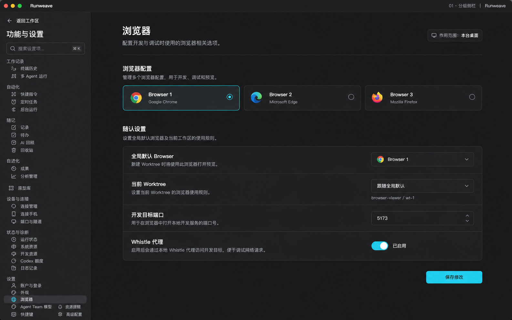
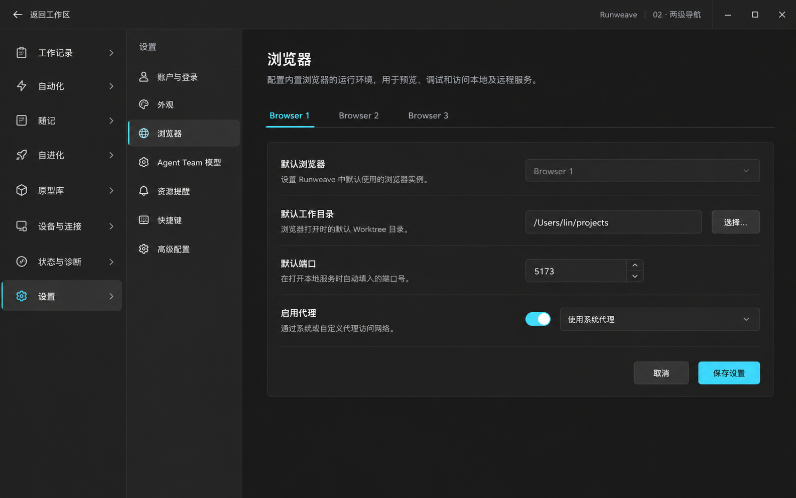
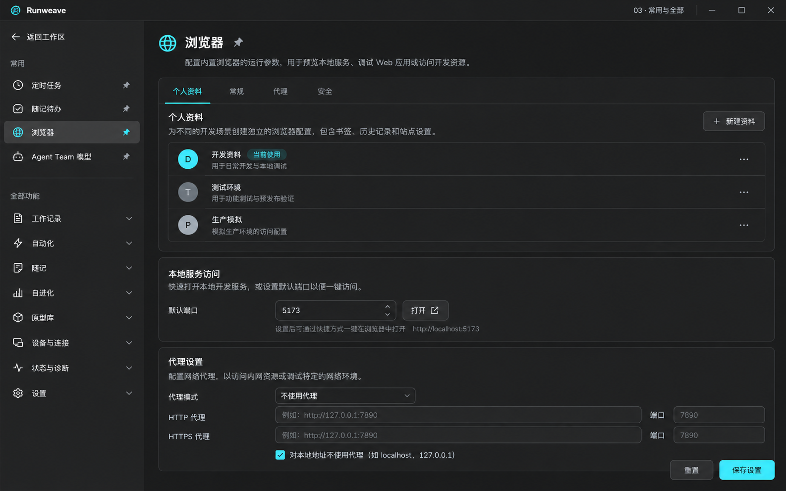
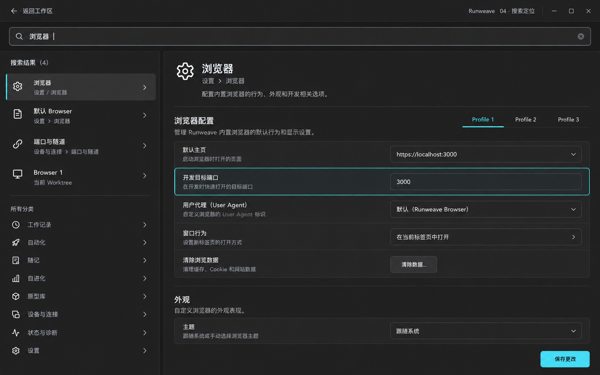
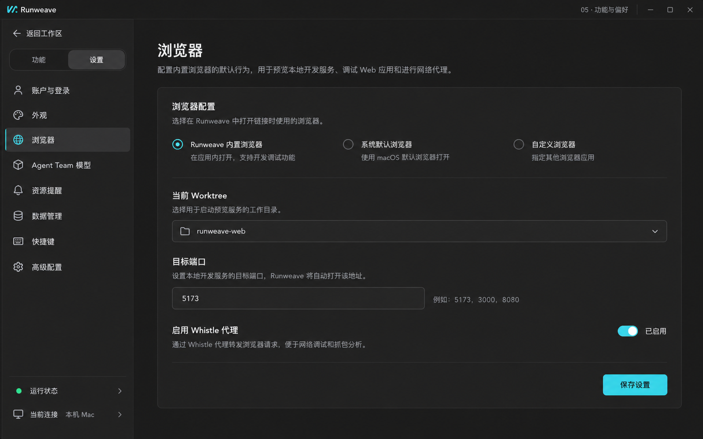
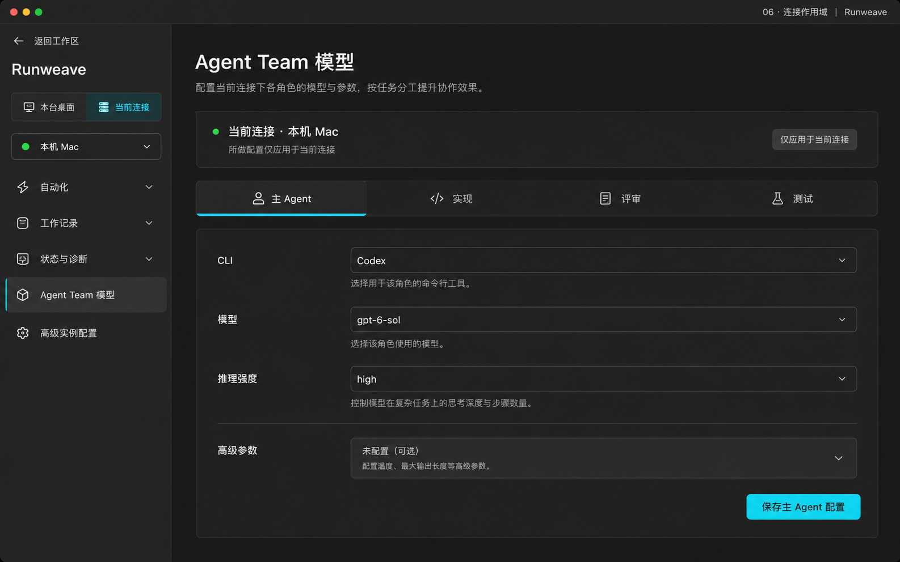
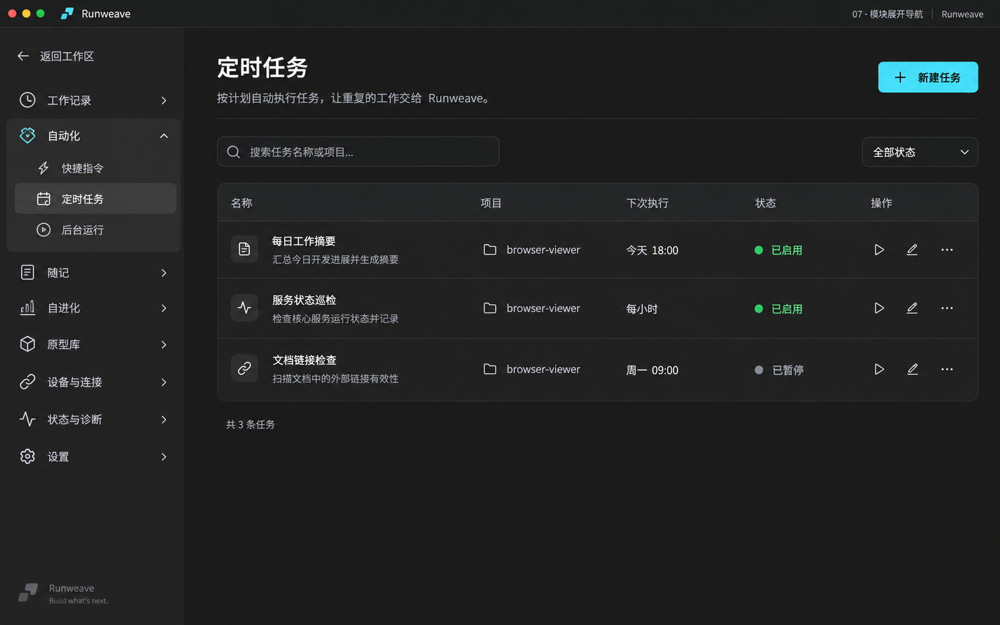
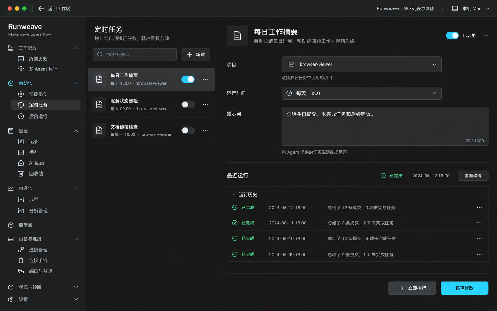
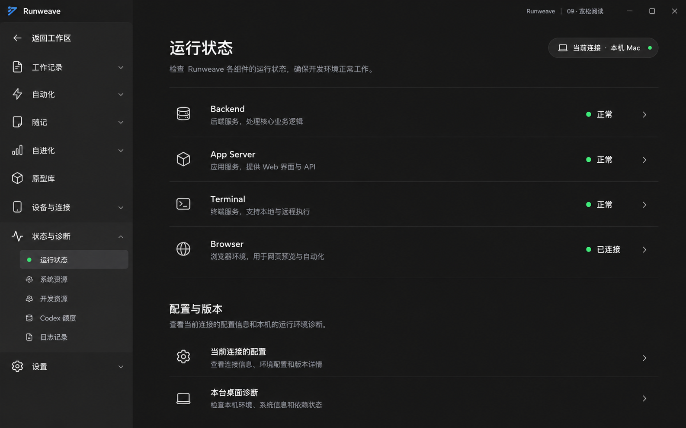
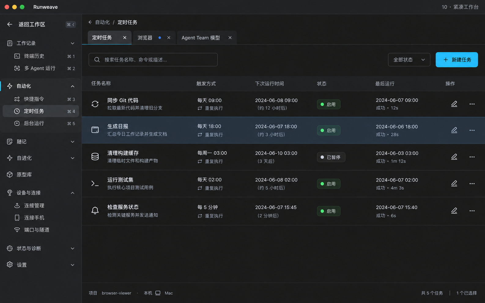

# 桌面二级页面：10 张图片方案

> **最新可交互原型：** [全局设置第三版](../../global-settings/README.md)，已撤掉浏览器设置入口并按作用范围重新组织。

> **已被第二版范围修订替代。** 旧稿错误地混入终端、项目和业务功能。以 [全局设置边界修订](../scope-revision.md) 为准；下文及旧图仅保留作历史对照。

2026-10-11 设计探索材料，待评审；不是当前产品实现或已冻结的实施方案。

这 10 张图比较的是全屏二级页面的导航与内容组织。共同前提是进入后占满应用内容区，左上角返回工作区；返回后的项目、终端及右侧工具大布局保持不变。

图片由图像生成工具生成，原图完整复制并保留。图中个别字段、示例数据、图标和窗口装饰存在生成偏差，不作为新增功能或数据合同：例如 Browser 1/2/3 在当前项目中表示 Profile，不表示 Chrome、Edge、Firefox 三种浏览器；部分图中出现的默认目录、代理选项和快捷键也需按实际代码校准。

## 修订图状态（浏览器方案已撤回）

- [V2 全局设置与外观](v2-global-settings.png)：侧栏“浏览器默认”已撤回，图片待同步。
- [V2 浏览器默认配置](v2-browser-defaults.png)：整张方案作废；浏览器全部保留现有入口和交互。
- [36 项归属核查、新导航树和逐方案修订](../scope-revision.md)

以下 01–10 是旧图，不再作为当前菜单范围。新图收敛为同一套全局配置导航；任务与终端业务不再出现在侧栏。

## 方案索引

| 编号 | 图片                                           | 核心区别                                                                               |
| ---- | ---------------------------------------------- | -------------------------------------------------------------------------------------- |
| 01   | [分组侧栏](01-grouped-sidebar.png)             | 把全部功能放进一套稳定的分组导航，用户始终知道自己在哪个模块。它最接近你提供的参考图。 |
| 02   | [两级导航](02-two-level-navigation.png)        | 把“选择模块”和“选择模块里的功能”分成两列，避免把几十个入口铺在同一条长列表中。         |
| 03   | [常用与全部](03-favorites-and-all.png)         | 把高频入口与完整功能目录分开：顶部常用满足日常操作，底部分类保证所有功能都有归属。     |
| 04   | [搜索定位](04-search-navigation.png)           | 把搜索变成可持续使用的导航方式，同时显示结果所属模块，降低记忆菜单位置的成本。         |
| 05   | [功能与偏好](05-functions-and-preferences.png) | 先区分“执行工作”和“调整软件”。任务、随记、历史归功能，外观、模型与浏览器配置归设置。   |
| 06   | [连接作用域](06-connection-scope.png)          | 优先让用户确认“正在操作哪台电脑”。把本台桌面与当前连接的配置分开，减少改错目标的可能。 |
| 07   | [模块展开导航](07-expandable-modules.png)      | 让侧栏只展开当前相关模块，用一列完成两级导航，把更多空间留给列表和表单。               |
| 08   | [列表与详情](08-master-detail.png)             | 让对象列表和当前对象详情同时可见，减少从列表进入详情、再返回列表的往返操作。           |
| 09   | [宽松阅读](09-comfortable-reading.png)         | 用清晰标题、留白和分隔线替代层层卡片，把视觉注意力集中到状态与下一步操作。             |
| 10   | [紧凑工作台](10-compact-workbench.png)         | 允许多个二级任务页面通过标签并存，保留各页筛选条件和编辑草稿，减少反复重新打开页面。   |

## 组合建议

建议以 **07 模块展开导航** 作为整体结构，采用 **09 宽松阅读** 的排版节奏；任务、随记等对象管理页按需采用 **08 列表与详情**。搜索可以逐步加入，常用固定入口取决于实际使用频率。

若优先追求与你提供的参考图一致，选择 **01 分组侧栏**。若模块还会持续增多，比较 **02 两级导航** 与 **07 模块展开导航**。

这些方向可以组合，但不应把所有导航手段同时加入第一版。特别是 10 的多页面标签，需要额外的页面状态设计。

## 01 · 分组侧栏

**设计理念：** 把全部功能放进一套稳定的分组导航，用户始终知道自己在哪个模块。它最接近你提供的参考图。

**交互方式：** 返回工作区 → 左侧按组找功能 → 右侧查看或编辑；切换页面时左侧导航位置不变。

**适用场景：** 适合希望所有入口都能被发现、跨模块切换频繁的用户。

**取舍：** 入口较多时侧栏需要滚动；低频诊断项宜折叠，避免主要功能被挤到底部。

## 02 · 两级导航

**设计理念：** 把“选择模块”和“选择模块里的功能”分成两列，避免把几十个入口铺在同一条长列表中。

**交互方式：** 第一列选设置，第二列选浏览器，右侧编辑 Browser Profile；切换模块时第二列随之变化。

**适用场景：** 适合模块多、每个模块又有多个管理页面的完整桌面产品。

**取舍：** 占用更多横向空间；较窄窗口应合并导航层级，否则表单内容会被压缩。

## 03 · 常用与全部

**设计理念：** 把高频入口与完整功能目录分开：顶部常用满足日常操作，底部分类保证所有功能都有归属。

**交互方式：** 从全部功能打开页面，固定到常用；以后直接从常用进入，取消固定只移除快捷入口。

**适用场景：** 适合每个人使用习惯不同、但通常只反复使用少数功能的情况。

**取舍：** 需要新增固定入口与排序规则；常用项必须控制数量，否则会再次变成长菜单。

## 04 · 搜索定位

**设计理念：** 把搜索变成可持续使用的导航方式，同时显示结果所属模块，降低记忆菜单位置的成本。

**交互方式：** 输入浏览器或端口 → 左侧选择结果 → 右侧打开所属页面并定位设置项；仍可回到分类浏览。

**适用场景：** 适合功能多、用户知道要改什么却不清楚入口在哪的场景。

**取舍：** 需要维护名称、别名与设置项索引；搜索不能替代清晰分类，无结果时也要有后续入口。

## 05 · 功能与偏好

**设计理念：** 先区分“执行工作”和“调整软件”。任务、随记、历史归功能，外观、模型与浏览器配置归设置。

**交互方式：** 侧栏顶部切换功能或设置 → 选择对应页面 → 右侧操作；同一套全屏容器负责返回与保存。

**适用场景：** 适合希望设置区简洁、又不愿把业务功能塞进设置的用户。

**取舍：** 需要明确跨类别功能的归属，例如运行状态与资源提醒；跨区关联应提供直接跳转。

## 06 · 连接作用域

**设计理念：** 优先让用户确认“正在操作哪台电脑”。把本台桌面与当前连接的配置分开，减少改错目标的可能。

**交互方式：** 先选择本台桌面或当前连接，再选具体连接与设置；角色配置分别保存，切换目标前处理未保存修改。

**适用场景：** 适合同时连接本机与远端开发机、经常调整模型或服务配置的用户。

**取舍：** 作用域增加一个理解层级；它适合作为页面中的上下文控制，不一定适合统领随记、原型库等全部功能。

## 07 · 模块展开导航

**设计理念：** 让侧栏只展开当前相关模块，用一列完成两级导航，把更多空间留给列表和表单。

**交互方式：** 展开自动化 → 进入定时任务 → 搜索、筛选、新建或编辑；其他模块保持折叠。

**适用场景：** 适合当前 Runweave：模块较多，主工作区布局又需要保持不变。

**取舍：** 展开状态与选中状态需要区分；应保留展开状态，并确保搜索结果能展开到目标页面。

## 08 · 列表与详情

**设计理念：** 让对象列表和当前对象详情同时可见，减少从列表进入详情、再返回列表的往返操作。

**交互方式：** 左侧选功能，中间选任务，右侧编辑任务或查看运行记录；切换任务时处理未保存修改。

**适用场景：** 适合定时任务、快捷指令、随记和历史记录等需要连续浏览多个对象的页面。

**取舍：** 三列会占用宽度，窄窗口需要改为列表与详情逐页进入；不应把外观等简单设置也强行做成三列。

## 09 · 宽松阅读

**设计理念：** 用清晰标题、留白和分隔线替代层层卡片，把视觉注意力集中到状态与下一步操作。

**交互方式：** 左侧选运行状态 → 右侧扫描各服务健康状况 → 从具体服务进入配置或诊断。

**适用场景：** 适合运行状态、账户、资源概览和说明较多的设置页，也更利于长时间阅读。

**取舍：** 同屏信息量较少，不适合高密度日志或大型任务表；应作为内容排版风格与其他导航方案结合。

## 10 · 紧凑工作台

**设计理念：** 允许多个二级任务页面通过标签并存，保留各页筛选条件和编辑草稿，减少反复重新打开页面。

**交互方式：** 从侧栏打开任务、浏览器与模型页 → 在内容区顶部标签之间切换 → 关闭含未保存内容的标签时确认。

**适用场景：** 适合频繁跨页面比对和配置的熟练用户。

**取舍：** 页面标签会增加产品复杂度，还需处理重名、关闭、恢复和草稿生命周期；第一版不建议默认引入。

## 文件与验证

10 张 PNG 按编号命名，均与生成源文件逐字节一致。图片没有经过裁切或重绘。本文和图片存放在当前 Worktree 的 `docs/prototypes/desktop-secondary-pages/image-options/`；生成工具原始目录仍保留。

这次交付为图片及设计说明，不包含可点击交互或产品功能验收。此前 HTML 原型的验证结论不适用于这些图片中的新设计。
